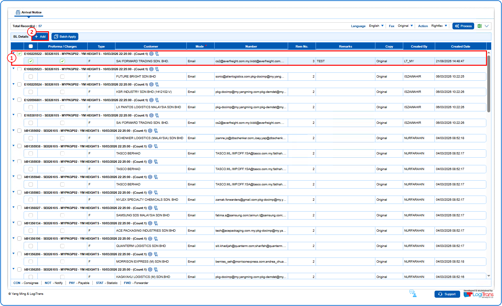
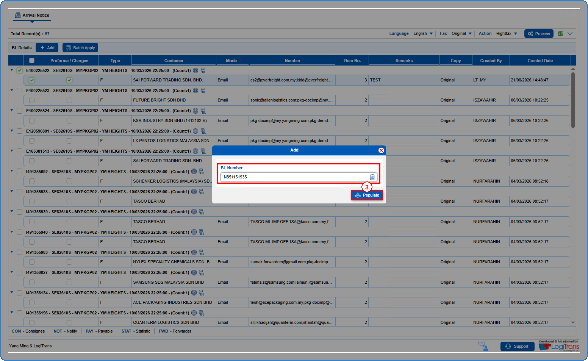
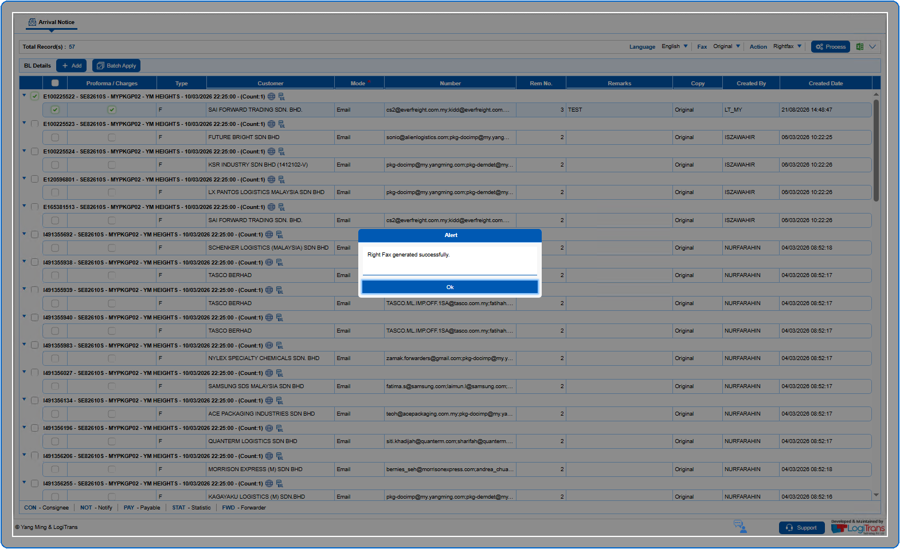
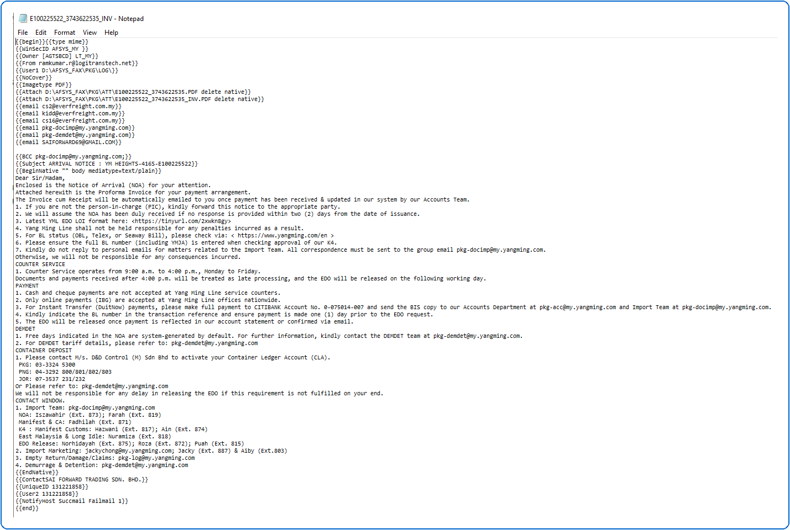

## Pre defined conditions

## Steps
**Step 1** : Either select all records available by clicking on {img:../img/icon_select_all.png} or select individual records by clicking on {img:../img/icon_single_select.png}.
**Step 2** : Click on {img:../img/btn_add.png}.

**Step 3** : Upon clicking {img:../img/btn_add.png}, the user is shown Add pop up screen.
**Step 4** : Enter the details as given below and click on {img:../img/btn_populate.png}.

If successfully populated, an alert is shown as given below.

The generated files can be viewed in the path as shown below.

