## Pre defined conditions

## Steps
**Step 1** : Either select all records available by clicking on {img:../img/icon_select_all.png} or select individual records by clicking on {img:../img/icon_single_select.png}.
**Step 2** : Click on {img:../img/btn_batch_apply.png}.
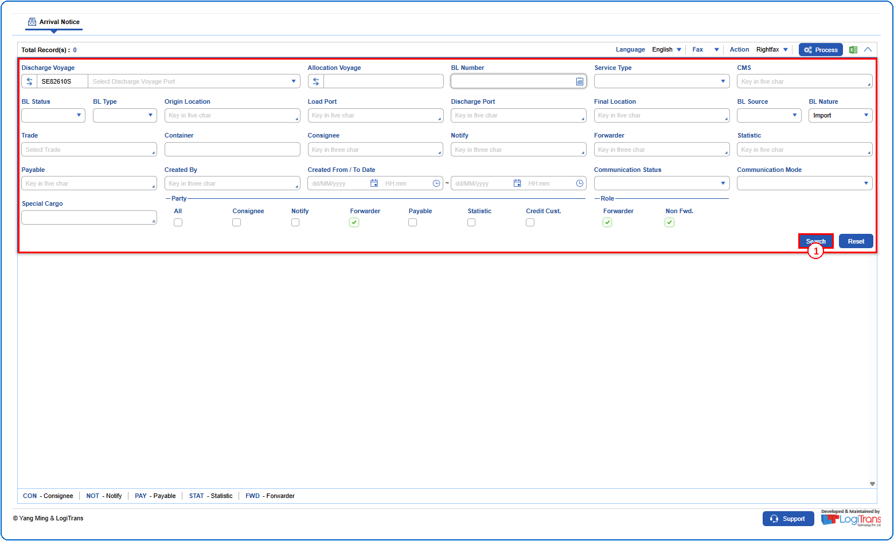
**Step 3** : Upon clicking {img:../img/btn_batch_apply.png}, the user is shown Modify pop up screen.
**Step 4** : Enter the Email and Remarks as given below.
**Step 5** : Click on {img:../img/btn_apply.png}.
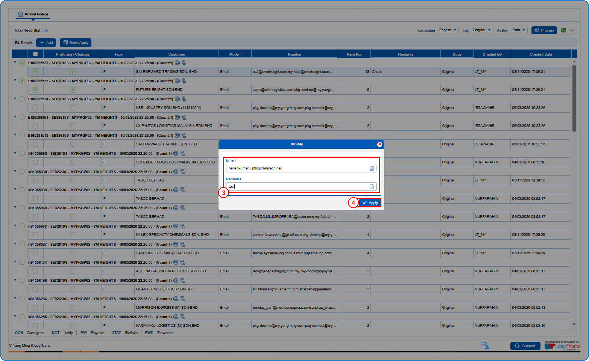
If successfully applied, an alert is shown as given below and the email is changed for the selected records.
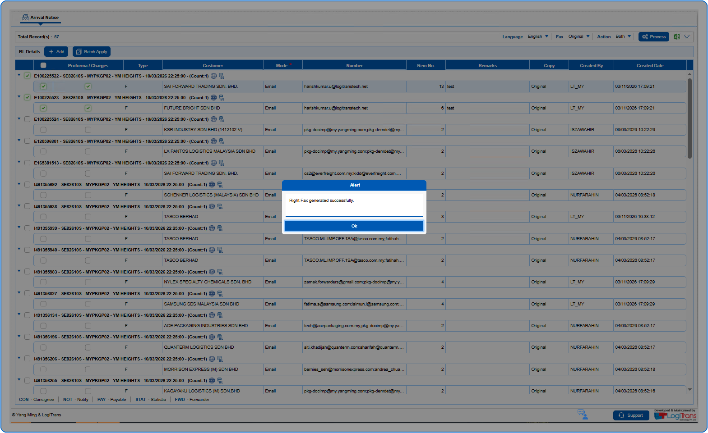
The generated files are saved in the path as shown below.
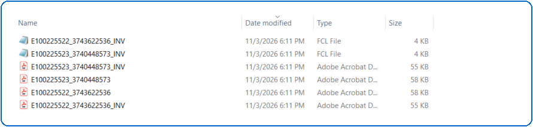
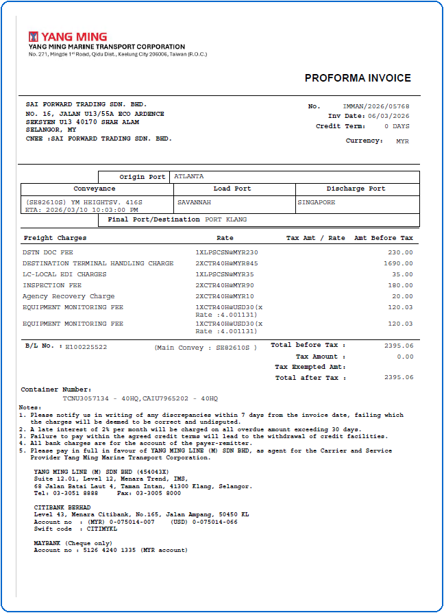
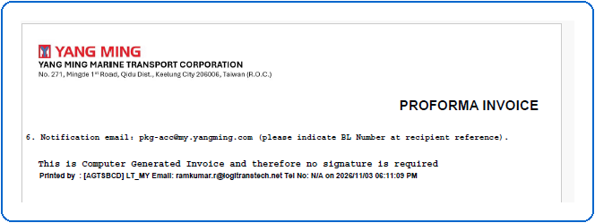
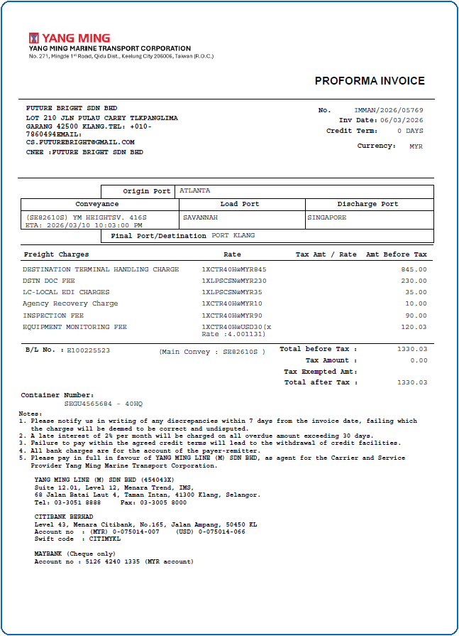
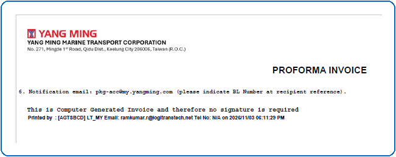

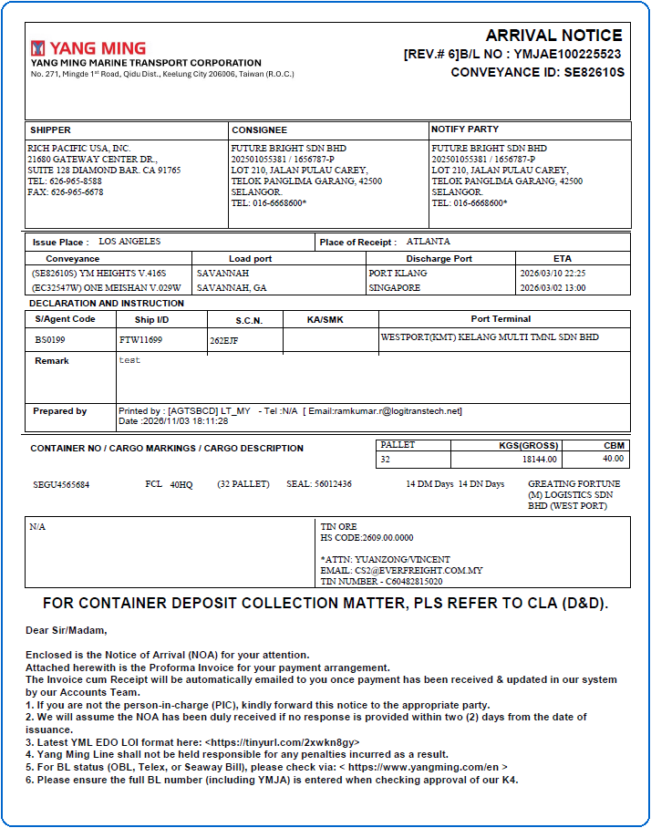

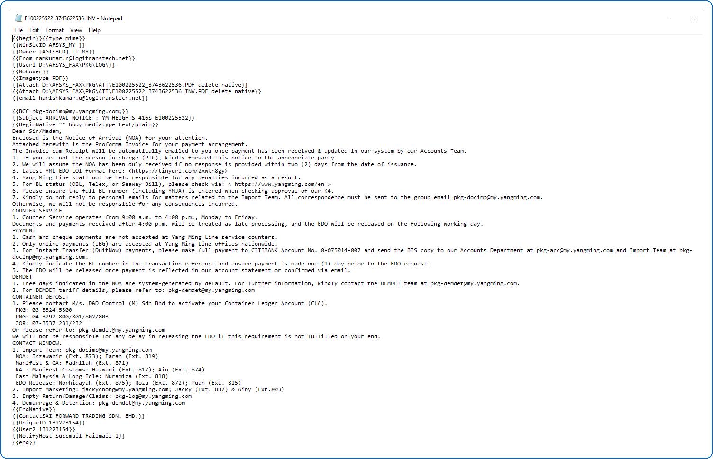
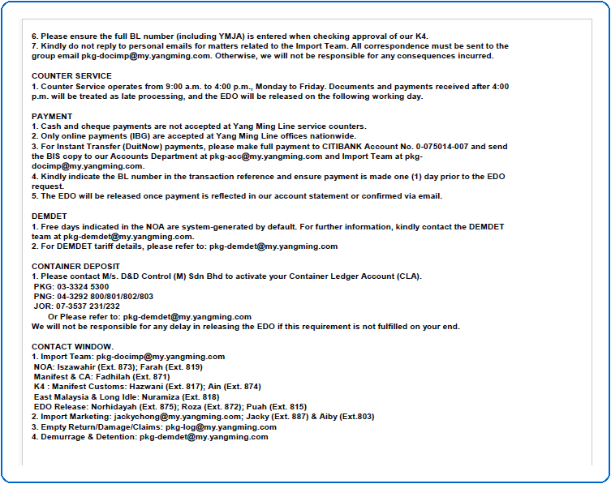
