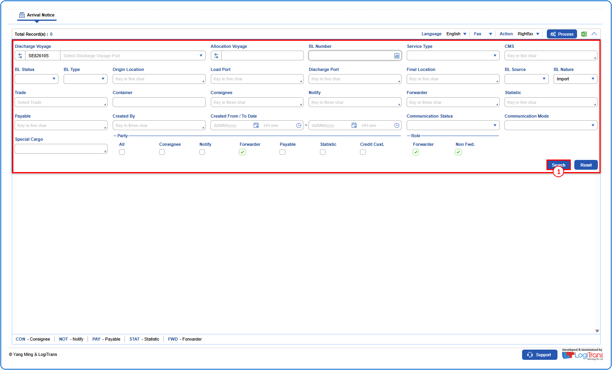
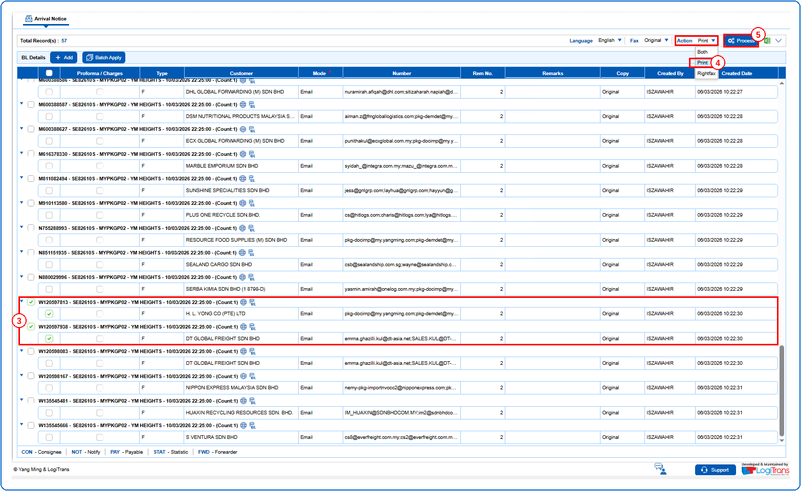
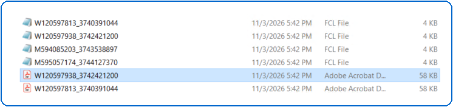
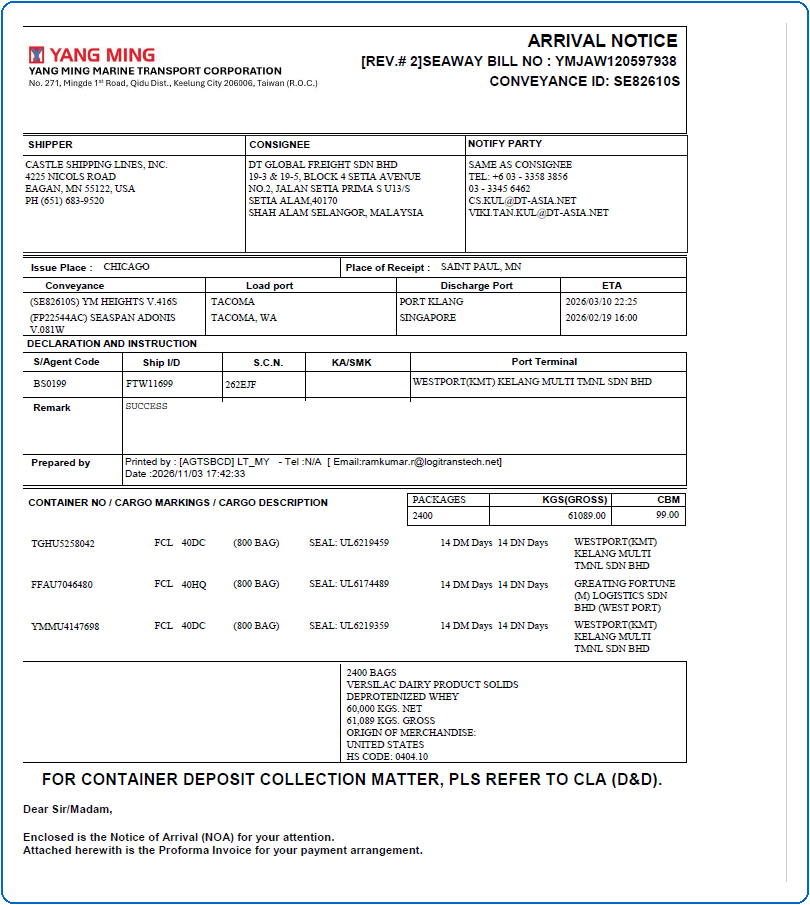
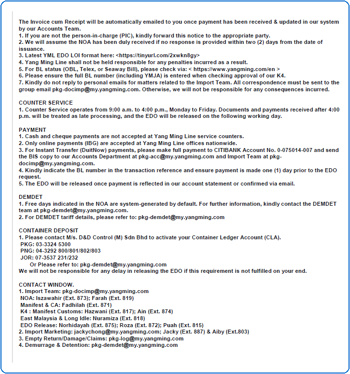
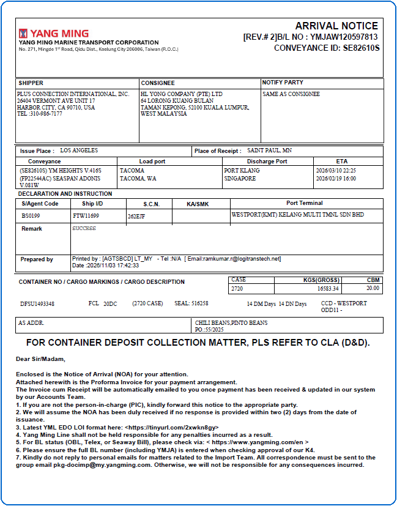
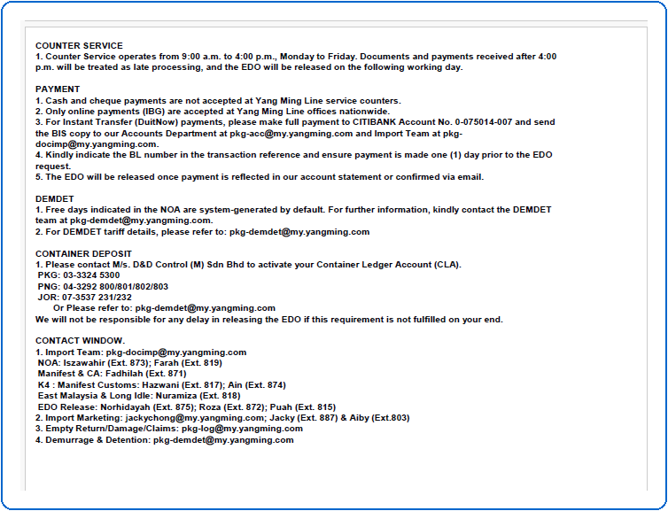
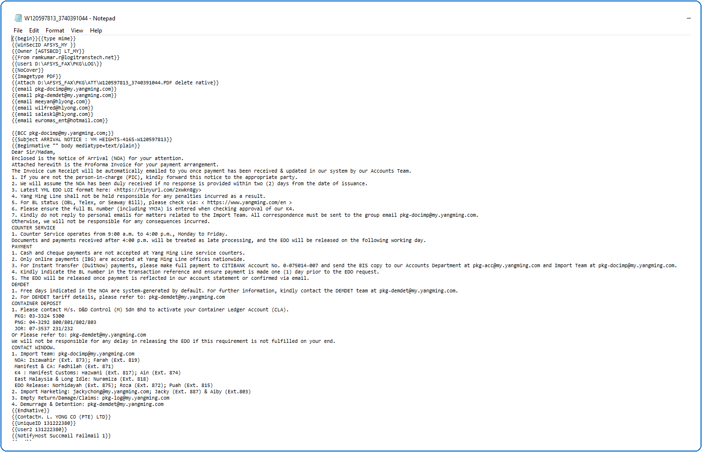
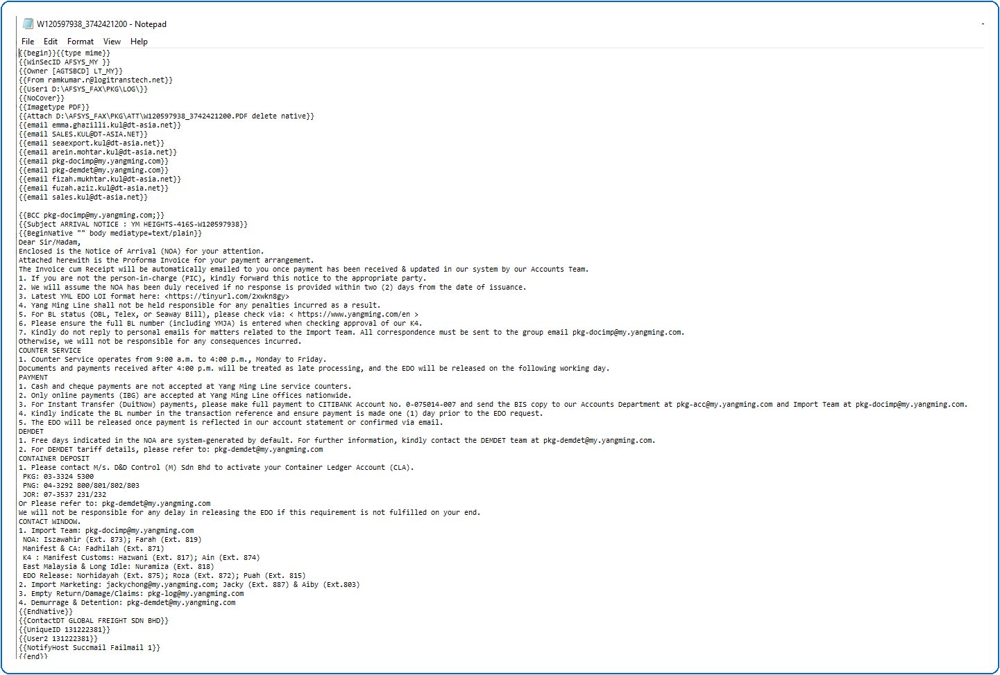

## Steps
**Step 1** : Enter the query fields with desirable input for querying data and click on {img:../img/btn_search_q.png}.

**Step 2** : Upon clicking {img:../img/btn_search_q.png}, records with matching information are returned.
**Step 3** : Either select all records available by clicking on {img:../img/cb_select_all.png}(select all checkbox) or select individual records by clicking on {img:../img/cb_single_select.png}(single select checkbox).
**Step 4** : Select "**Print**" from the Action drop-down.
**Step 5** : Click on {img:../img/btn_process.png}.

If successfully processed, the files are generated in the path as given below.

The generated pdf is shown as given below.

The generated notepad file is shown as given below.

**Note** : For GR location, the user will be allowed to generate Print/Right Fax in local language.
