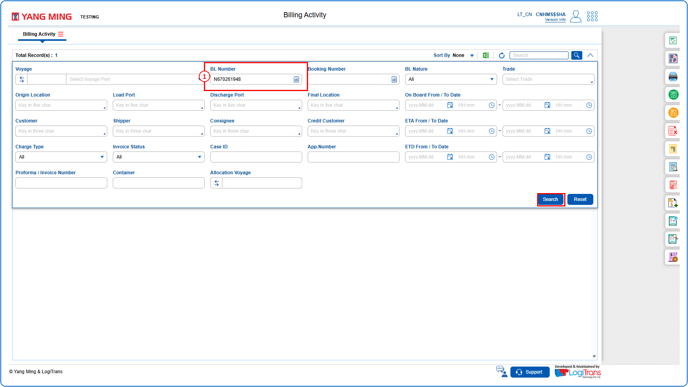
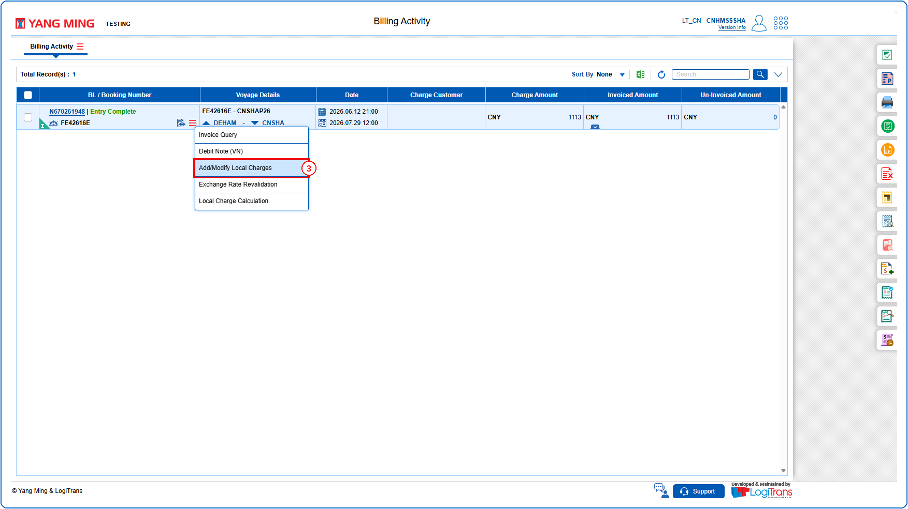
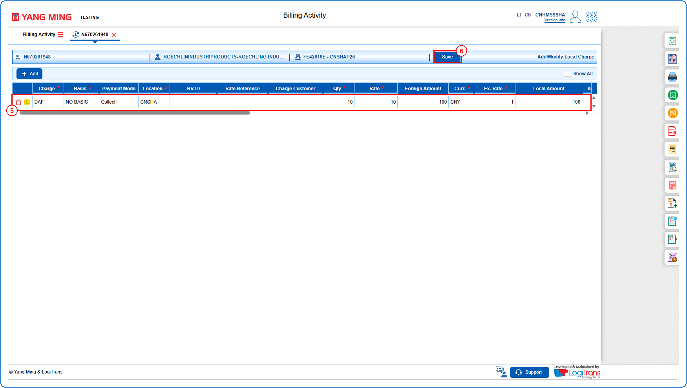
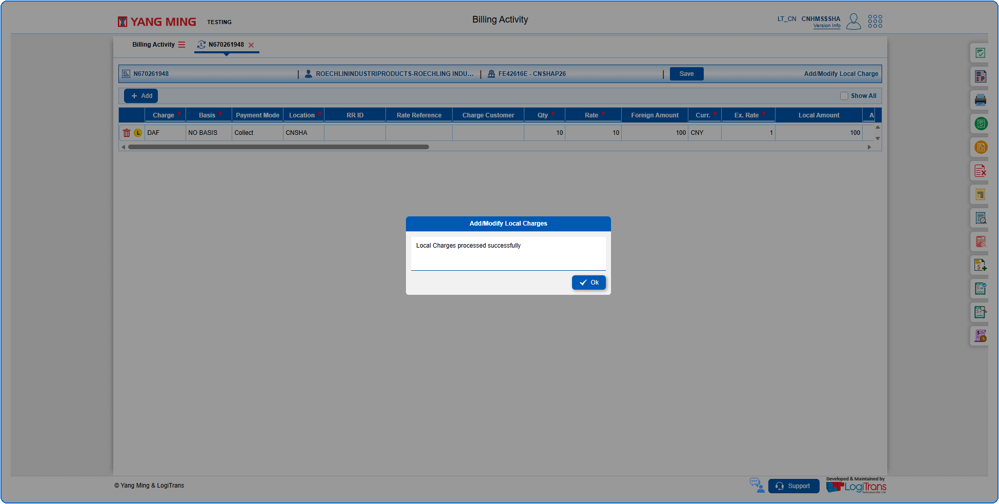
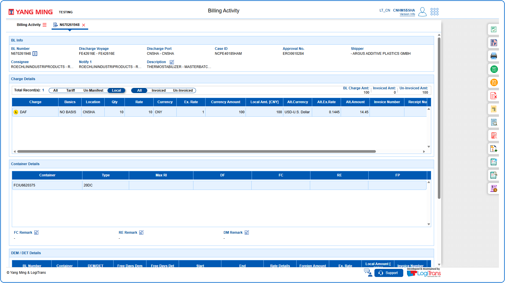

## Steps
**Step 1** : Enter the BL Number and click on {img:../img/btn_search_q.png}.

**Step 2** : Upon clicking {img:../img/btn_search_q.png}, BL records with matching information are returned.
**Step 3** : Click on the menu icon {img:../img/icon_row_menu.png} of the required BL record and select "**Add/Modify Local Charges**" from the menu.

**Step 4** : Upon clicking "**Add/Modify Local Charges**", User will be shown the Add/Modify Local Charge screen.
**Step 5** : Click on {img:../img/btn_add.png} to add a new local charge or modify the details of an existing local charge.
**Step 6** : Click on {img:../img/btn_save.png}.

If successfully saved, an alert is shown as given below.

The added/modified local charge is shown in the Charge Details of the BL as given below.

