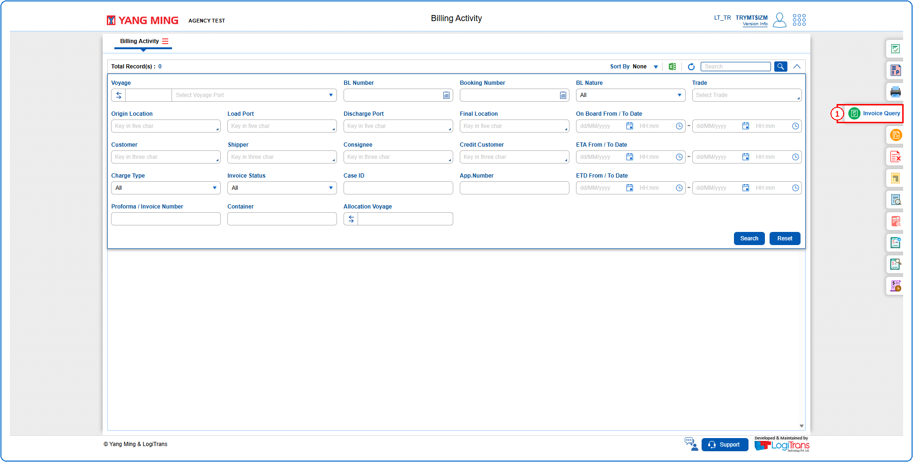
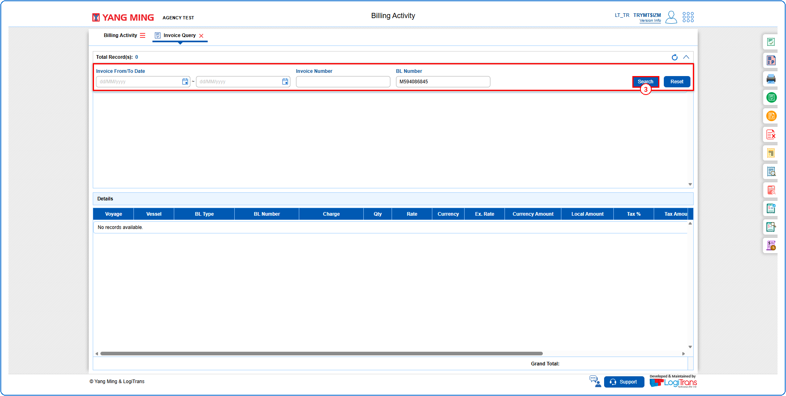
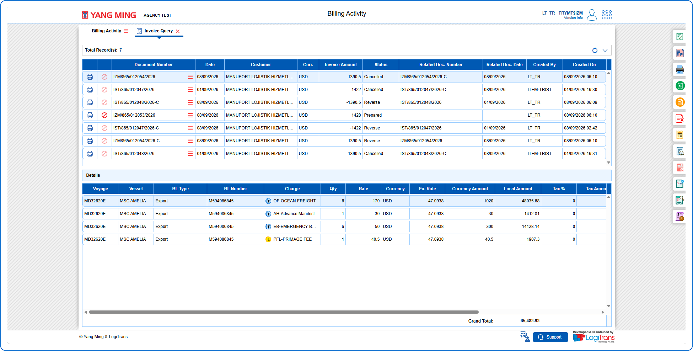

## Steps
**Step 1** : Click on the {img:../img/iq_icon_side.png} (Invoice Query side icon) given on the right side of the Billing Activity screen.

**Step 2** : Upon clicking {img:../img/iq_icon_side.png}, User will be shown the Invoice Query screen.
**Step 3** : Enter the query fields with desirable input for querying data and click on {img:../img/iq_btn_search.png}.

If data is available, the queried data is displayed as given below.

