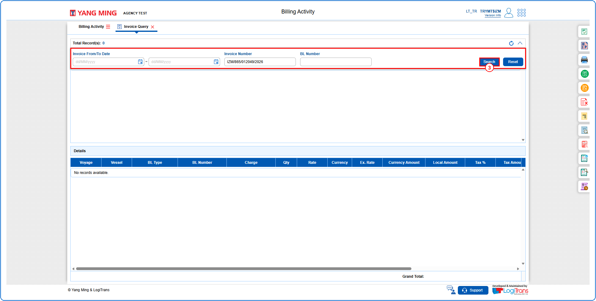
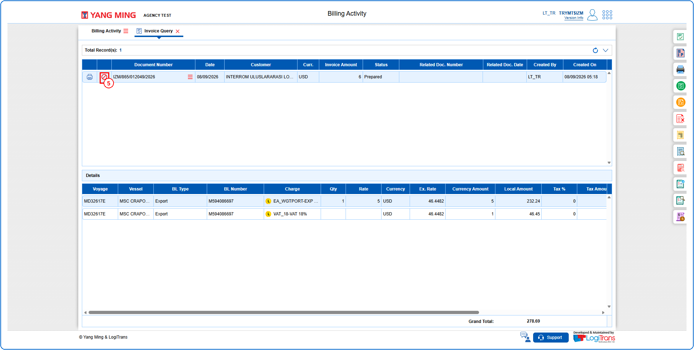
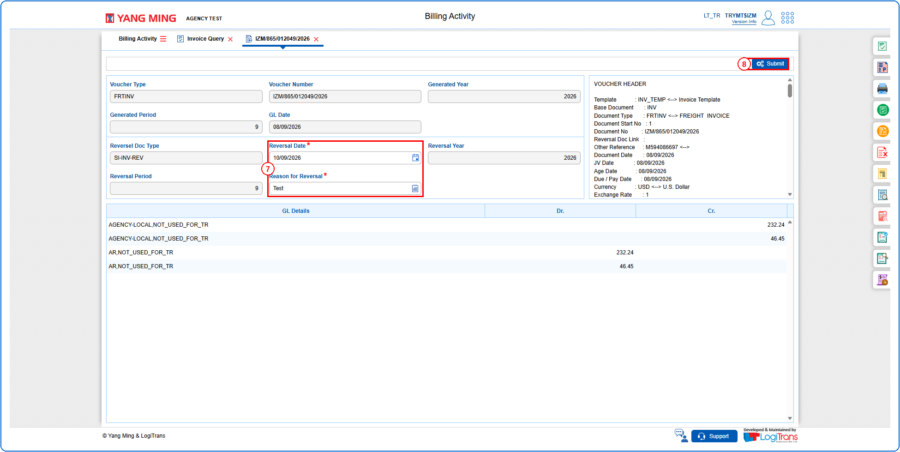
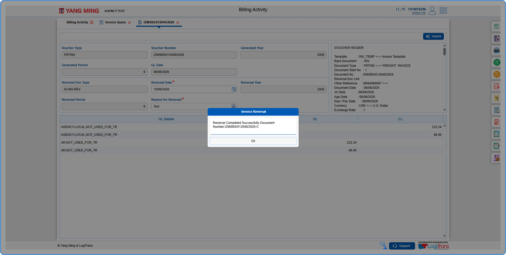
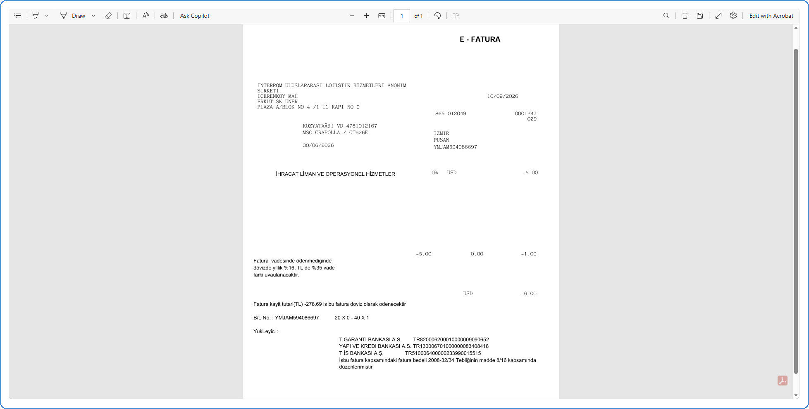
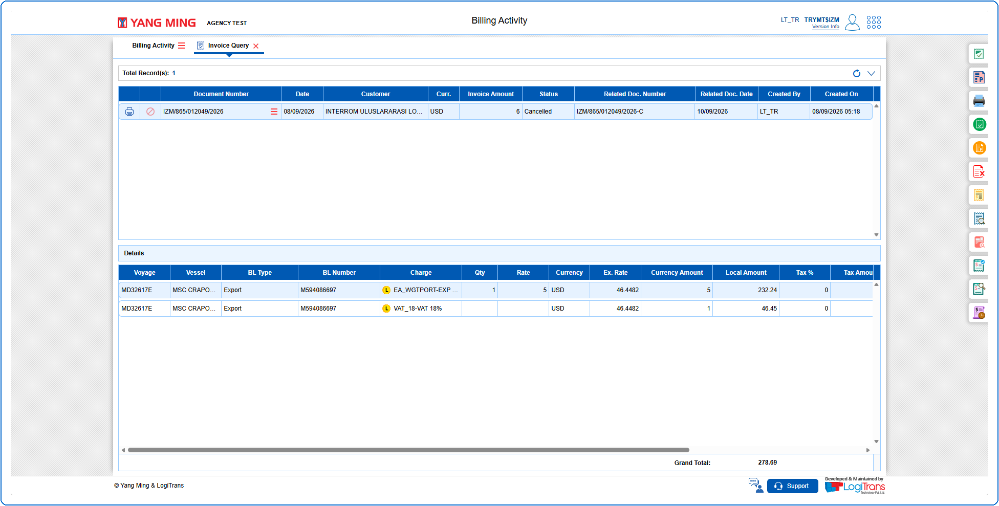

## Steps
**Step 1** : Click on the {img:../img/iq_icon_side.png} (Invoice Query side icon) given on the right side of the Billing Activity screen.

**Step 2** : Upon clicking {img:../img/iq_icon_side.png}, User will be shown the Invoice Query screen.
**Step 3** : Enter the query fields with desirable input for querying data and click on {img:../img/iq_btn_search.png}.

**Step 4** : Upon clicking {img:../img/iq_btn_search.png}, invoices with matching information are returned.
**Step 5** : Click on {img:../img/iq_icon_cancel.png}.

**Step 6** : Upon clicking {img:../img/iq_icon_cancel.png}, User will be shown the Invoice Reversal screen.
**Step 7** : Enter the data in "**Reversal Date**" and "**Reason for Reversal**" fields. These fields are mandatory.
**Step 8** : Click on {img:../img/iq_btn_submit.png}.

If successfully submitted, an alert with the System Generated Reversal Document Number is shown as given below and pdf is displayed.

The "**Status**" of the invoice is changed to "**Cancelled**" as shown below.

