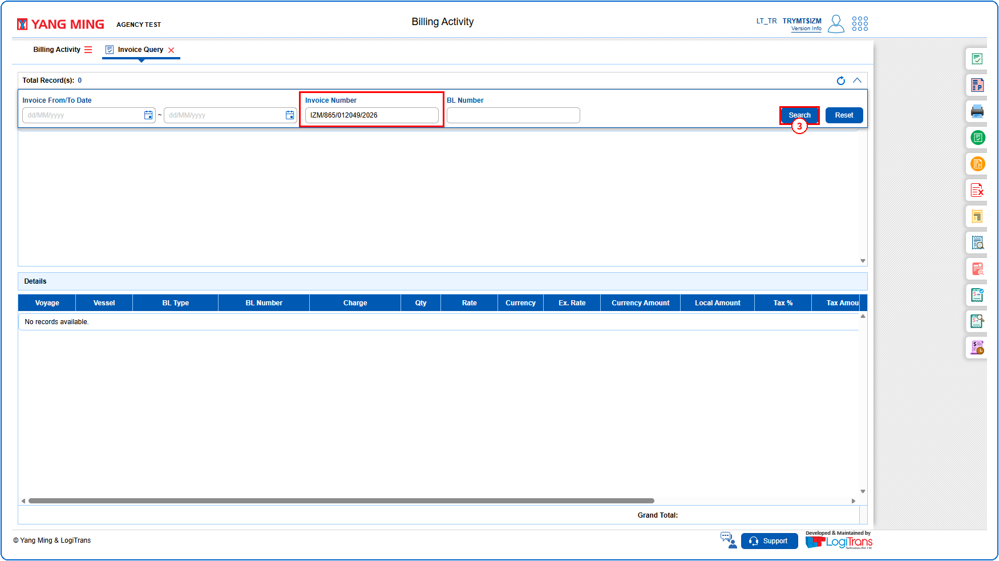
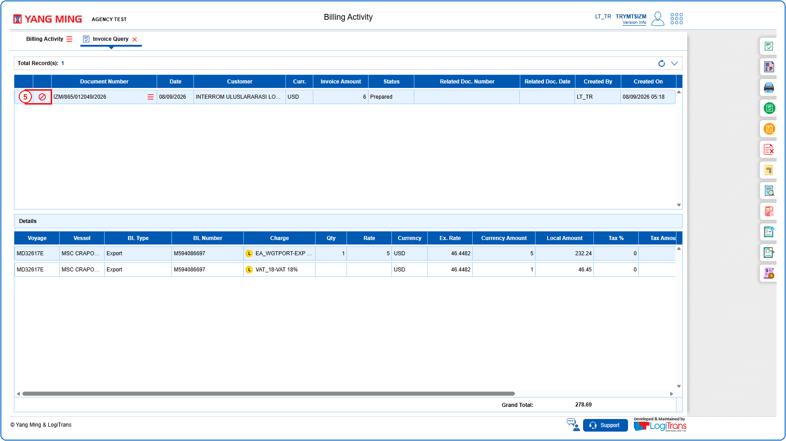
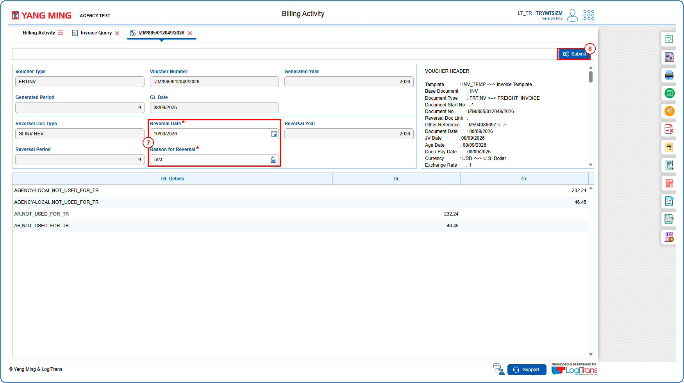
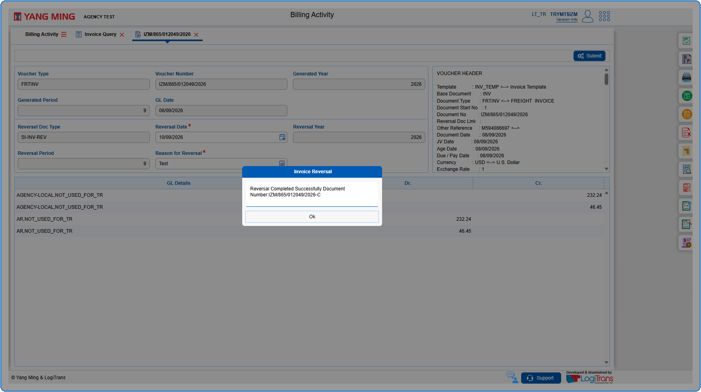
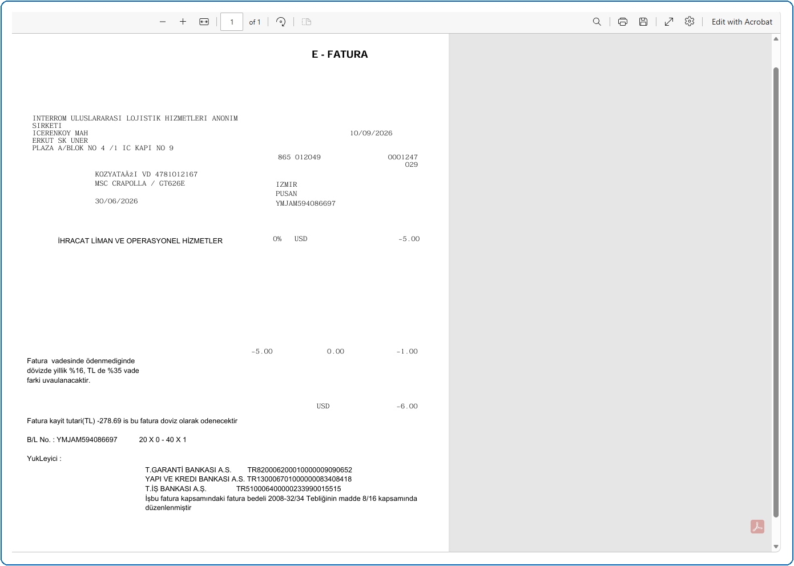
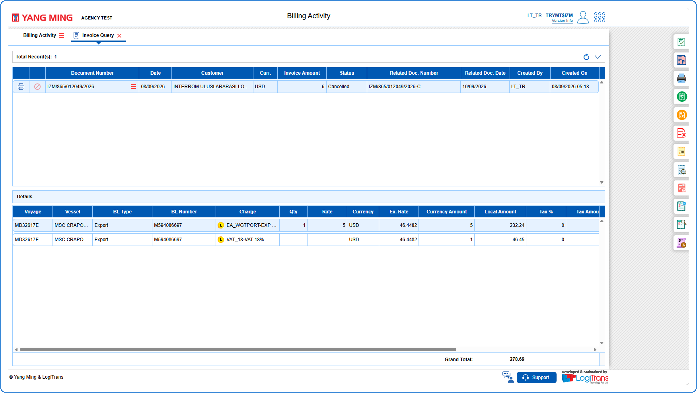

## Steps
**Step 1** : Click on the {img:../img/icon_invoice_query.png} (Invoice Query side icon) given on the right side of the Billing Activity screen.

**Step 2** : Upon clicking {img:../img/icon_invoice_query.png}, User will be shown the Invoice Query screen.
**Step 3** : Enter the Invoice Number and click on {img:../img/btn_search.png}.

**Step 4** : Upon clicking {img:../img/btn_search.png}, invoices with matching information are returned along with their details.
**Step 5** : Click on {img:../img/icon_cancel.png}(cancel icon) of the required invoice.

**Step 6** : Upon clicking {img:../img/icon_cancel.png}, User will be shown the invoice reversal screen.
**Step 7** : Enter the required Reversal Date and Reason for Reversal.
**Step 8** : Click on {img:../img/btn_submit.png}.

If successfully reversed, an alert with the Reversal Document Number is shown as given below.

Upon clicking Ok, the reversal invoice pdf is displayed as given below.

The status of the invoice is changed to Cancelled as given below.

