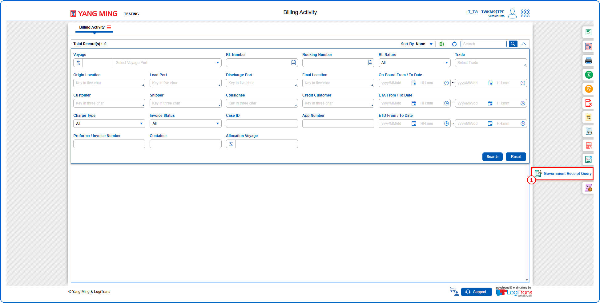
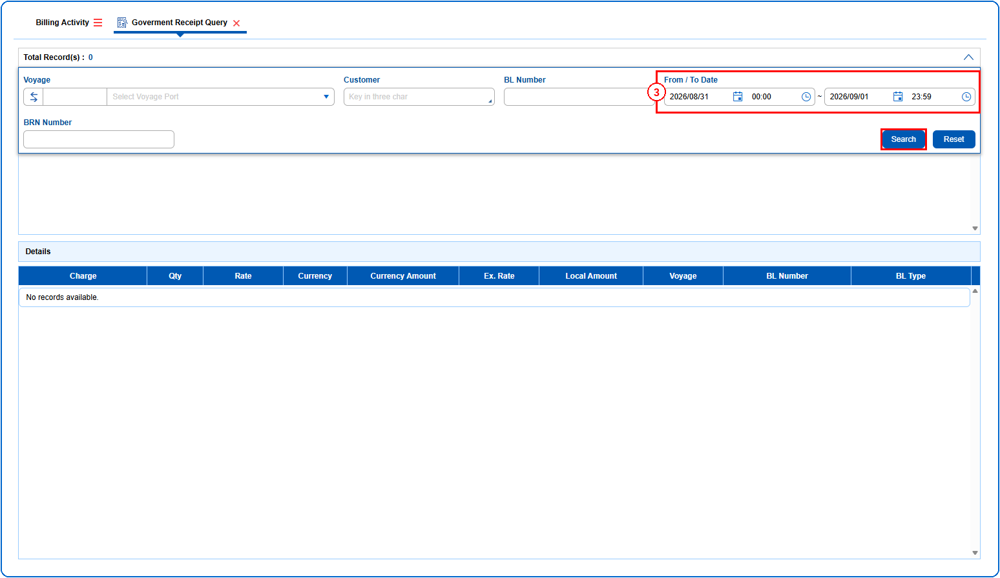
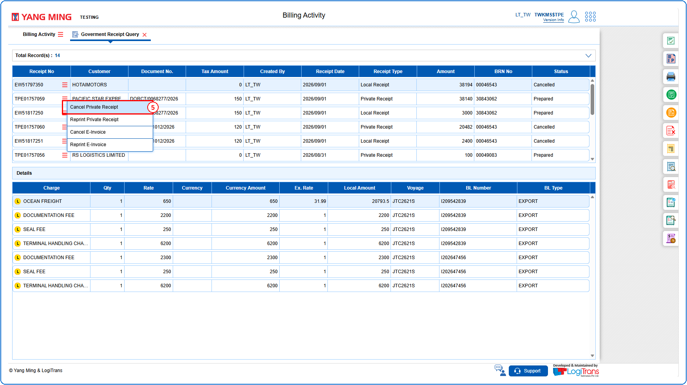
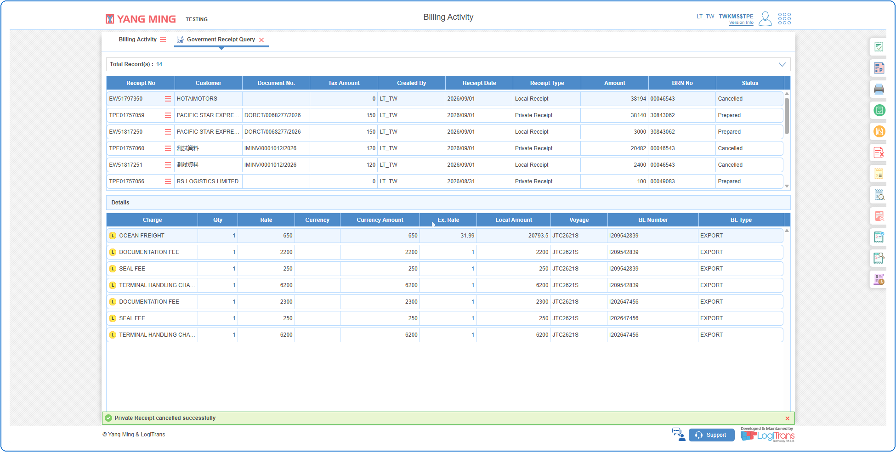
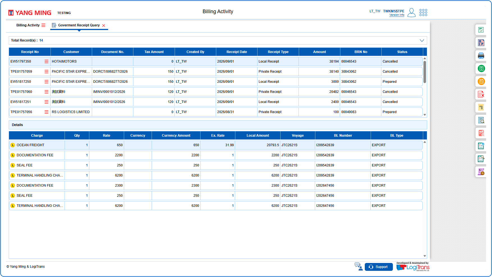

## Steps
**Step 1** : Click on the {img:../img/icon_government_receipt_query.png} (Government Receipt Query side icon) given on the right side of the Billing Activity screen.

**Step 2** : Upon clicking {img:../img/icon_government_receipt_query.png}, User will be shown the Government Receipt Query screen.
**Step 3** : Enter the From/To Date and click on {img:../img/btn_search.png}.

**Step 4** : Upon clicking {img:../img/btn_search.png}, receipts with matching information are returned.
**Step 5** : Click on the menu icon {img:../img/icon_row_menu.png} of the required receipt and select "**Cancel Private Receipt**" from the menu.

If successfully cancelled, a success message is shown as given below.

The status of the receipt is updated to Cancelled as given below.

