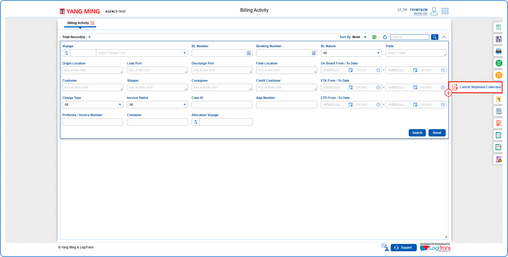
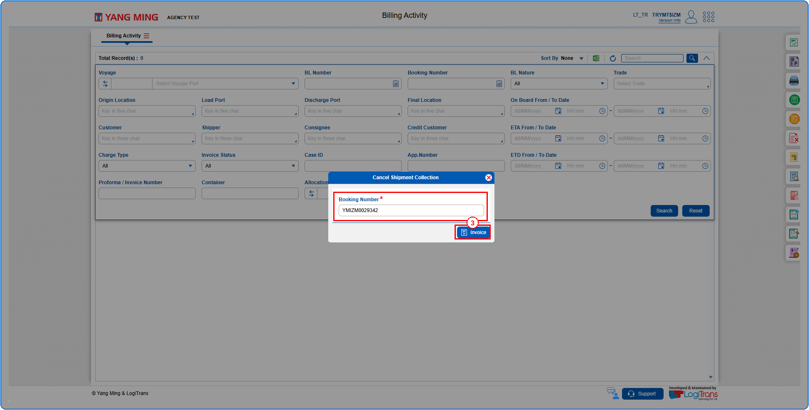
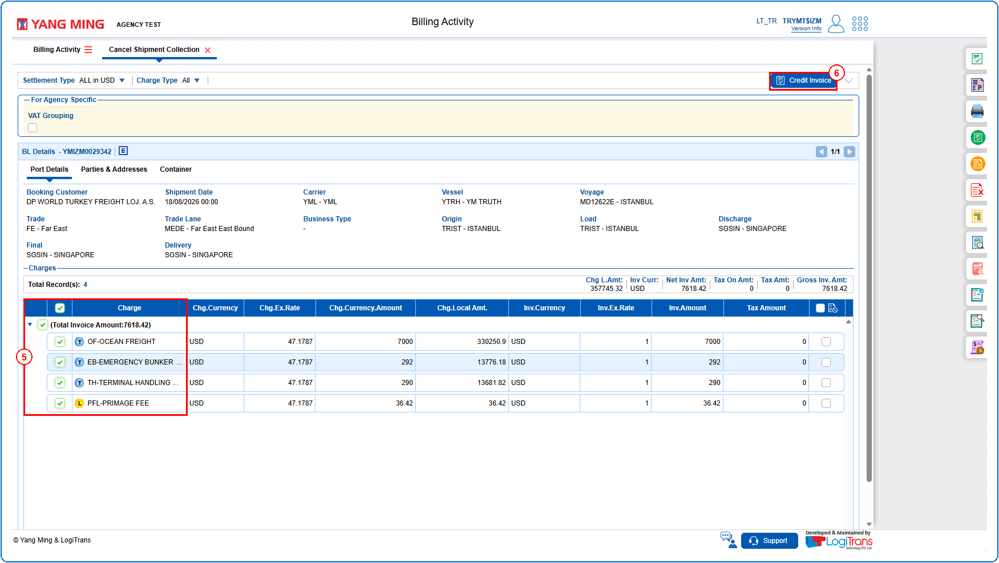
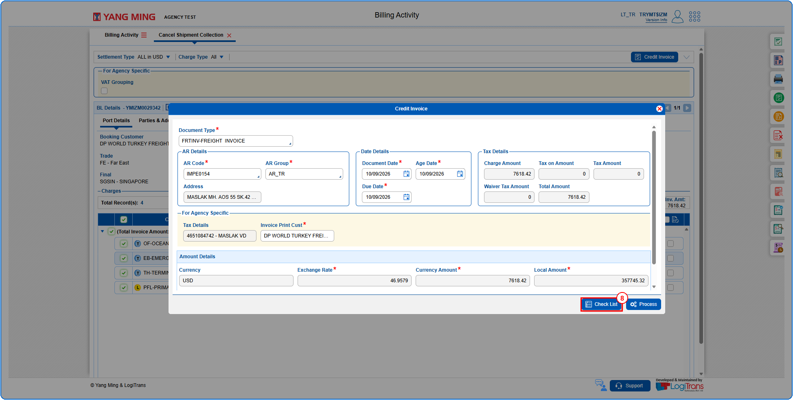
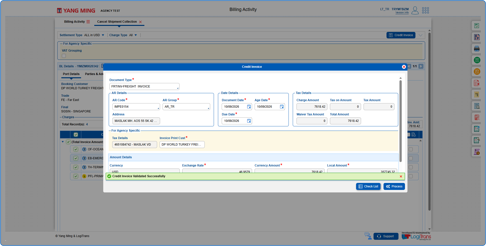
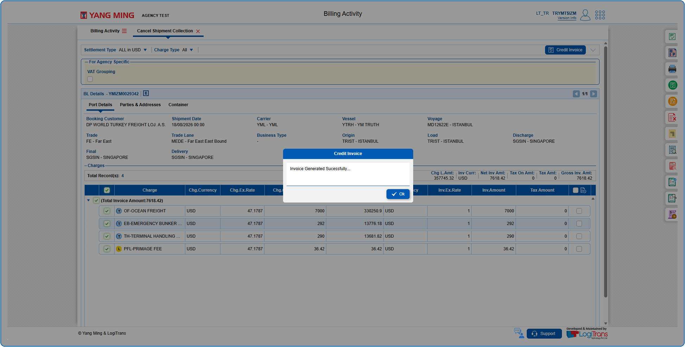

## Steps
**Step 1** : Click on the {img:../img/icon_cancel_shipment_collection.png} (Cancel Shipment Collection side icon) given on the right side of the Billing Activity screen.

**Step 2** : Upon clicking {img:../img/icon_cancel_shipment_collection.png}, User will be shown the Cancel Shipment Collection pop up screen.
**Step 3** : Enter the Booking Number and click on {img:../img/btn_invoice_csc.png}.

**Step 4** : Upon clicking {img:../img/btn_invoice_csc.png}, User will be shown the Cancel Shipment Collection screen.
**Step 5** : Select the required charges by clicking on {img:../img/chk_single.png}(single select checkbox).
**Step 6** : Click on {img:../img/btn_credit_invoice_csc.png}.

**Step 7** : Upon clicking {img:../img/btn_credit_invoice_csc.png}, User will be shown the Credit Invoice pop up screen.
**Step 8** : Check the details and click on {img:../img/btn_check_list.png}.

If successfully validated, a success message is shown as given below.

**Step 9** : Click on {img:../img/btn_process.png}.

If successfully generated, an alert is shown as given below.

