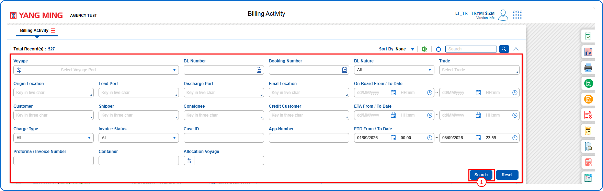
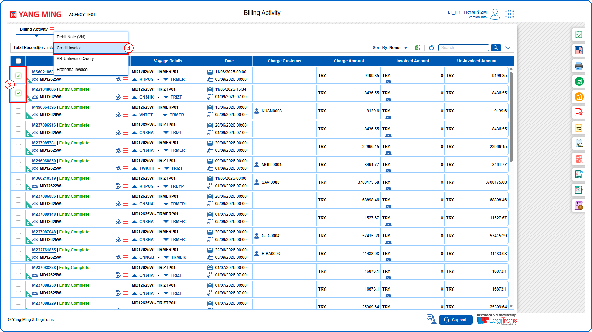
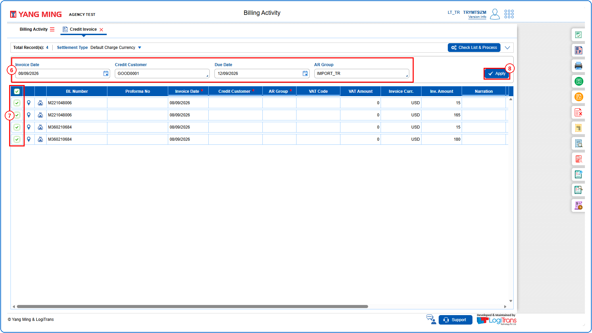
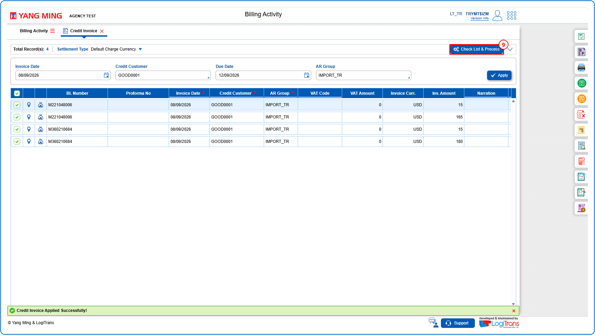
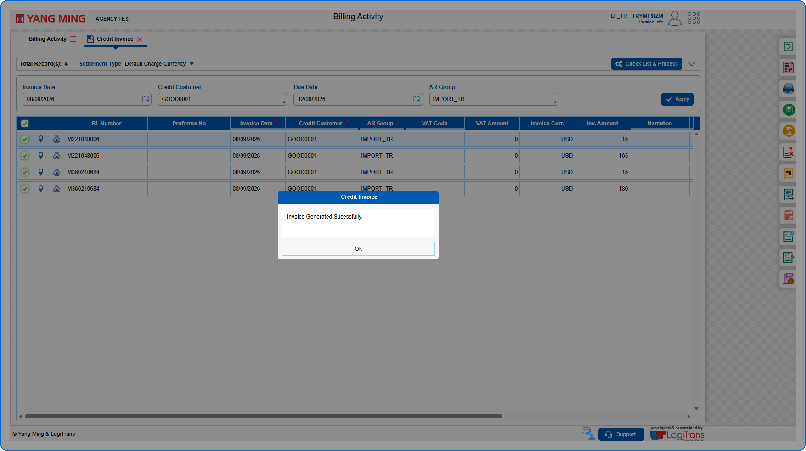

## Steps
**Step 1** : Enter the query fields with desirable input for querying data and click on {img:../img/btn_search_q.png}.

**Step 2** : Upon clicking {img:../img/btn_search_q.png}, BL/Booking Number records with matching information are returned.
**Step 3** : Either select all BL/Booking Number records available by clicking on {img:../img/chk_select_all.png}(select all checkbox) or select individual BL/Booking Number records by clicking on {img:../img/chk_single.png}(single select checkbox).
**Step 4** : The user should drag the cursor to the batch function menu icon {icon:batch_menu}, click on it, and then select "**Credit Invoice**" from the menu.

**Step 5** : Upon clicking "**Credit Invoice**" User will be shown the Credit Invoice screen.
**Step 6** : Enter the required Invoice Date, Credit Customer, Due Date and AR Group.
**Step 7** : Either select all records available by clicking on {img:../img/chk_select_all.png}(select all checkbox) or select individual records by clicking on {img:../img/chk_single.png}(single select checkbox).
**Step 8** : Click on {img:../img/btn_apply.png}.

If successfully applied, a success message is shown as given below.
**Step 9** : Click on {img:../img/btn_check_list_process.png}.

If successfully processed, an alert is shown as given below.

