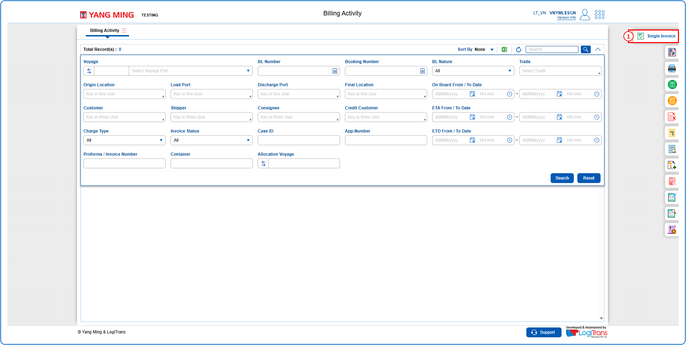
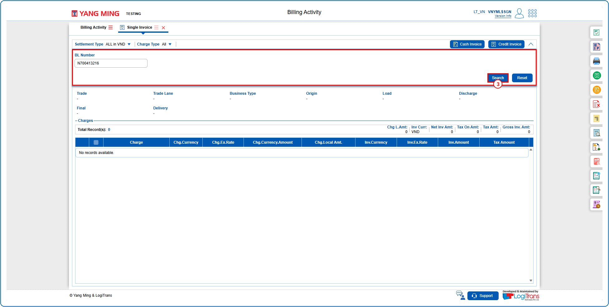
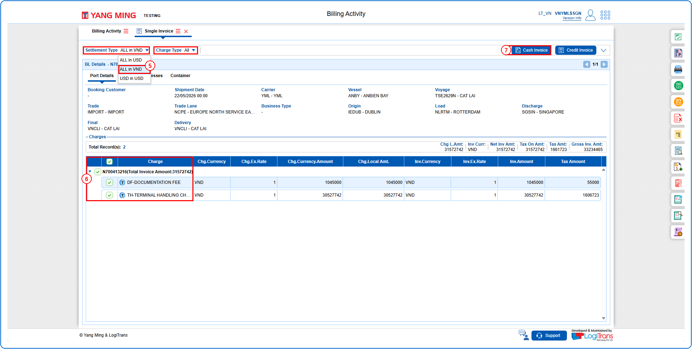
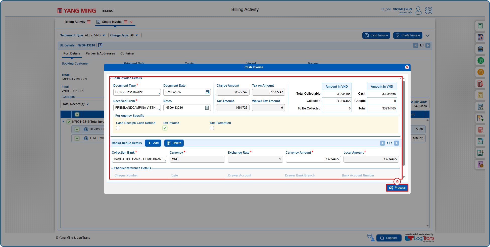
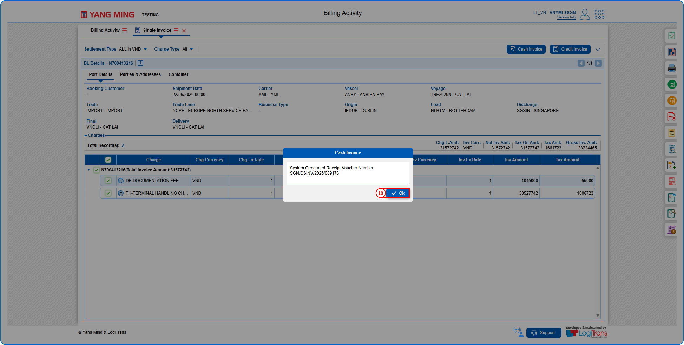
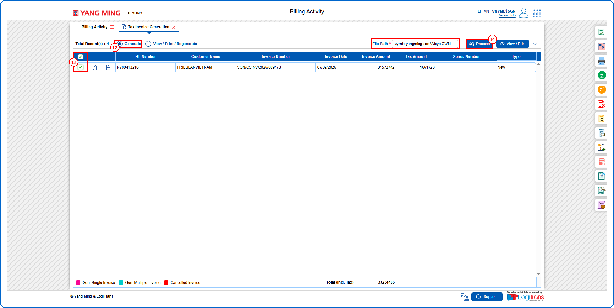
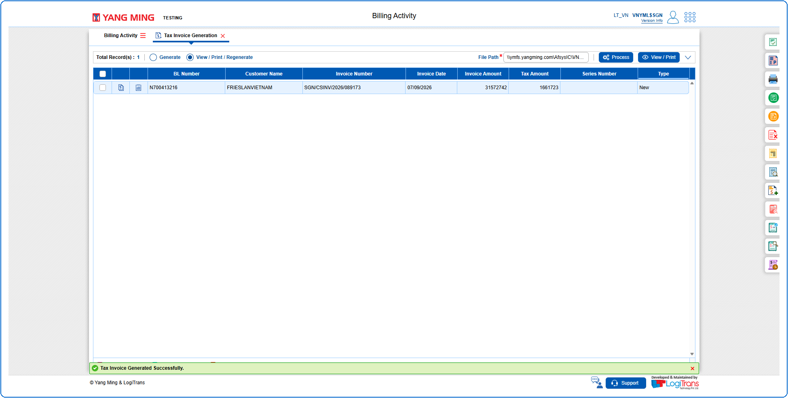

## Steps
**Step 1** : Click on the {img:../img/vn_icon_side.png} (Single Invoice side icon) given on the right side of the Billing Activity screen.

**Step 2** : Upon clicking {img:../img/vn_icon_side.png}, User will be shown the Single Invoice screen.
**Step 3** : Enter the query fields with desirable input for querying data and click on {img:../img/vn_btn_search.png}.

**Step 4** : Upon clicking {img:../img/vn_btn_search.png}, the BL details and charges with matching information are returned.
**Step 5** : Select the required Settlement Type and Charge Type.
**Step 6** : Either select all charges available by clicking on {img:../img/vn_cb_all.png}(select all checkbox) or select individual charges by clicking on {img:../img/vn_cb_single.png}(single select checkbox).
**Step 7** : Click on {img:../img/vn_btn_cash_invoice.png}.

**Step 8** : Upon clicking {img:../img/vn_btn_cash_invoice.png}, the user is shown Cash Invoice pop up screen.
**Step 9** : Enter the details as given below and click on {img:../img/vn_btn_process_cash.png}.

If successfully processed, an alert with the System Generated Receipt Voucher Number is shown as given below.
**Step 10** : Click on {img:../img/vn_btn_ok.png}.

**Step 11** : Upon clicking {img:../img/vn_btn_ok.png}, User will be shown the Tax Invoice Generation screen with the File Path auto populated.
**Step 12** : Click on {img:../img/vn_rb_generate.png}(Generate radio button).
**Step 13** : Either select all invoices available by clicking on {img:../img/vn_tig_cb_all.png}(select all checkbox) or select individual invoices by clicking on {img:../img/vn_tig_cb_single.png}(single select checkbox).
**Step 14** : Enter the File Path and click on {img:../img/vn_btn_process_tig.png}.

If successfully processed, a success message is shown as given below.

