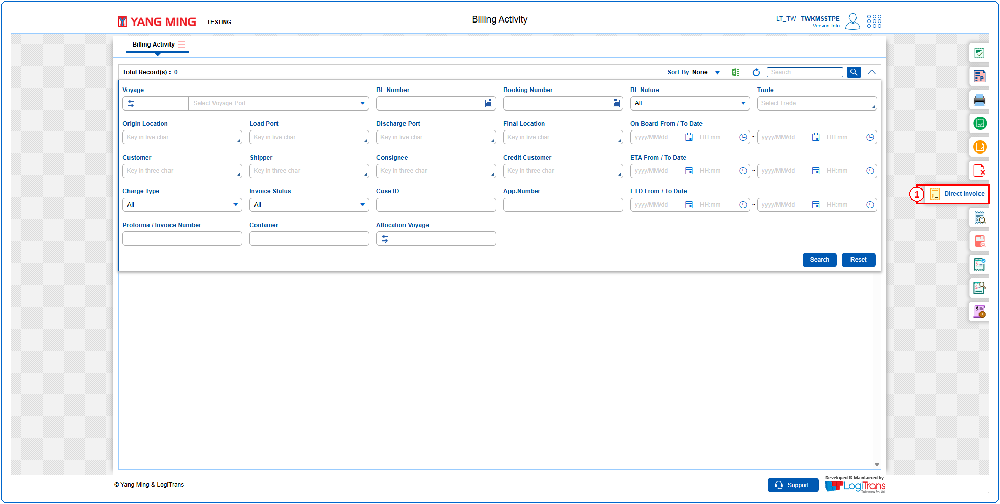
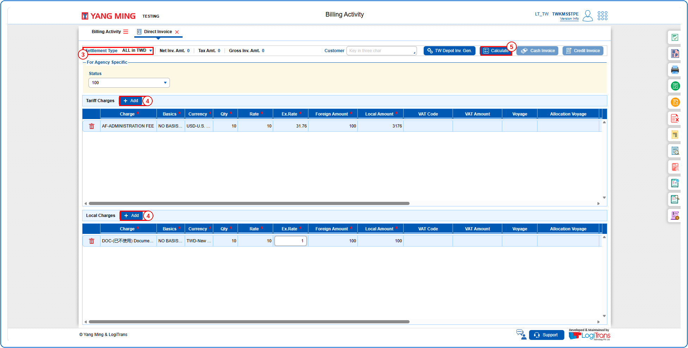
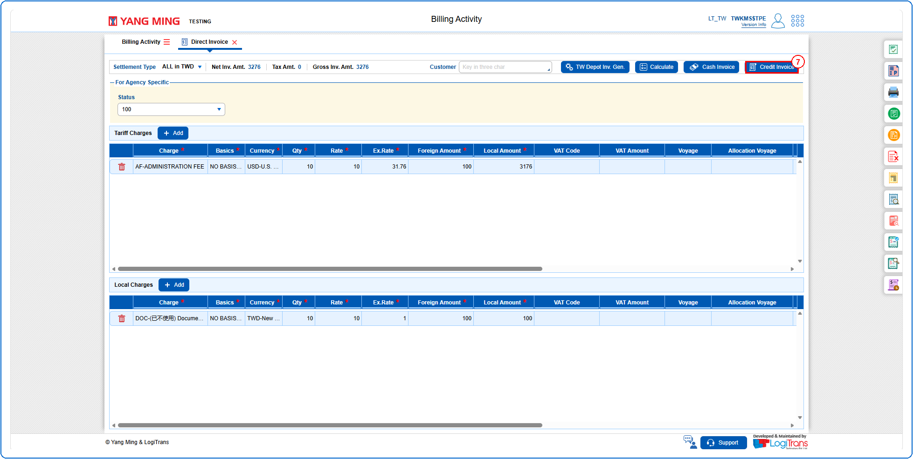
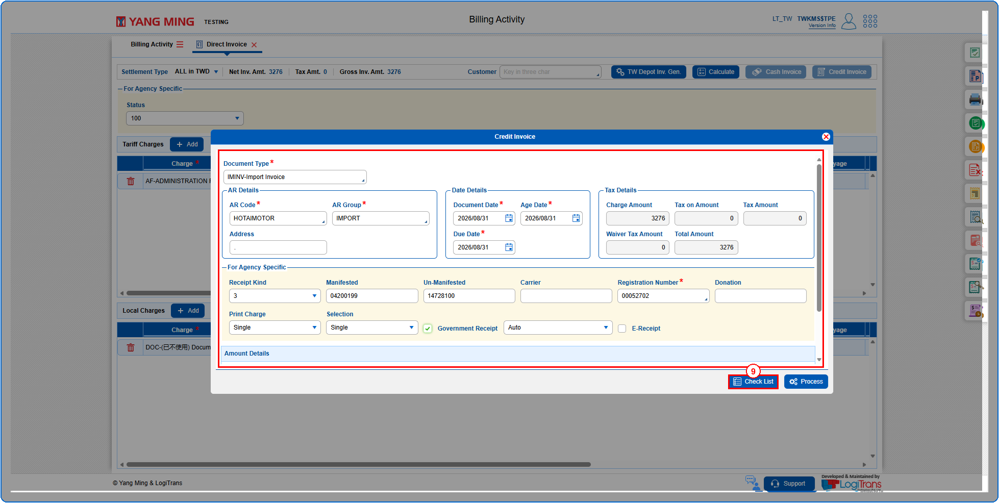
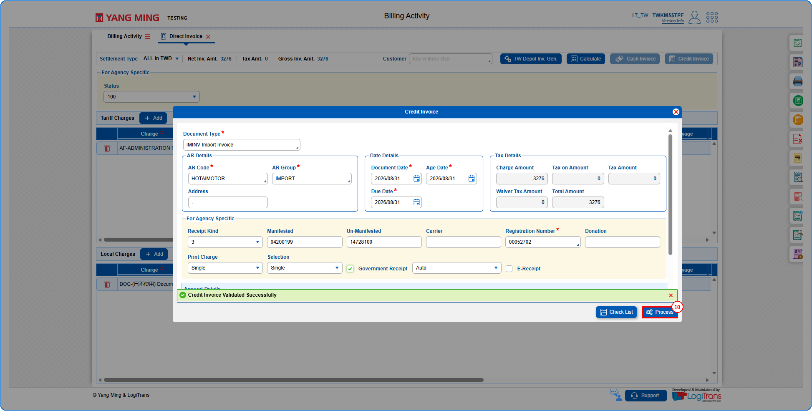
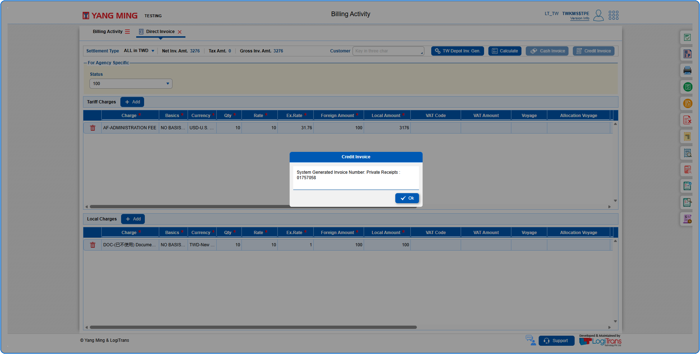
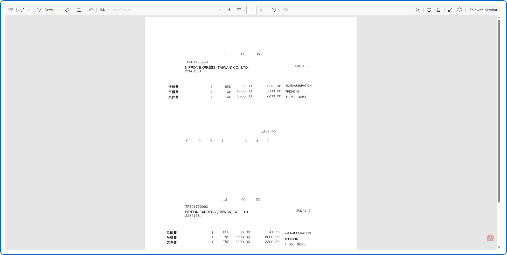

## Steps
**Step 1** : Click on the {img:../img/dt_icon_side.png} (Direct Invoice side icon) given on the right side of the Billing Activity screen.

**Step 2** : Upon clicking {img:../img/dt_icon_side.png}, User will be shown the Direct Invoice screen.
**Step 3** : Select the required Settlement Type.
**Step 4** : Add charges by clicking on {img:../img/dt_btn_add.png} under Tariff Charges / Local Charges and enter the charge details.
**Step 5** : Click on {img:../img/dt_btn_calculate.png}.

**Step 6** : Upon clicking {img:../img/dt_btn_calculate.png}, the invoice amounts are calculated and the Cash Invoice and Credit Invoice buttons are enabled.
**Step 7** : Click on {img:../img/dt_btn_credit_invoice.png}.

**Step 8** : Upon clicking {img:../img/dt_btn_credit_invoice.png}, the user is shown Credit Invoice pop up screen.
**Step 9** : Enter the details as given below and click on {img:../img/dt_btn_check_list.png}.

If successfully validated, a success message is shown as given below.
**Step 10** : Click on {img:../img/dt_btn_process.png}.

If successfully processed, an alert with the System Generated Invoice Number is shown as given below and pdf is displayed.

