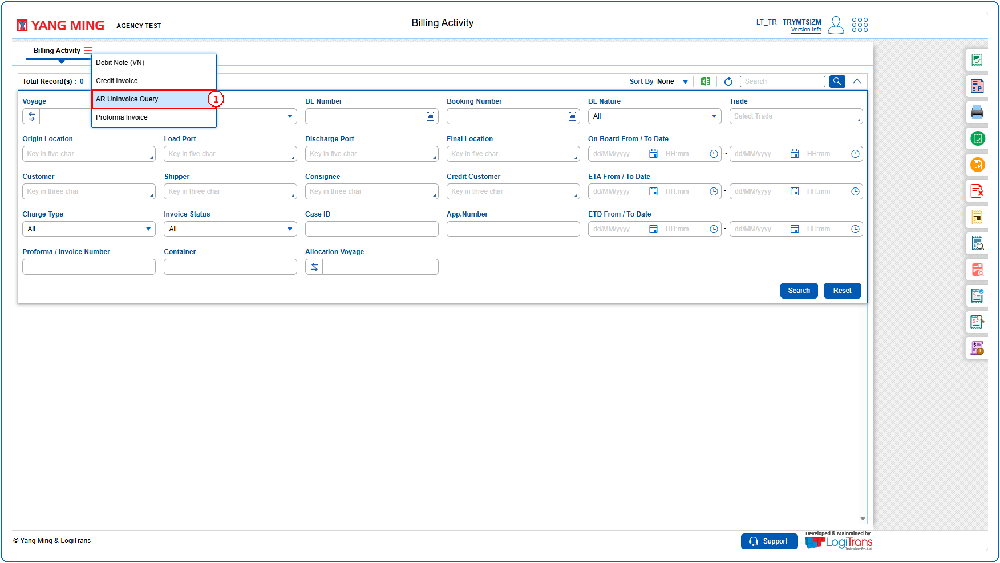
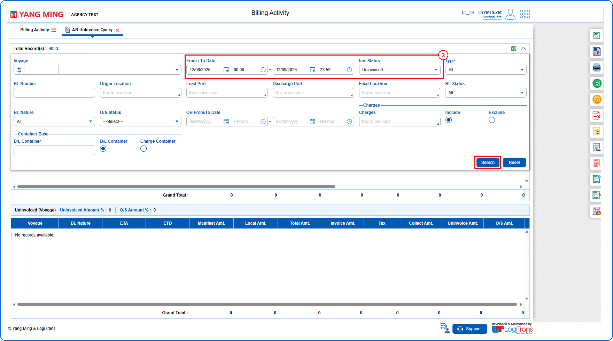
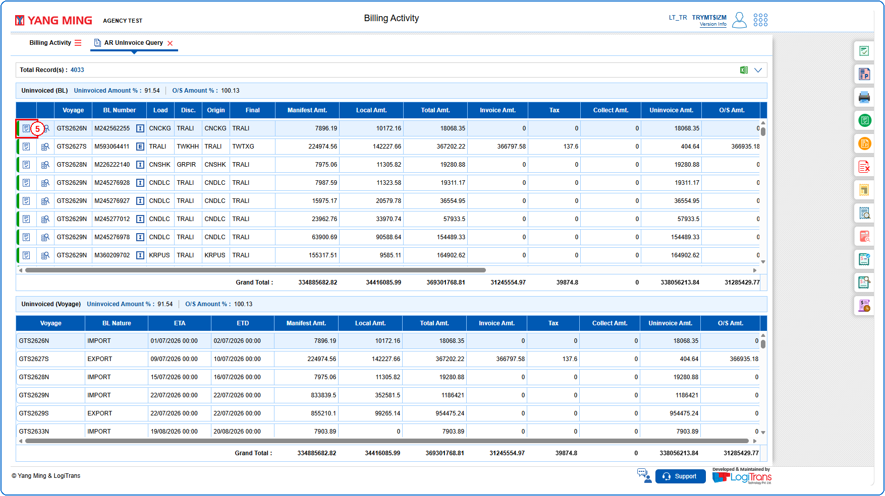
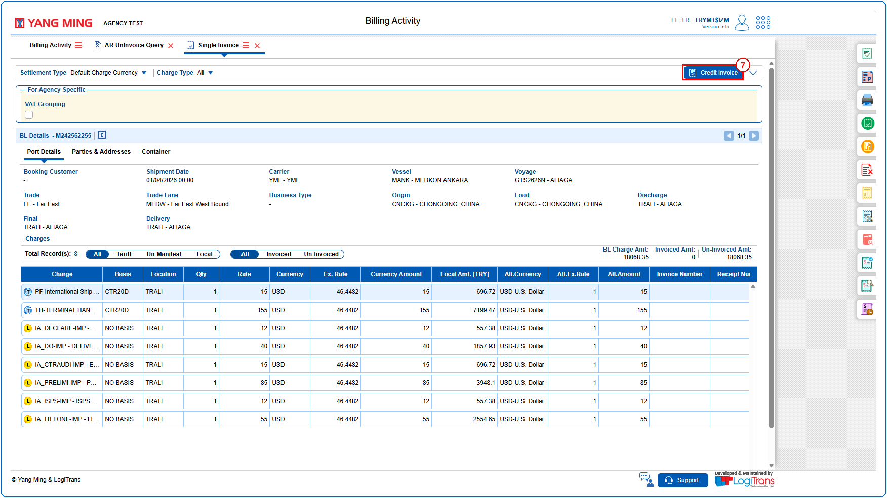
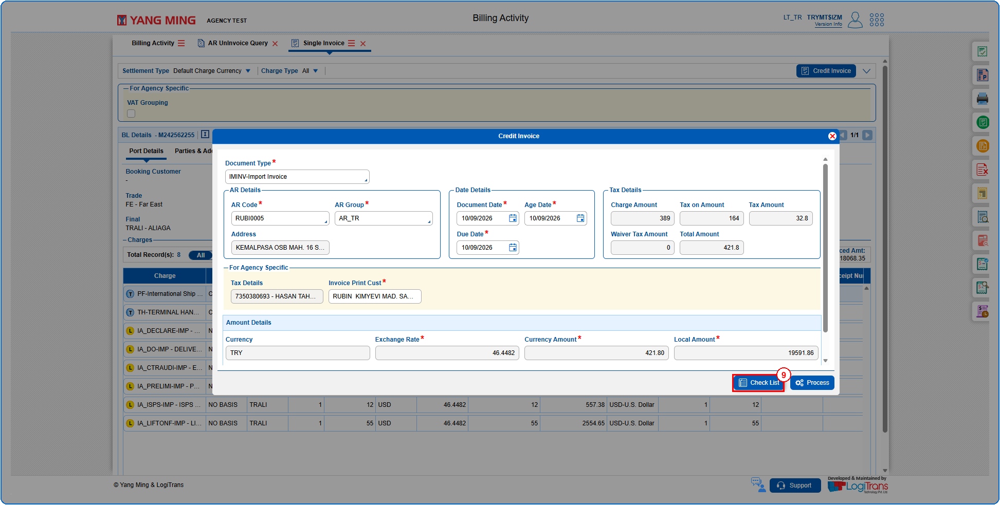
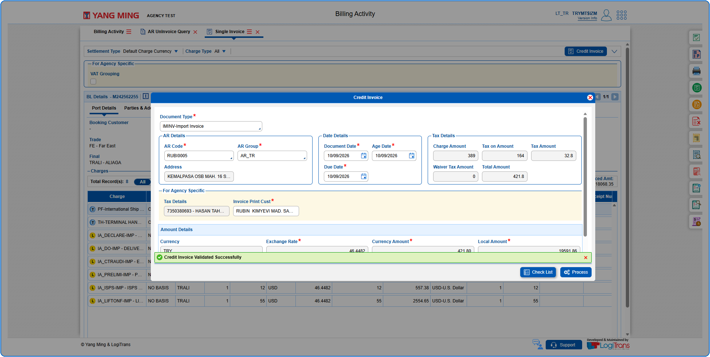
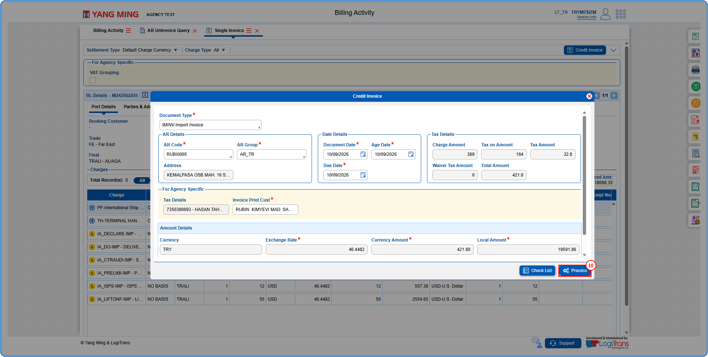
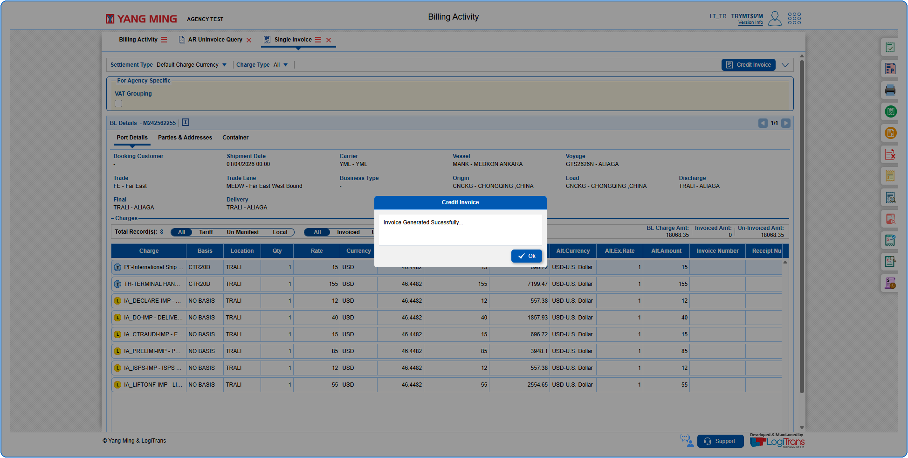

## Steps
**Step 1** : The user should click on the menu icon {icon:batch_menu} of the Billing Activity tab and select "**AR UnInvoice Query**" from the menu.

**Step 2** : Upon clicking "**AR UnInvoice Query**", User will be shown the AR Un-Invoiced Query screen.
**Step 3** : Enter the From/To Date, select the Inv. Status and click on {img:../img/btn_search.png}.

**Step 4** : Upon clicking {img:../img/btn_search.png}, BL records with matching information are returned.
**Step 5** : Click on the {img:../img/icon_invoice_doc.png} (invoice icon) of the required BL record.

**Step 6** : Upon clicking {img:../img/icon_invoice_doc.png}, User will be shown the Single Invoice screen.
**Step 7** : Click on {img:../img/btn_credit_invoice_csc.png}.

**Step 8** : Upon clicking {img:../img/btn_credit_invoice_csc.png}, User will be shown the Credit Invoice pop up screen.
**Step 9** : Check the details and click on {img:../img/btn_check_list.png}.

If successfully validated, a success message is shown as given below.

**Step 10** : Click on {img:../img/btn_process.png}.

If successfully generated, an alert is shown as given below.

