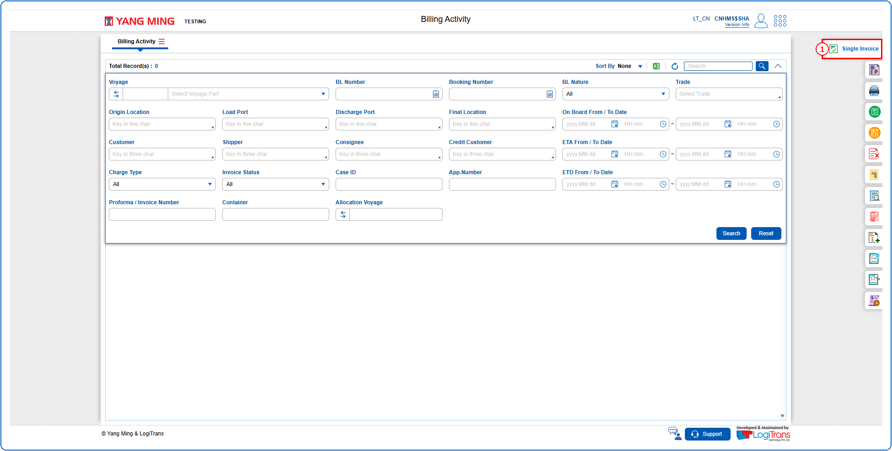
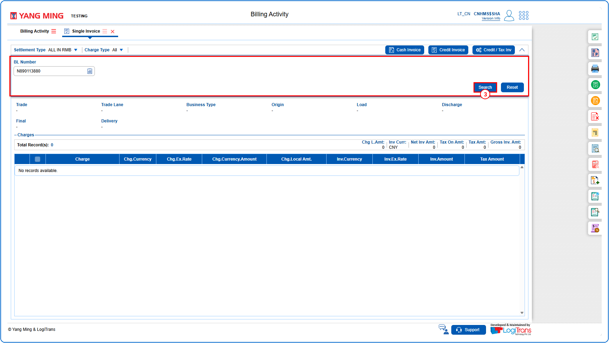
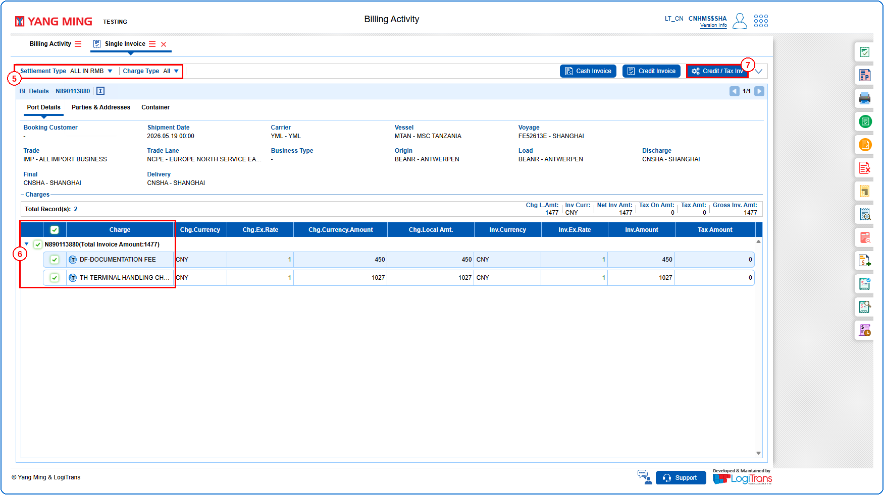
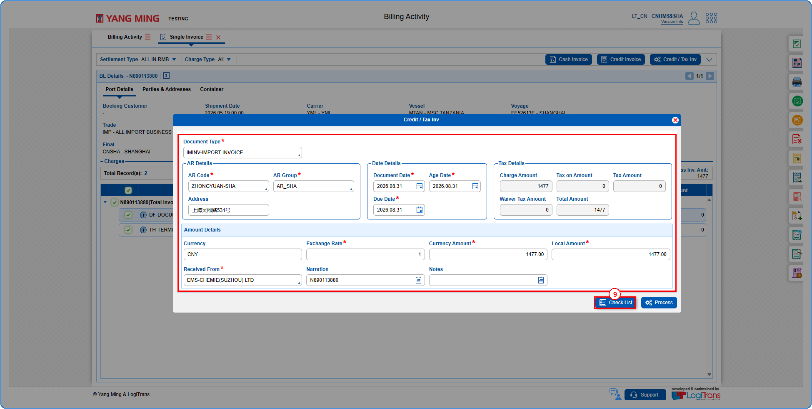
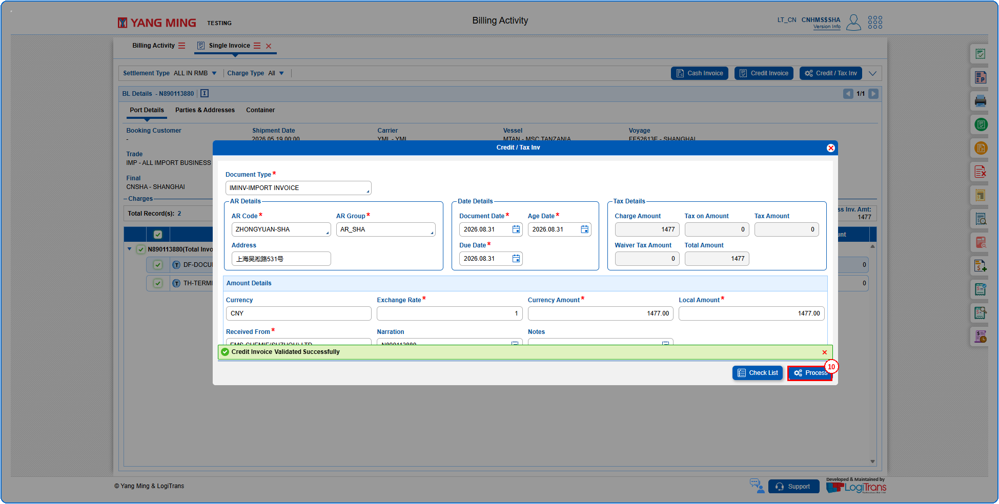
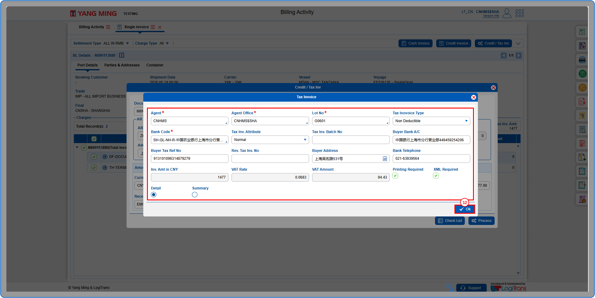
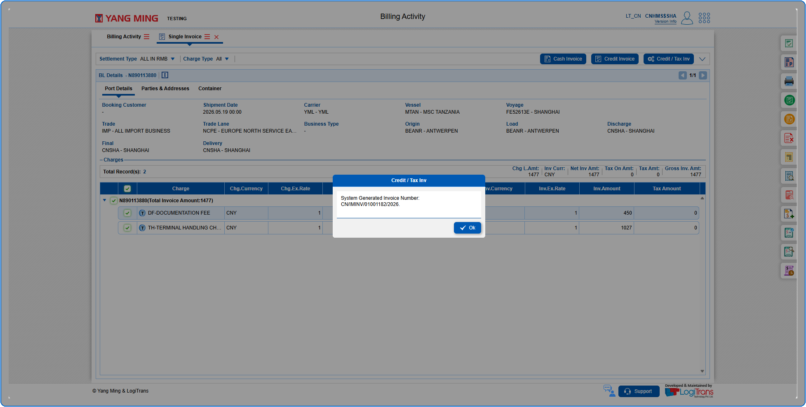
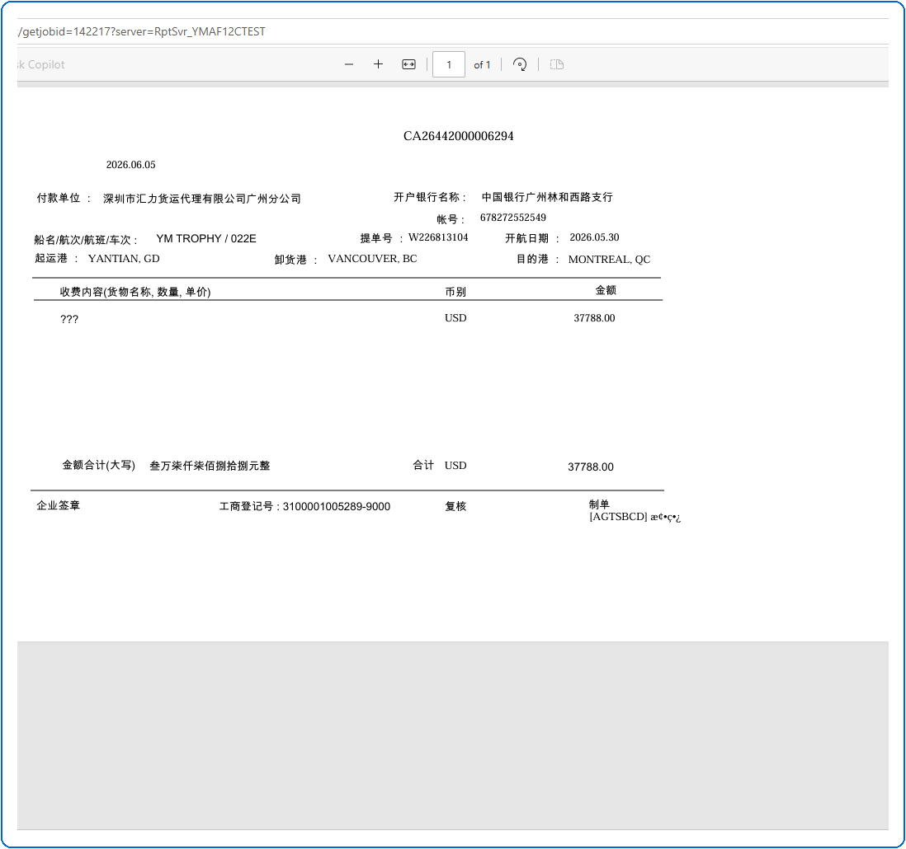

## Steps
**Step 1** : Click on the {img:../img/icon_single_invoice.png} (Single Invoice side icon) given on the right side of the Billing Activity screen.

**Step 2** : Upon clicking {img:../img/icon_single_invoice.png}, User will be shown the Single Invoice screen.
**Step 3** : Enter the query fields with desirable input for querying data and click on {img:../img/btn_search.png}.

**Step 4** : Upon clicking {img:../img/btn_search.png}, charges with matching information are returned.
**Step 5** : Select the required Settlement Type and Charge Type.
**Step 6** : Either select all charges available by clicking on {img:../img/chk_select_all.png}(select all checkbox) or select individual charges by clicking on {img:../img/chk_single.png}(single select checkbox).
**Step 7** : Click on {img:../img/btn_credit_tax_inv.png}.

**Step 8** : Upon clicking {img:../img/btn_credit_tax_inv.png}, the user is shown Credit / Tax Inv pop up screen.
**Step 9** : Enter the details as given below and click on {img:../img/btn_check_list.png}.

If successfully validated, a success message is shown as given below.
**Step 10** : Click on {img:../img/btn_process.png}.

**Step 11** : Upon clicking {img:../img/btn_process.png}, the user is shown Tax Invoice pop up screen.
**Step 12** : Enter the details as given below and click on {img:../img/btn_ok_tax.png}.

If successfully processed, an alert with the System Generated Invoice Number is shown as given below and pdf is displayed.

