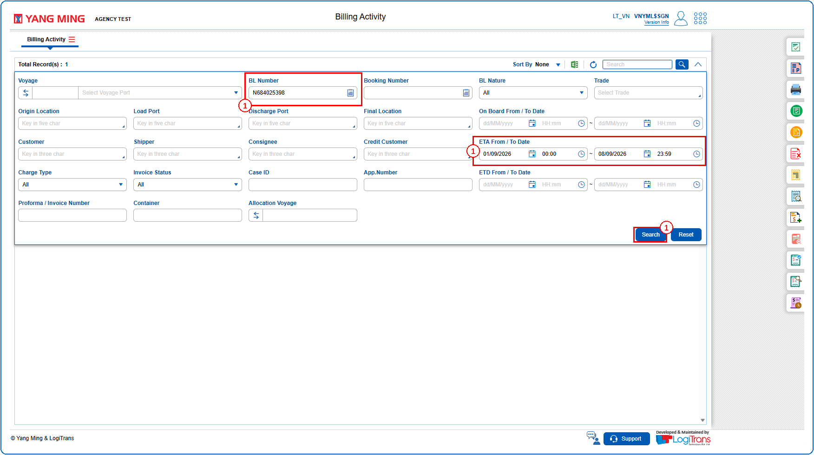
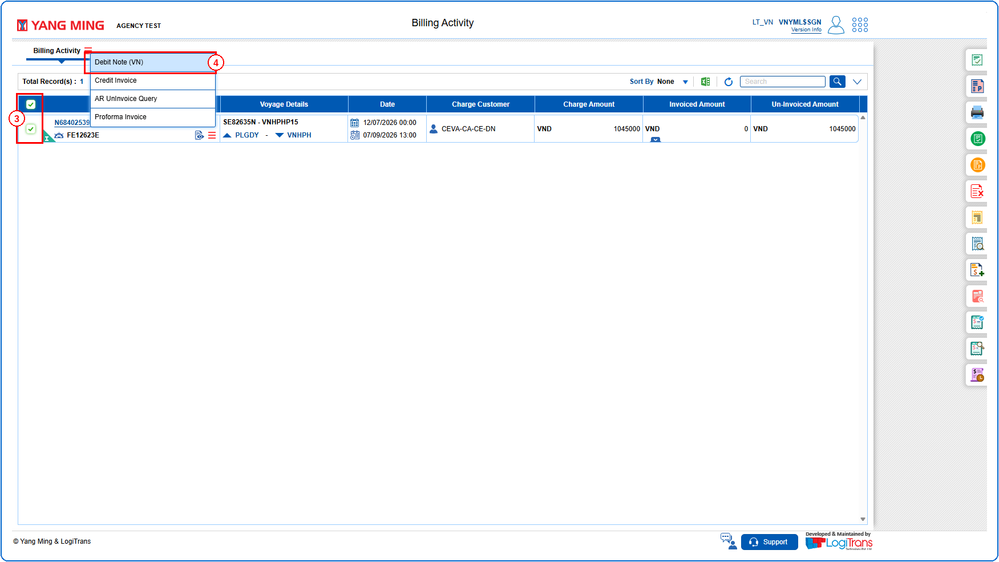
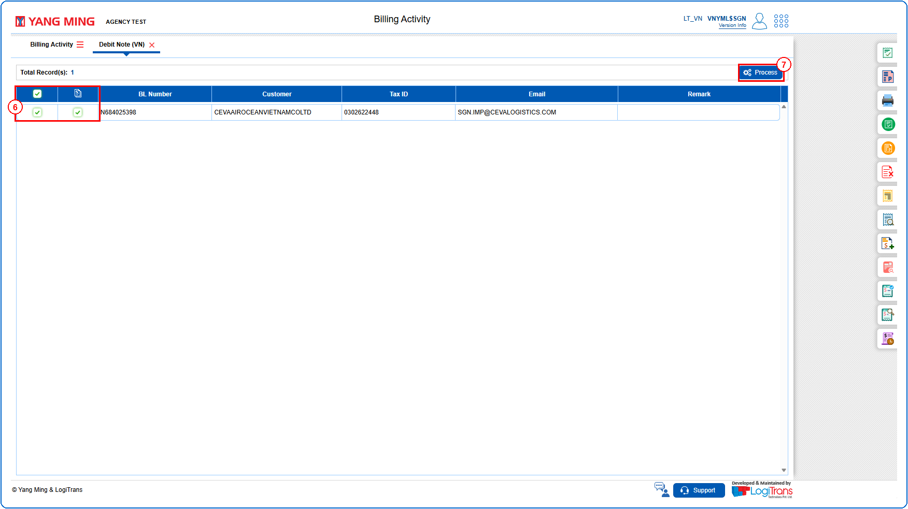
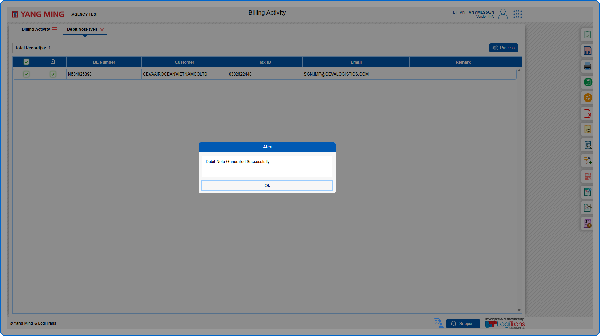

## Steps
**Step 1** : Enter the BL Number and ETA From/To Date and click on {img:../img/btn_search_q.png}.

**Step 2** : Upon clicking {img:../img/btn_search_q.png}, BL records with matching information are returned.
**Step 3** : Either select all BL records available by clicking on {img:../img/chk_select_all.png}(select all checkbox) or select individual BL records by clicking on {img:../img/chk_single.png}(single select checkbox).
**Step 4** : The user should drag the cursor to the batch function menu icon {icon:batch_menu}, click on it, and then select "**Debit Note (VN)**" from the menu.

**Step 5** : Upon clicking "**Debit Note (VN)**" User will be shown the Debit Note (VN) screen.
**Step 6** : Select the required records.
**Step 7** : Click on {img:../img/btn_process_dn.png}.

If successfully generated, an alert is shown as given below.

