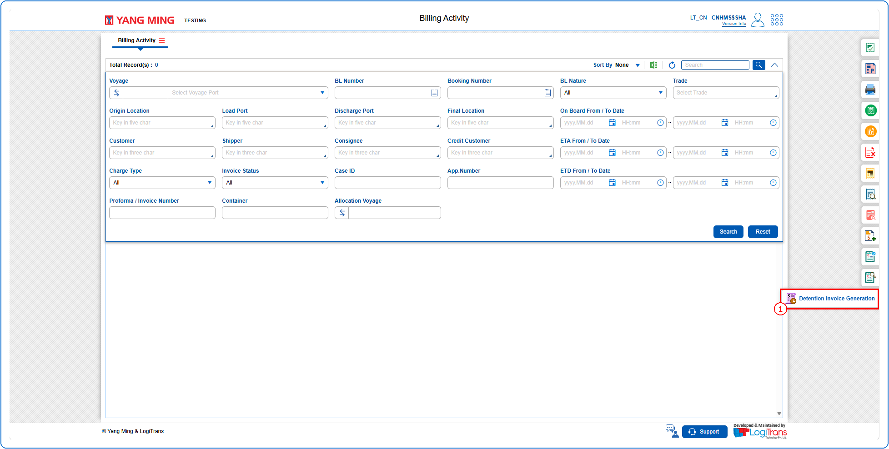
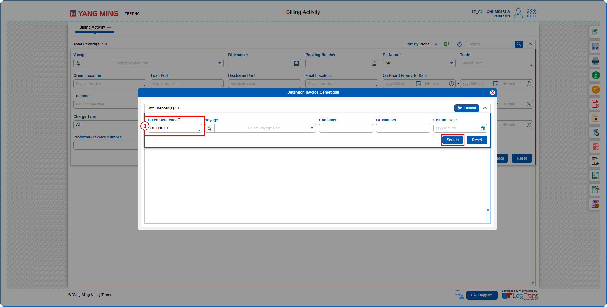
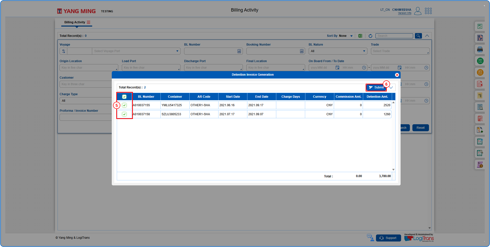
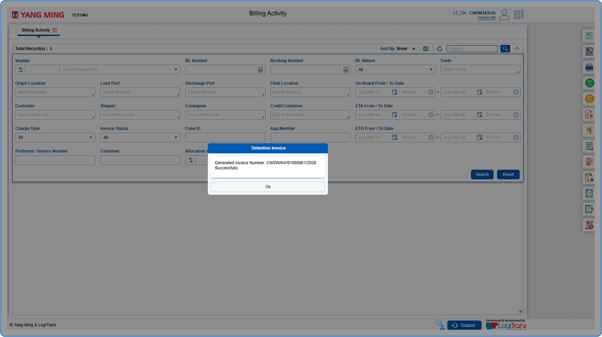

## Steps
**Step 1** : Click on the {img:../img/icon_detention_invoice_generation.png} (Detention Invoice Generation side icon) given on the right side of the Billing Activity screen.

**Step 2** : Upon clicking {img:../img/icon_detention_invoice_generation.png}, User will be shown the Detention Invoice Generation pop up screen.
**Step 3** : Enter the Batch Reference and click on {img:../img/btn_search.png}.

**Step 4** : Upon clicking {img:../img/btn_search.png}, records with matching information are returned.
**Step 5** : Either select all records available by clicking on {img:../img/chk_select_all.png}(select all checkbox) or select individual records by clicking on {img:../img/chk_single.png}(single select checkbox).
**Step 6** : Click on {img:../img/btn_submit_dig.png}.

If successfully generated, an alert with the generated Invoice Number is shown as given below.

