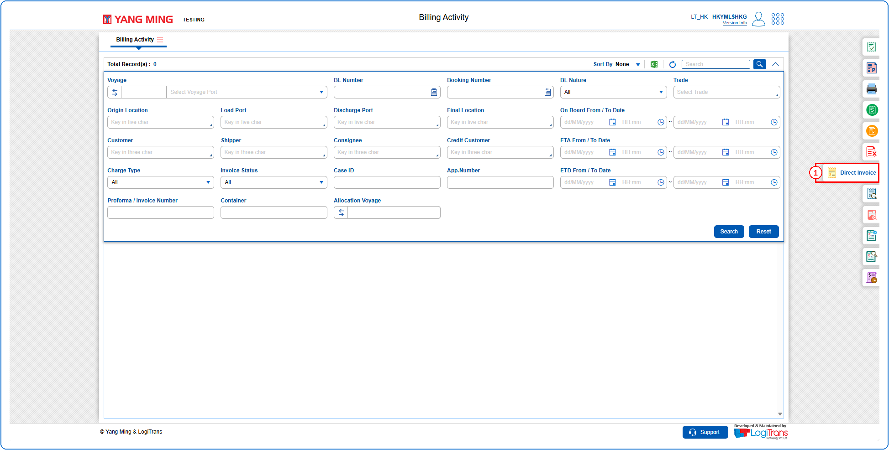
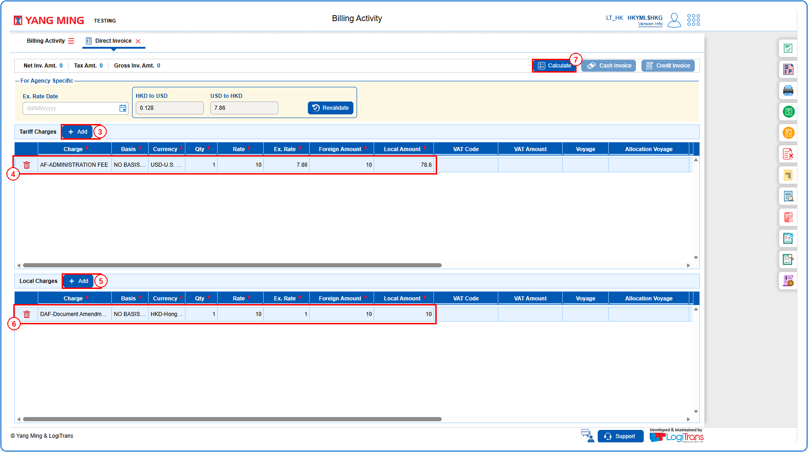
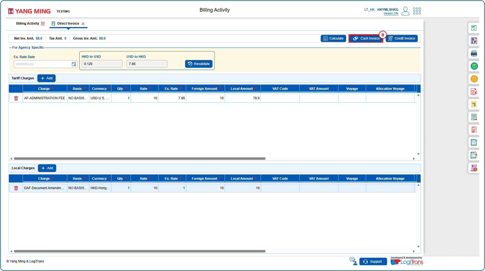
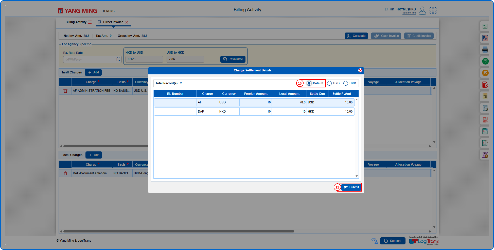
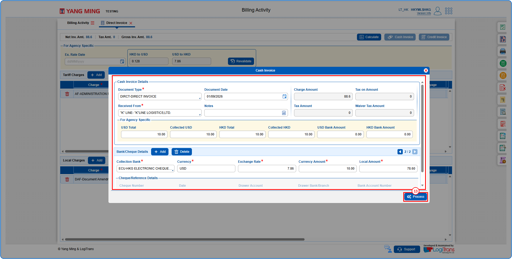
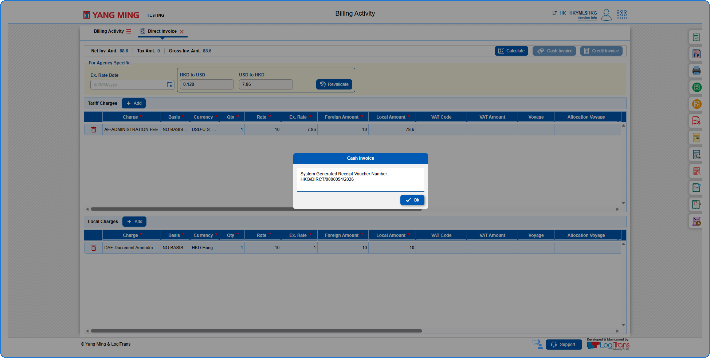

## Steps
**Step 1** : Click on the {img:../img/icon_direct_invoice.png} (Direct Invoice side icon) given on the right side of the Billing Activity screen.

**Step 2** : Upon clicking {img:../img/icon_direct_invoice.png}, User will be shown the Direct Invoice screen.
**Step 3** : Click on {img:../img/btn_add.png} in Tariff Charges to add a new tariff charge.
**Step 4** : Enter the required charge details in the editable fields.
**Step 5** : Click on {img:../img/btn_add.png} in Local Charges to add a new local charge.
**Step 6** : Enter the required charge details in the editable fields.
**Step 7** : Click on {img:../img/btn_calculate.png}.

**Step 8** : Click on {img:../img/btn_di_cash_invoice.png}.

**Step 9** : Upon clicking {img:../img/btn_di_cash_invoice.png}, the user is shown Charge Settlement Details pop up screen.
**Step 10** : Select the required settlement currency option (Default, USD or HKD).
**Step 11** : Click on {img:../img/btn_submit_settle.png}.

**Step 12** : Upon clicking {img:../img/btn_submit_settle.png}, the user is shown Cash Invoice pop up screen.
**Step 13** : Enter the details as given below and click on {img:../img/btn_process.png}.

If successfully processed, an alert with the System Generated Receipt Voucher Number is shown as given below.

