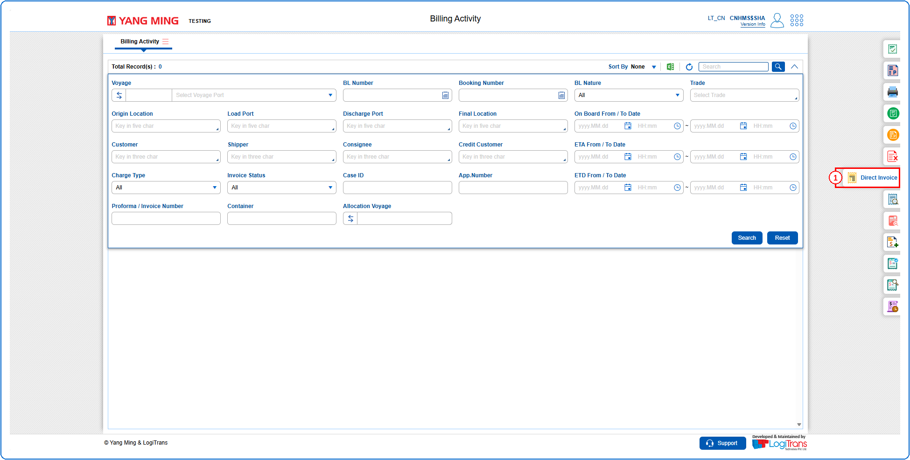
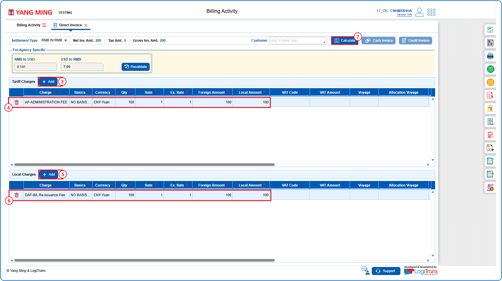
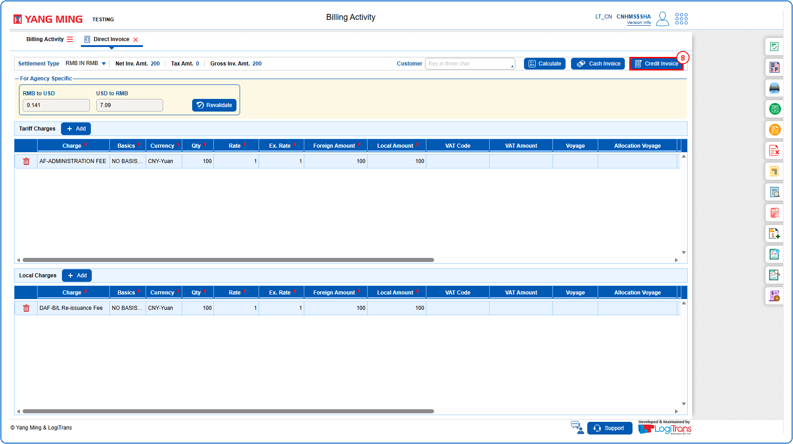
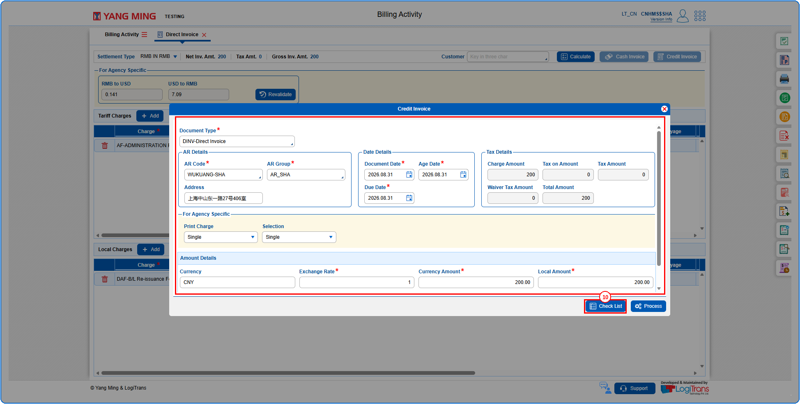
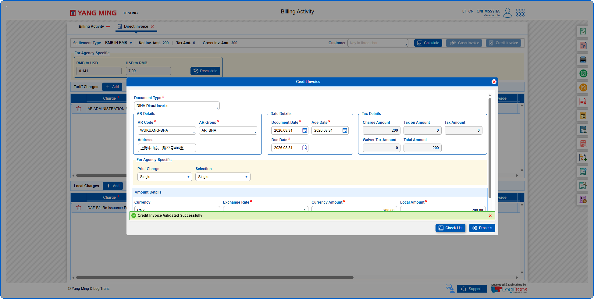
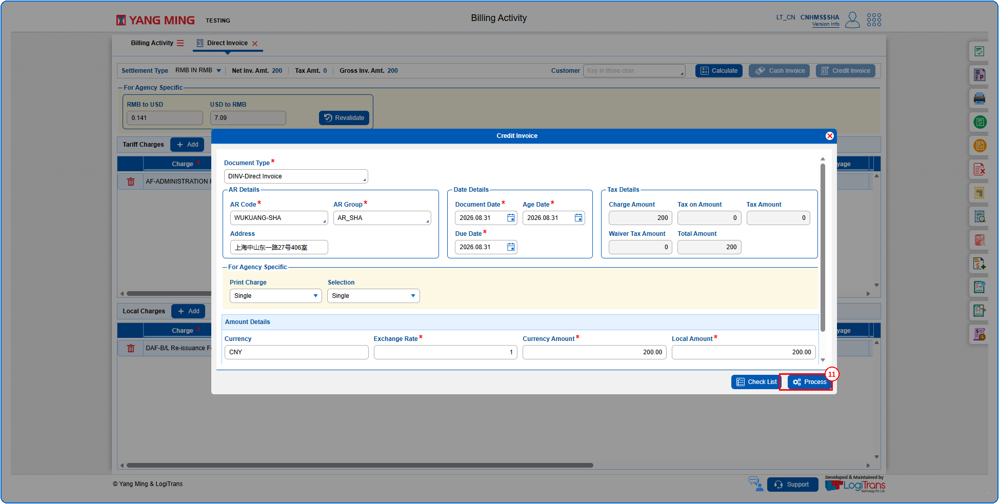
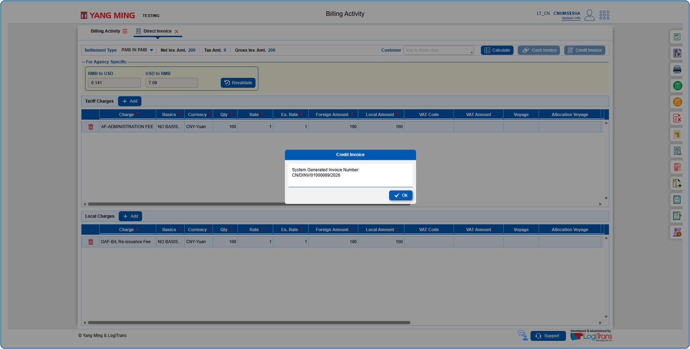
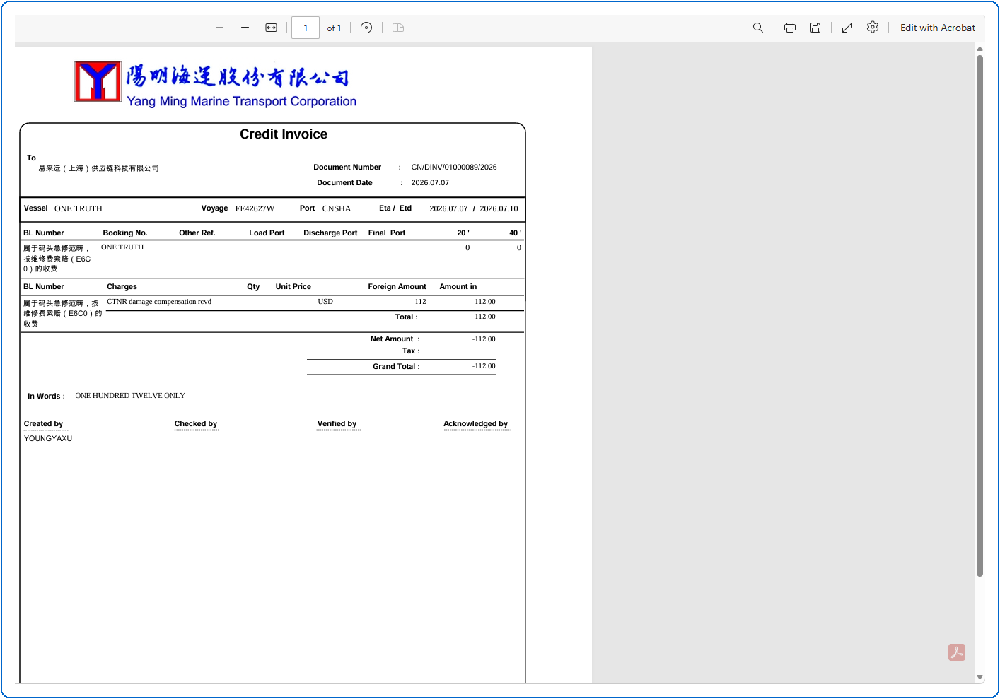

## Steps
**Step 1** : Click on the {img:../img/icon_direct_invoice.png} (Direct Invoice side icon) given on the right side of the Billing Activity screen.

**Step 2** : Upon clicking {img:../img/icon_direct_invoice.png}, User will be shown the Direct Invoice screen.
**Step 3** : Click on {img:../img/btn_add.png} in Tariff Charges to add a new tariff charge.
**Step 4** : Enter the required charge details in the editable fields.
**Step 5** : Click on {img:../img/btn_add.png} in Local Charges to add a new local charge.
**Step 6** : Enter the required charge details in the editable fields.
**Step 7** : Click on {img:../img/btn_calculate.png}.

**Step 8** : Click on {img:../img/btn_di_credit_invoice.png}.

**Step 9** : Upon clicking {img:../img/btn_di_credit_invoice.png}, the user is shown Credit Invoice pop up screen.
**Step 10** : Enter the details as given below and click on {img:../img/btn_check_list.png}.

If successfully validated, a success message is shown as given below.

**Step 11** : Click on {img:../img/btn_process.png}.

If successfully processed, an alert with the System Generated Invoice Number is shown as given below and pdf is displayed.

