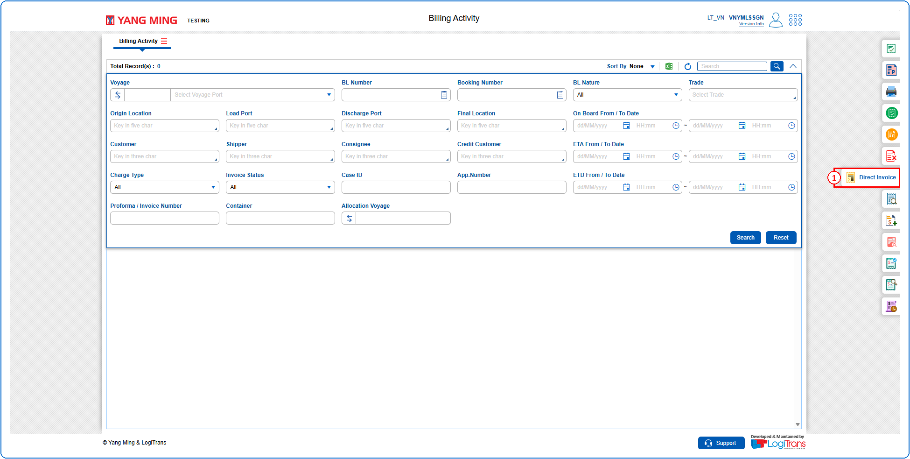
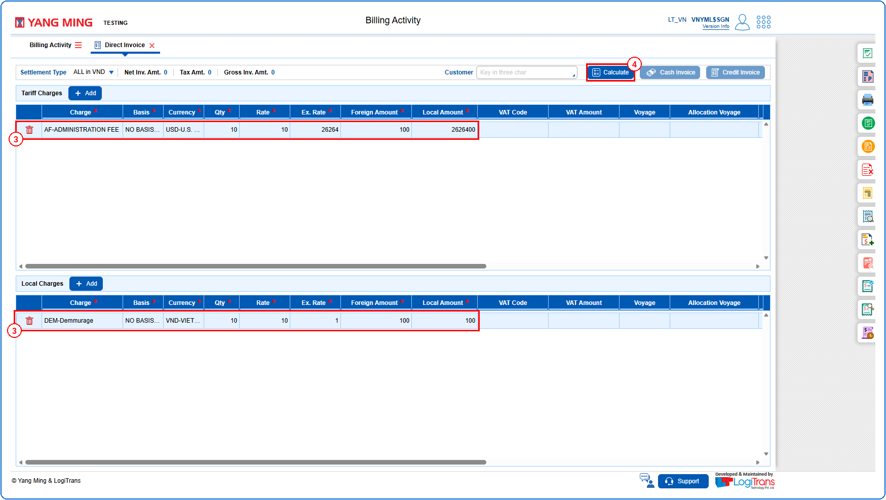
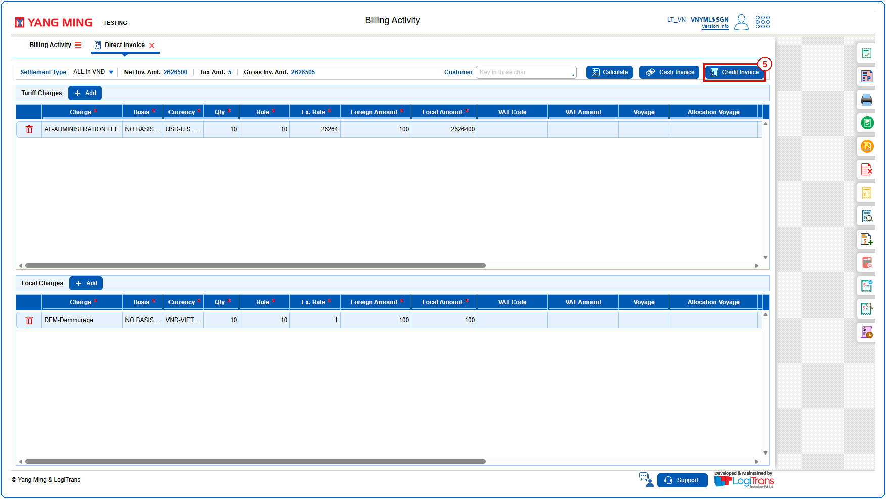
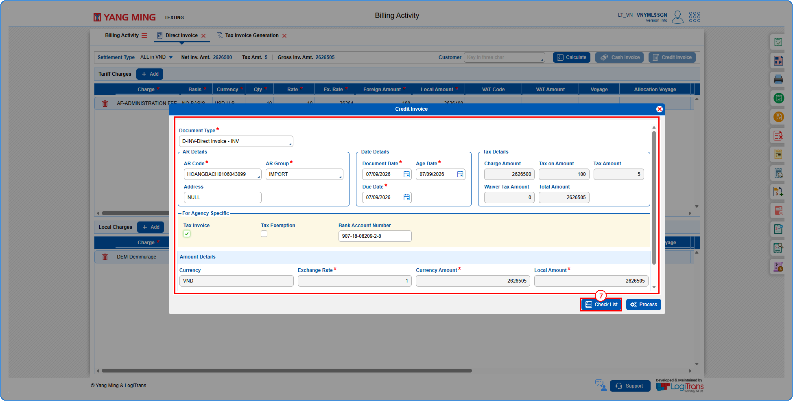
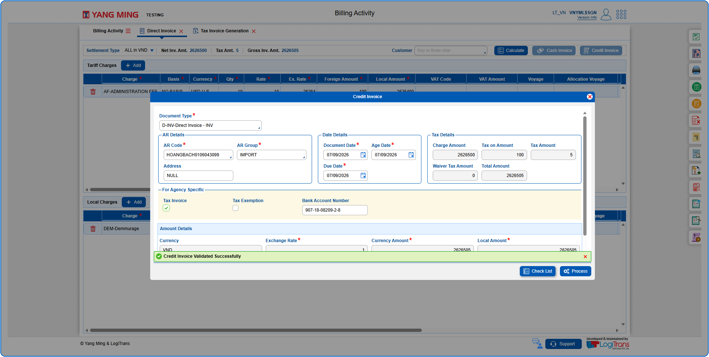
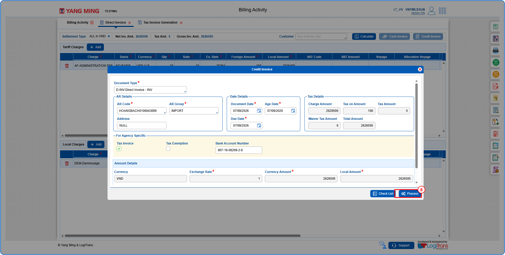
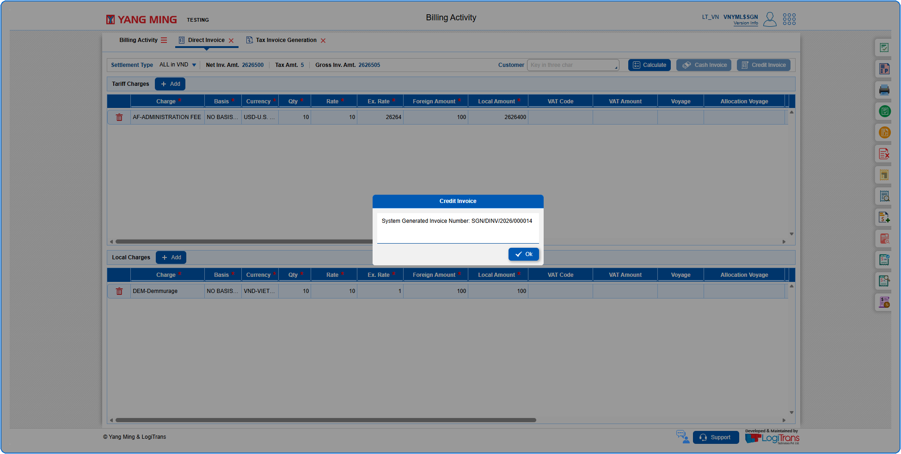
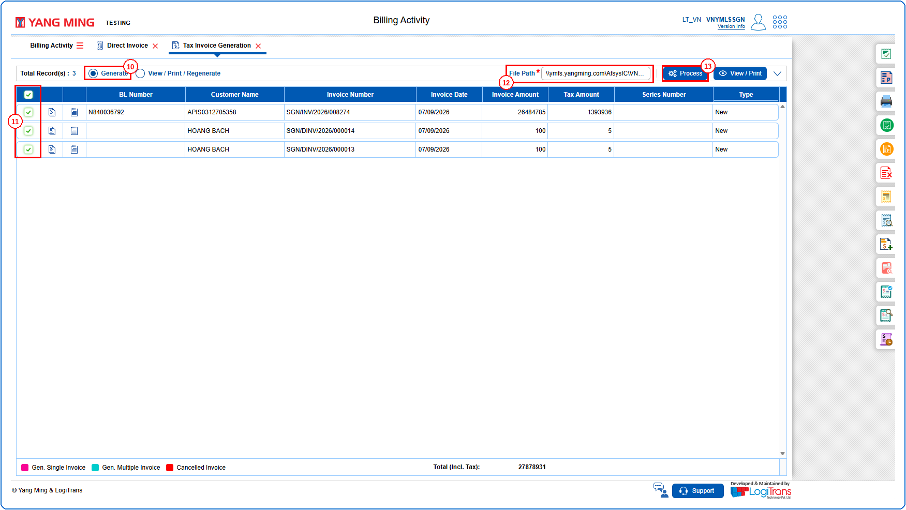
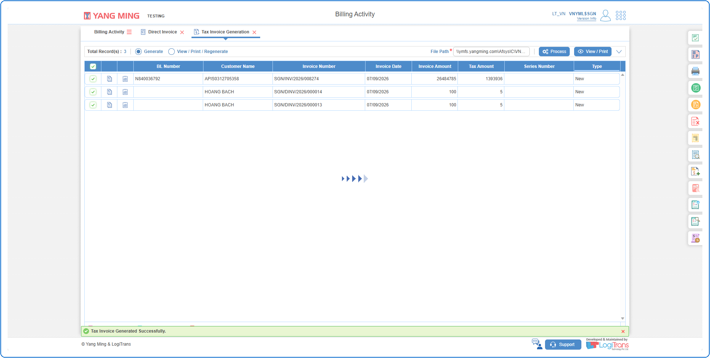

## Steps
**Step 1** : Click on the {img:../img/icon_direct_invoice.png} (Direct Invoice side icon) given on the right side of the Billing Activity screen.

**Step 2** : Upon clicking {img:../img/icon_direct_invoice.png}, User will be shown the Direct Invoice screen.
**Step 3** : Click on {img:../img/btn_add.png} and enter the required charge details in Tariff Charges and Local Charges.
**Step 4** : Click on {img:../img/btn_calculate.png}.

**Step 5** : Click on {img:../img/btn_di_credit_invoice.png}.

**Step 6** : Upon clicking {img:../img/btn_di_credit_invoice.png}, the user is shown Credit Invoice pop up screen.
**Step 7** : Enter the details as given below and click on {img:../img/btn_check_list.png}.

If successfully validated, a success message is shown as given below.

**Step 8** : Click on {img:../img/btn_process.png}.

If successfully processed, an alert with the System Generated Invoice Number is shown as given below.

**Step 9** : Upon clicking {img:../img/btn_ok_tax.png}, the user is shown the Tax Invoice Generation screen.
**Step 10** : Select the Generate option.
**Step 11** : Either select all records by clicking on {img:../img/chk_select_all.png}(select all checkbox) or select individual records by clicking on {img:../img/chk_single.png}(single select checkbox).
**Step 12** : Enter the File Path.
**Step 13** : Click on {img:../img/btn_process.png}.

If successfully processed, a success message is shown as given below.

