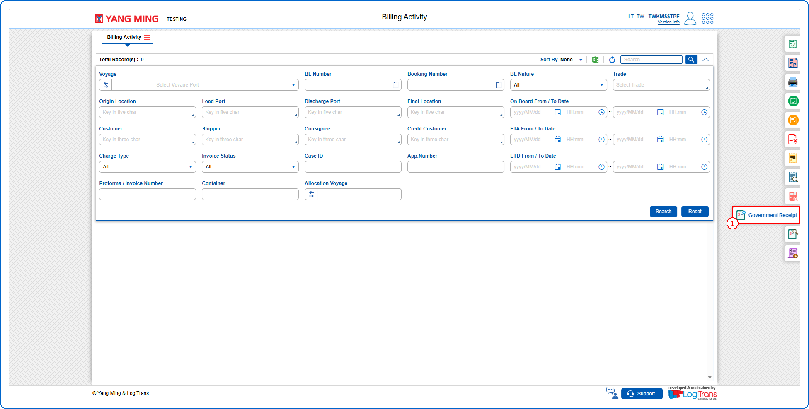
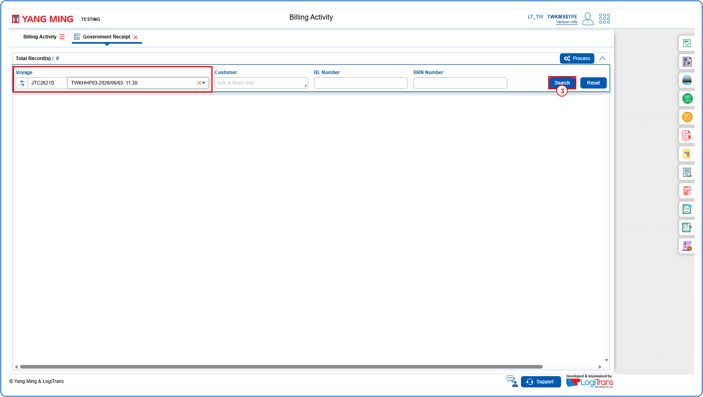
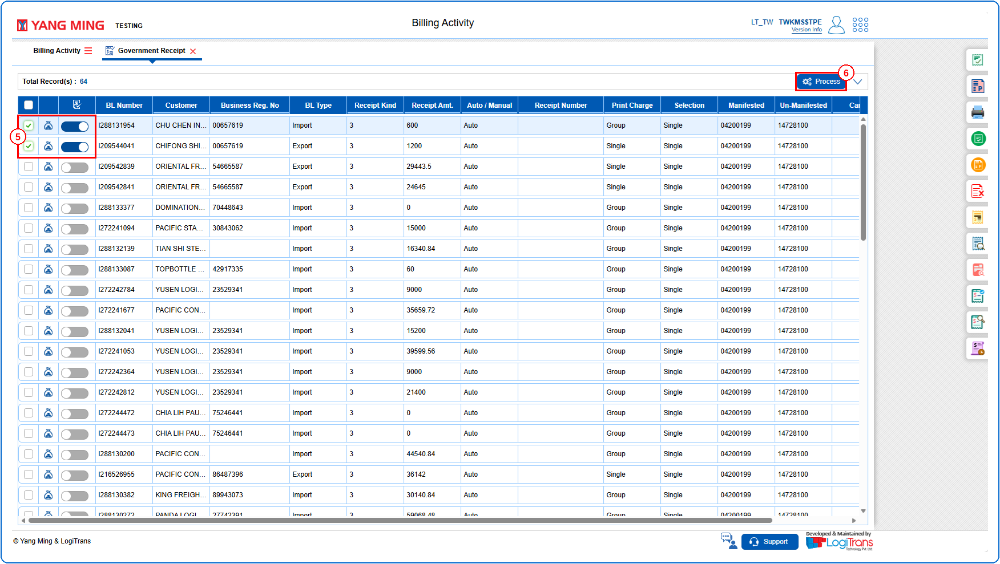
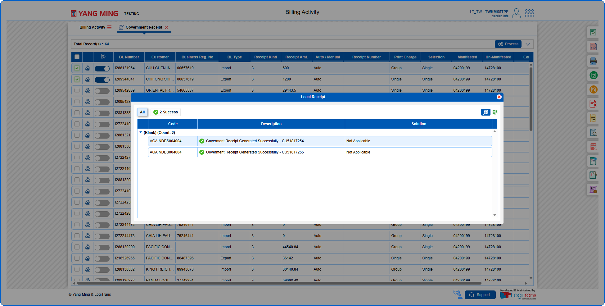
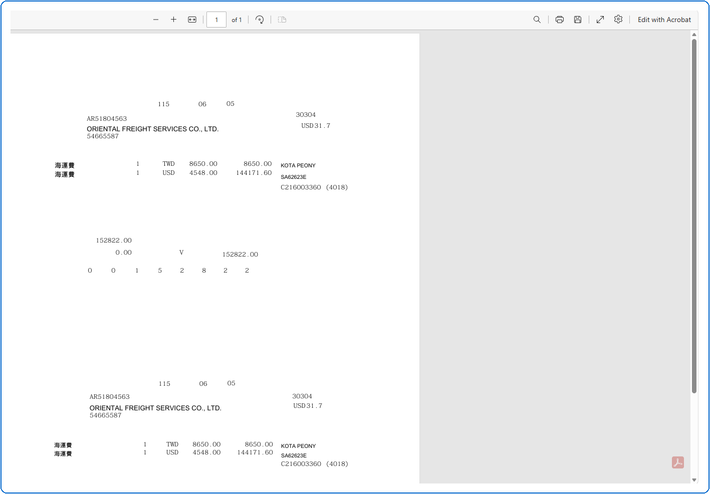

## Steps
**Step 1** : Click on the {img:../img/icon_government_receipt.png} (Government Receipt side icon) given on the right side of the Billing Activity screen.

**Step 2** : Upon clicking {img:../img/icon_government_receipt.png}, User will be shown the Government Receipt screen.
**Step 3** : Enter the Voyage and click on {img:../img/btn_search.png}.

**Step 4** : Upon clicking {img:../img/btn_search.png}, BL records with matching information are returned.
**Step 5** : Select the required BL records by clicking on {img:../img/chk_single.png}(single select checkbox) and switch on the toggle of the selected records.
**Step 6** : Click on {img:../img/btn_process_dn.png}.

If successfully generated, the Local Receipt pop up screen is shown with the success message as given below.

The Government Receipt pdf is displayed as given below.

