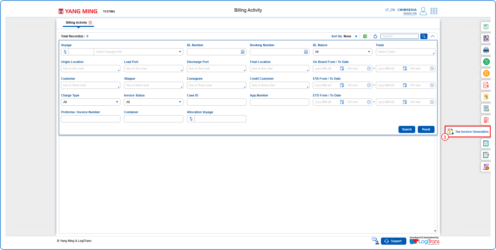
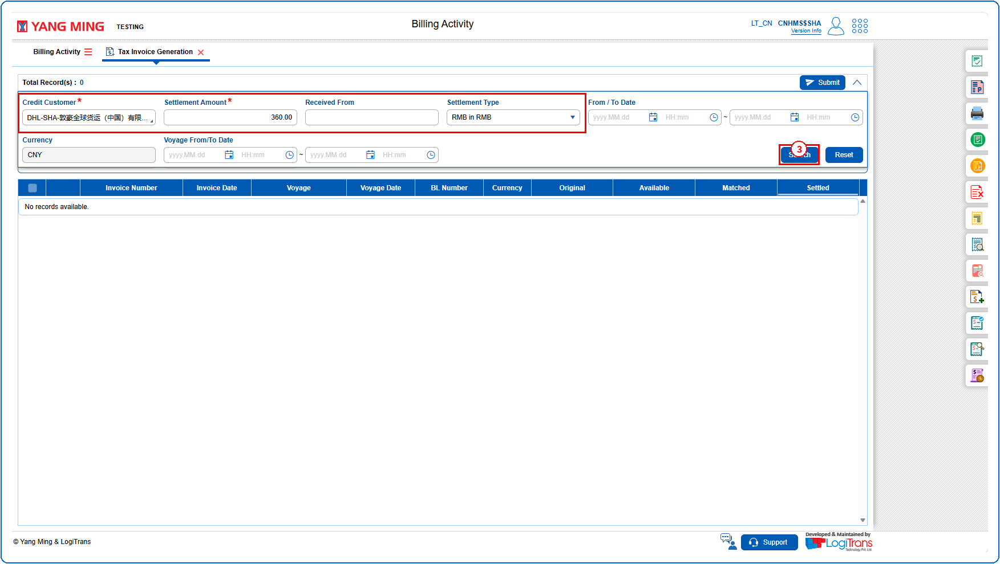
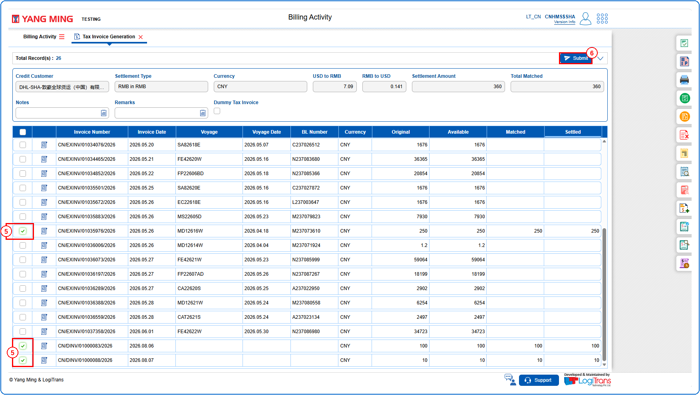
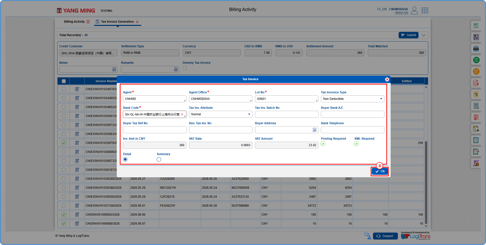
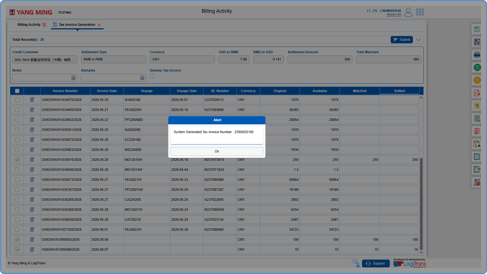
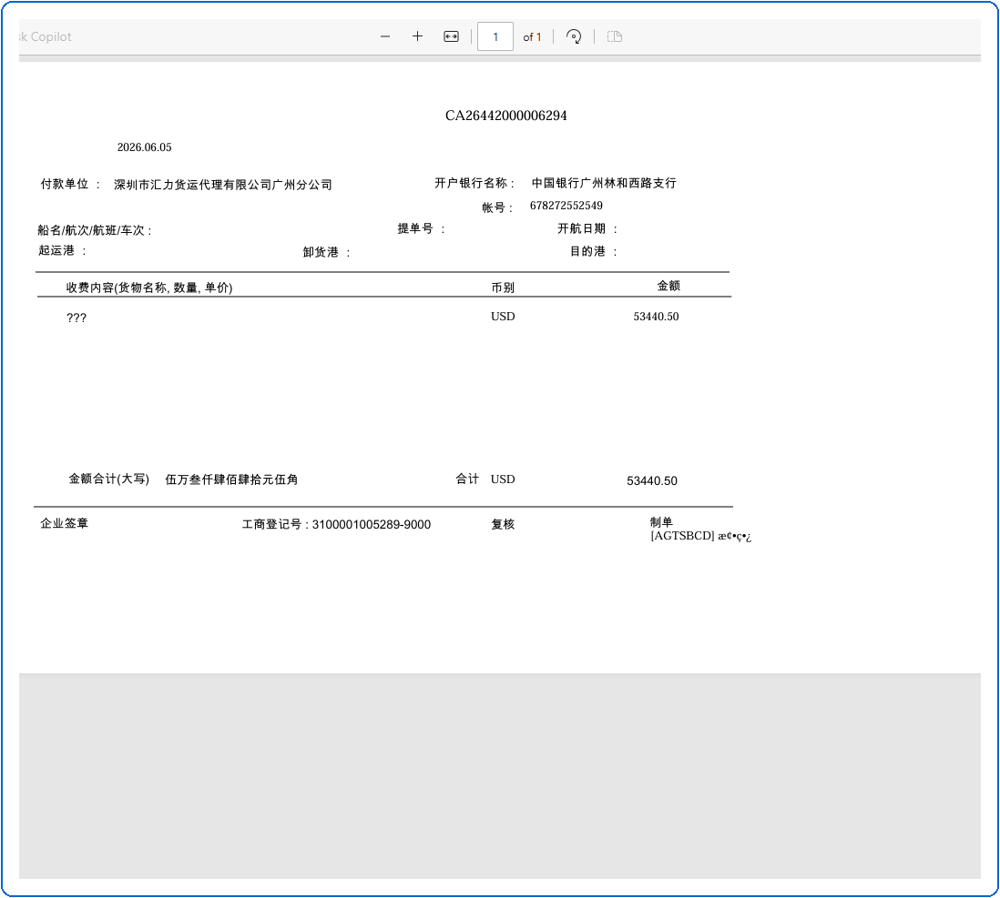

## Steps
**Step 1** : Click on the {img:../img/icon_tax_invoice_generation.png} (Tax Invoice Generation side icon) given on the right side of the Billing Activity screen.

**Step 2** : Upon clicking {img:../img/icon_tax_invoice_generation.png}, User will be shown the Tax Invoice Generation screen.
**Step 3** : Enter the Credit Customer, Settlement Amount, Received From and Settlement Type and click on {img:../img/btn_search.png}.

**Step 4** : Upon clicking {img:../img/btn_search.png}, invoices with matching information are returned.
**Step 5** : Select the required invoices by clicking on {img:../img/chk_single.png}(single select checkbox).
**Step 6** : Click on {img:../img/btn_submit.png}.

**Step 7** : Upon clicking {img:../img/btn_submit.png}, User will be shown the Tax Invoice pop up screen.
**Step 8** : Enter the details as given below and click on {img:../img/btn_ok_tax.png}.

If successfully generated, an alert with the System Generated Tax Invoice Number is shown as given below.

Upon clicking Ok, the tax invoice pdf is displayed as given below.

