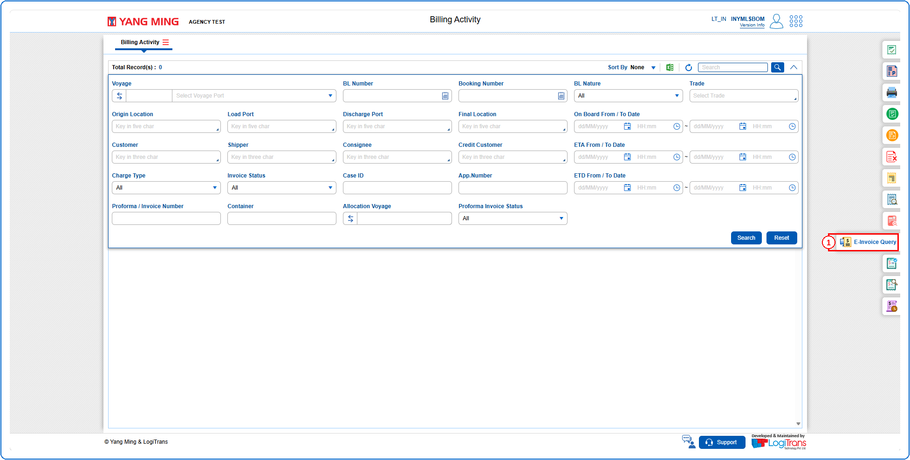
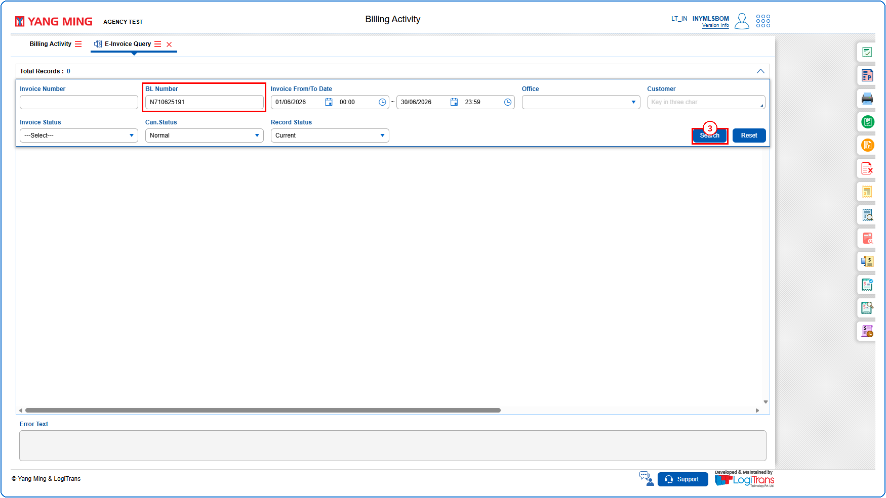
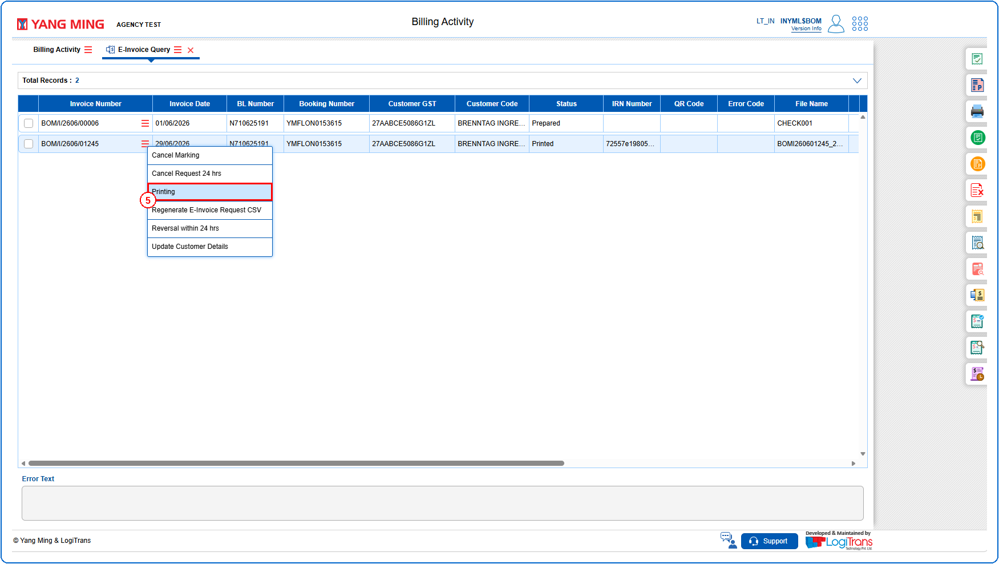
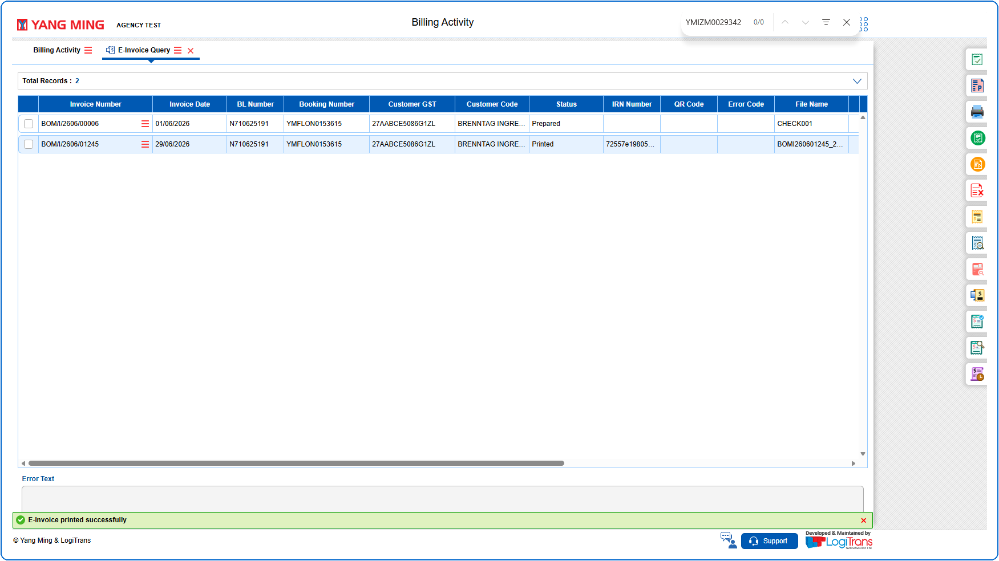

## Steps
**Step 1** : Click on the {img:../img/icon_e_invoice_query.png} (E-Invoice Query side icon) given on the right side of the Billing Activity screen.

**Step 2** : Upon clicking {img:../img/icon_e_invoice_query.png}, User will be shown the E-Invoice Query screen.
**Step 3** : Enter the BL Number and click on {img:../img/btn_search.png}.

**Step 4** : Upon clicking {img:../img/btn_search.png}, E-Invoices with matching information are returned.
**Step 5** : Click on {img:../img/icon_row_menu.png}(menu icon) of the required invoice and select "**Printing**".

If successfully printed, a success message is shown as given below.

