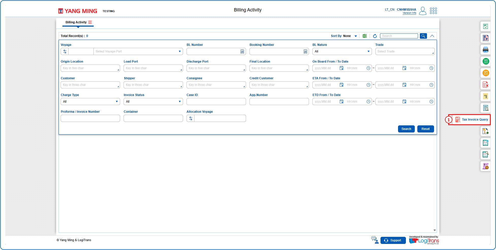
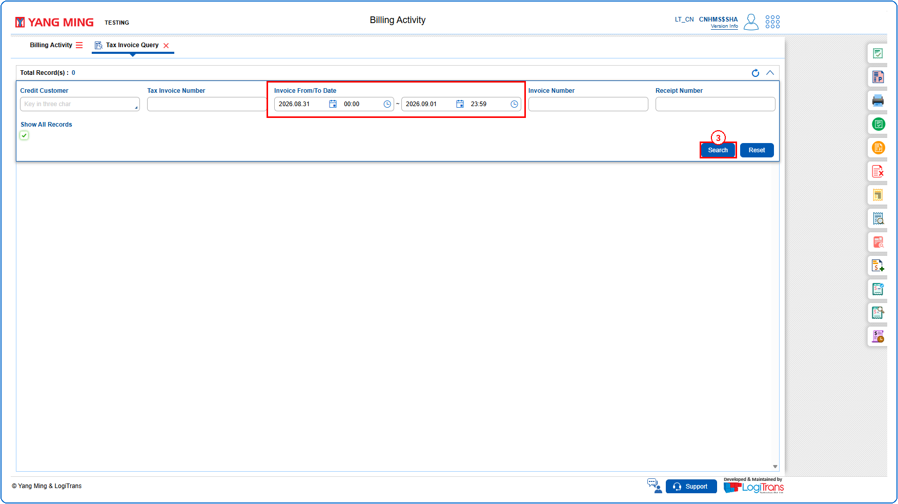
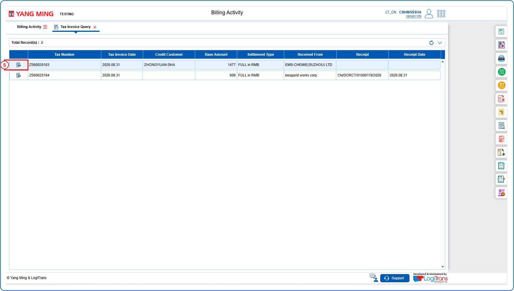
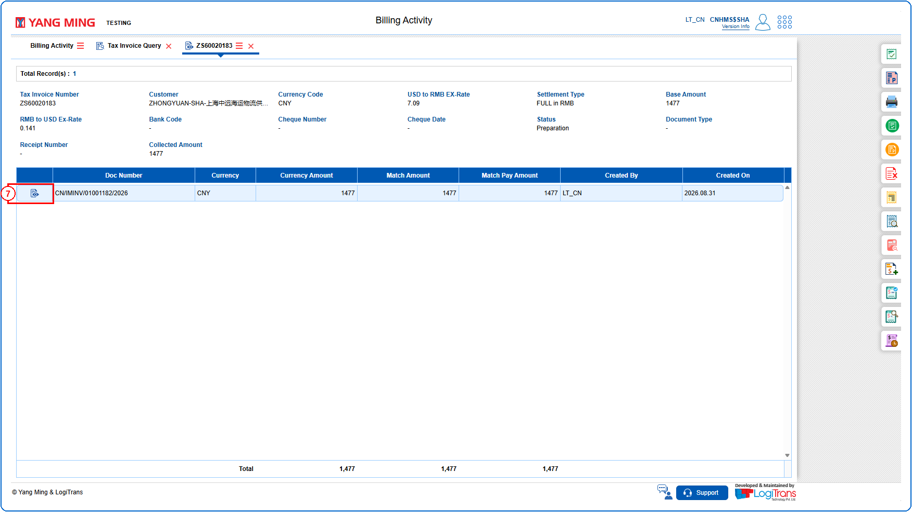
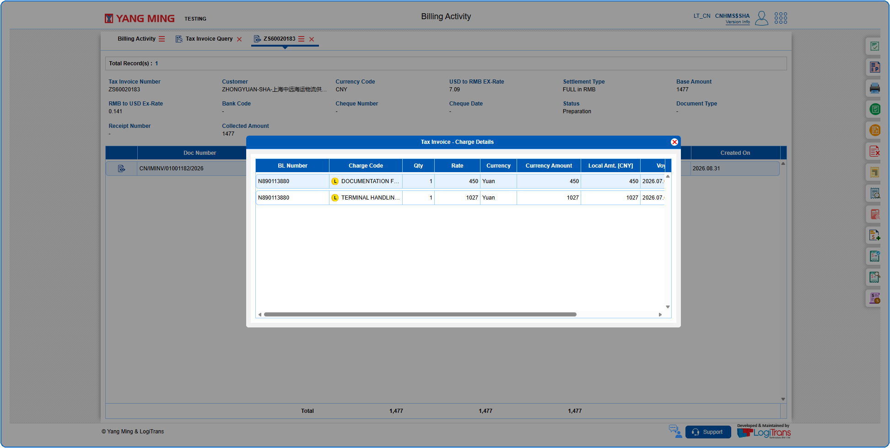

## Steps
**Step 1** : Click on the {img:../img/icon_tax_invoice_query.png} (Tax Invoice Query side icon) given on the right side of the Billing Activity screen.

**Step 2** : Upon clicking {img:../img/icon_tax_invoice_query.png}, User will be shown the Tax Invoice Query screen.
**Step 3** : Enter the Invoice From/To Date and click on {img:../img/btn_search.png}.

**Step 4** : Upon clicking {img:../img/btn_search.png}, tax invoices with matching information are returned.
**Step 5** : Click on {img:../img/icon_view_doc.png}(view icon) of the required tax invoice.

**Step 6** : Upon clicking {img:../img/icon_view_doc.png}, User will be shown the tax invoice details.
**Step 7** : Click on {img:../img/icon_view_doc.png}(view icon) of the required document to view the charge details.

Upon clicking {img:../img/icon_view_doc.png}, the Tax Invoice - Charge Details pop up is shown as given below.

