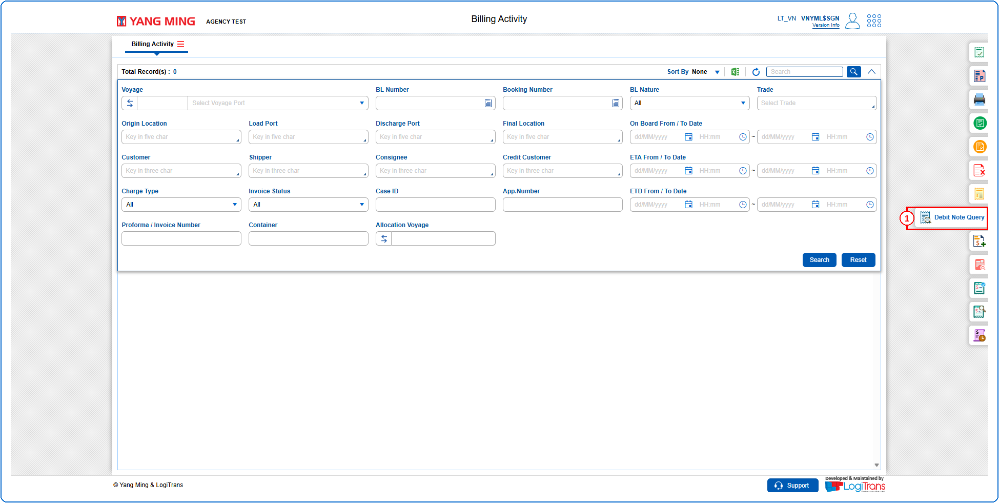
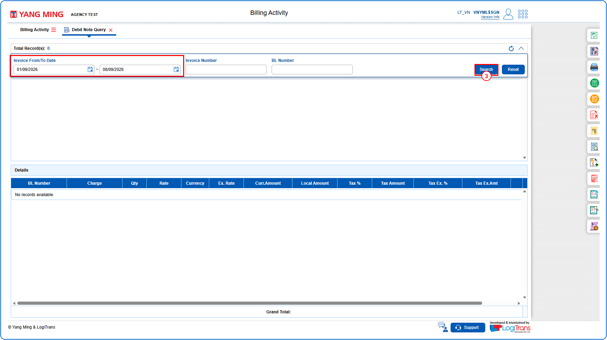
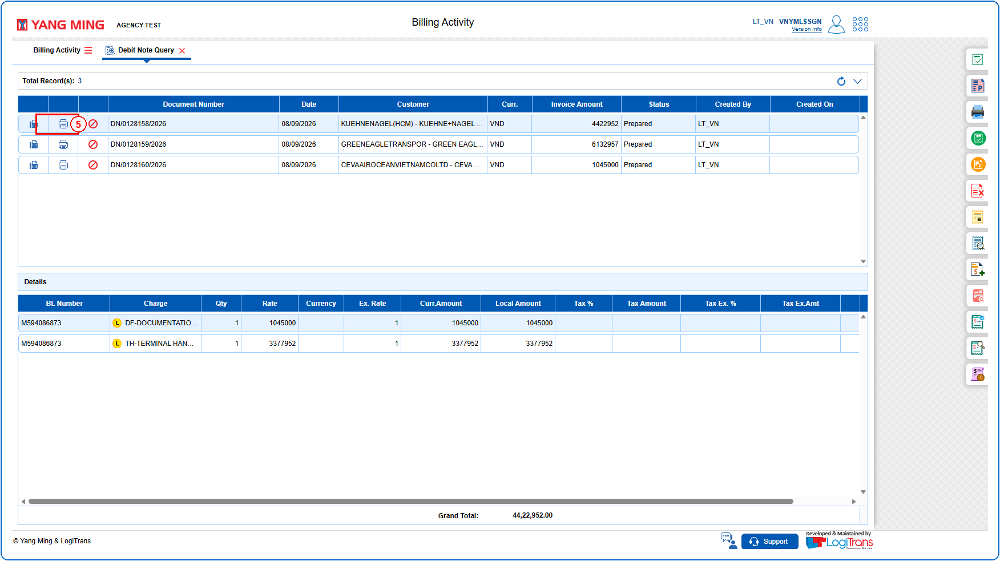
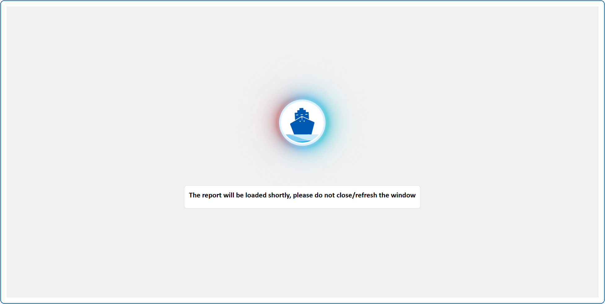
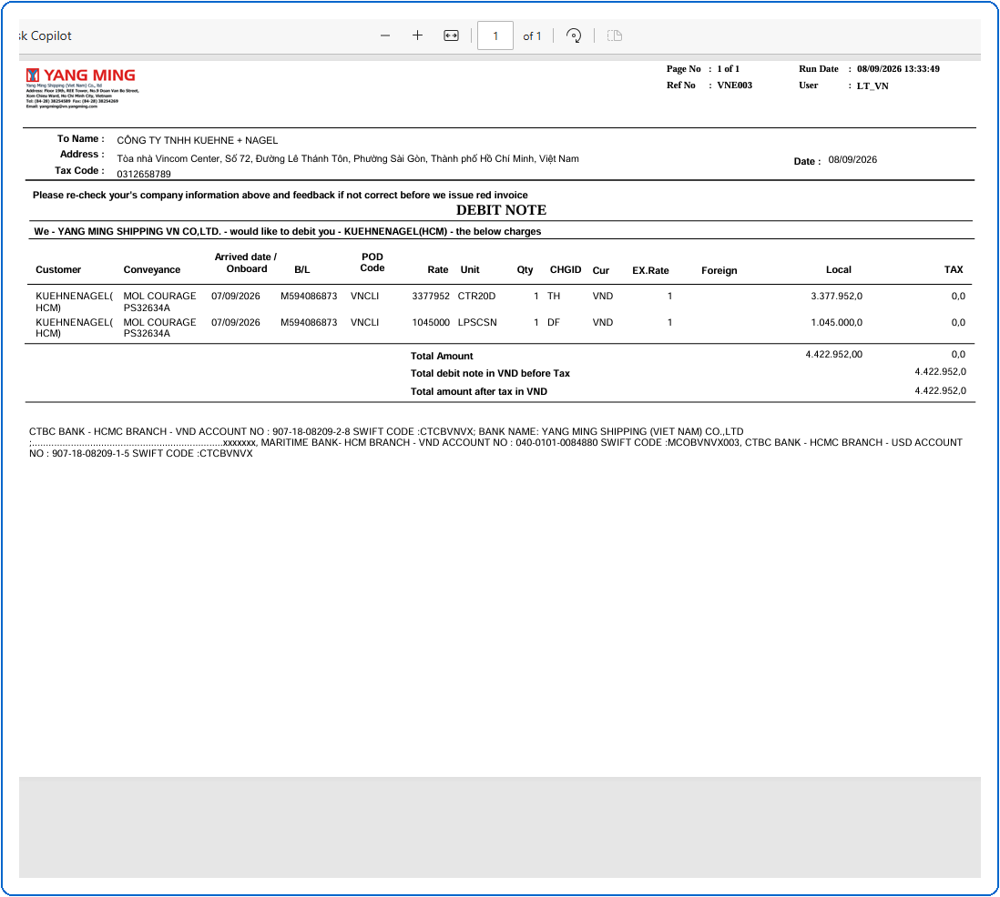

## Steps
**Step 1** : Click on the {img:../img/icon_debit_note_query.png} (Debit Note Query side icon) given on the right side of the Billing Activity screen.

**Step 2** : Upon clicking {img:../img/icon_debit_note_query.png}, User will be shown the Debit Note Query screen.
**Step 3** : Enter the Invoice From/To Date and click on {img:../img/btn_search.png}.

**Step 4** : Upon clicking {img:../img/btn_search.png}, debit notes with matching information are returned along with their details.
**Step 5** : Click on {img:../img/icon_print.png}(print icon) of the required debit note.

Upon clicking {img:../img/icon_print.png}, the report is loaded as given below.

The debit note pdf is displayed as given below.

