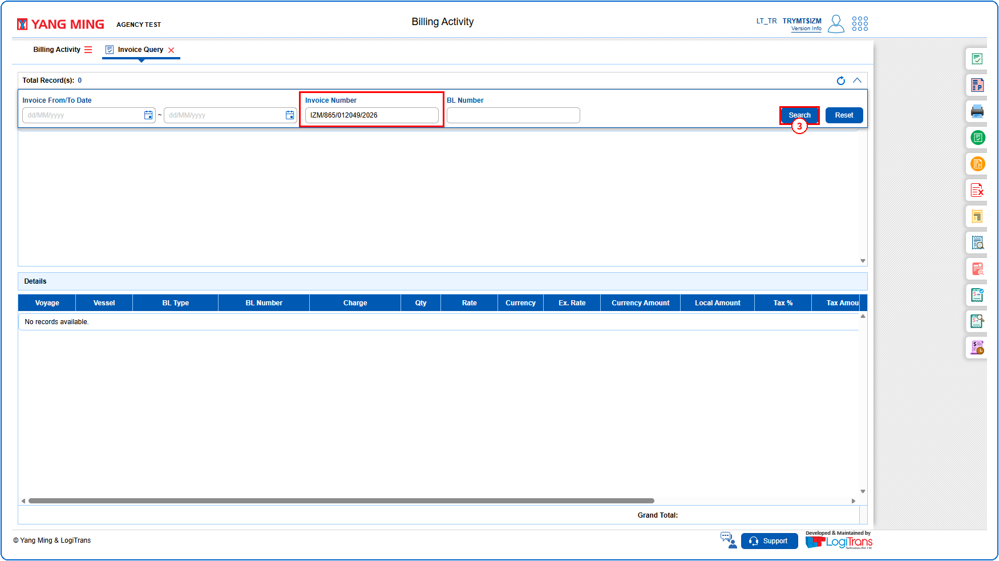
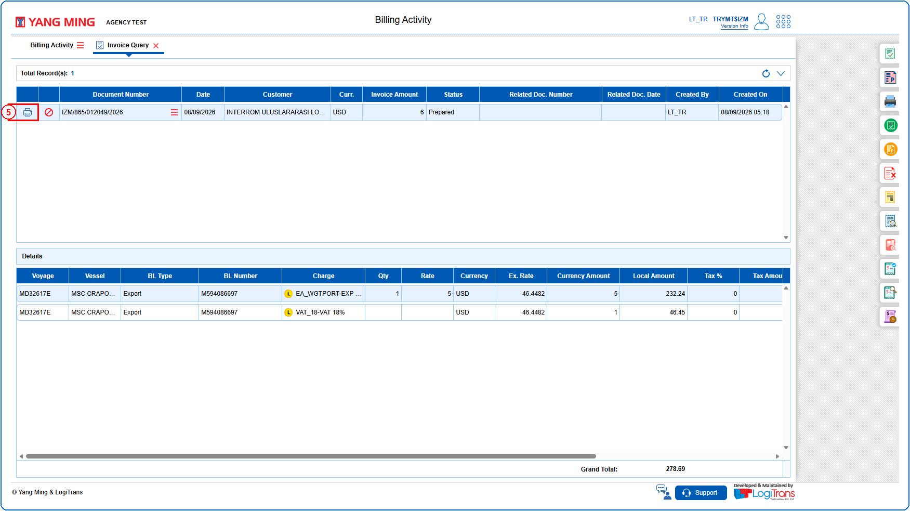
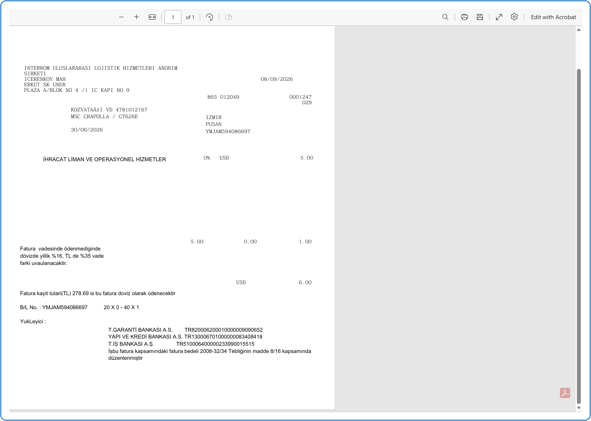

## Steps
**Step 1** : Click on the {img:../img/icon_invoice_query.png} (Invoice Query side icon) given on the right side of the Billing Activity screen.

**Step 2** : Upon clicking {img:../img/icon_invoice_query.png}, User will be shown the Invoice Query screen.
**Step 3** : Enter the Invoice Number and click on {img:../img/btn_search.png}.

**Step 4** : Upon clicking {img:../img/btn_search.png}, invoices with matching information are returned along with their details.
**Step 5** : Click on {img:../img/icon_print.png}(print icon) of the required invoice.

Upon clicking {img:../img/icon_print.png}, the invoice pdf is displayed as given below.

