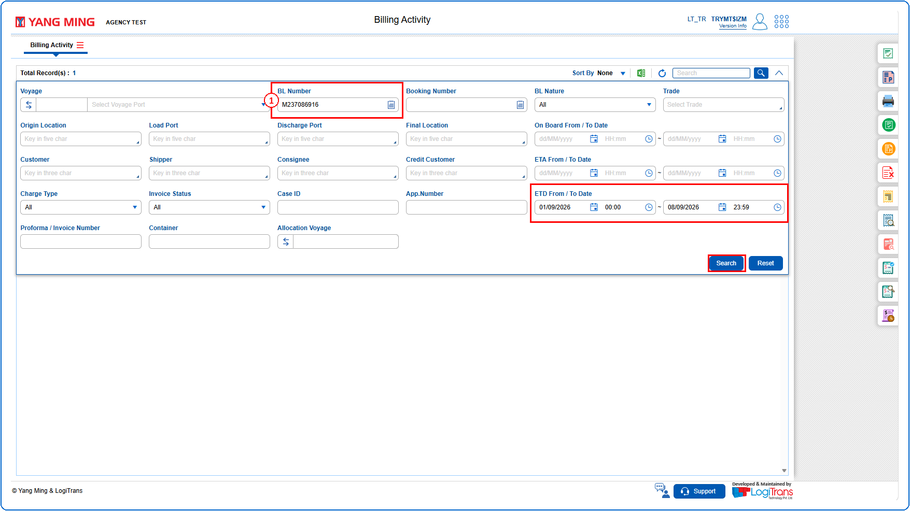
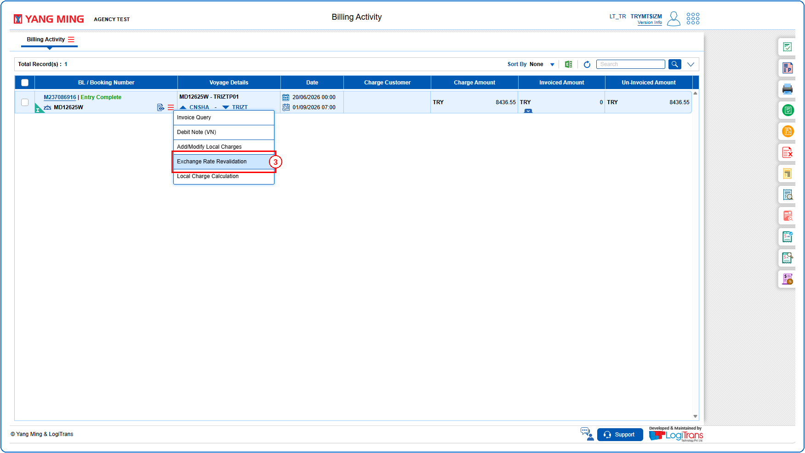
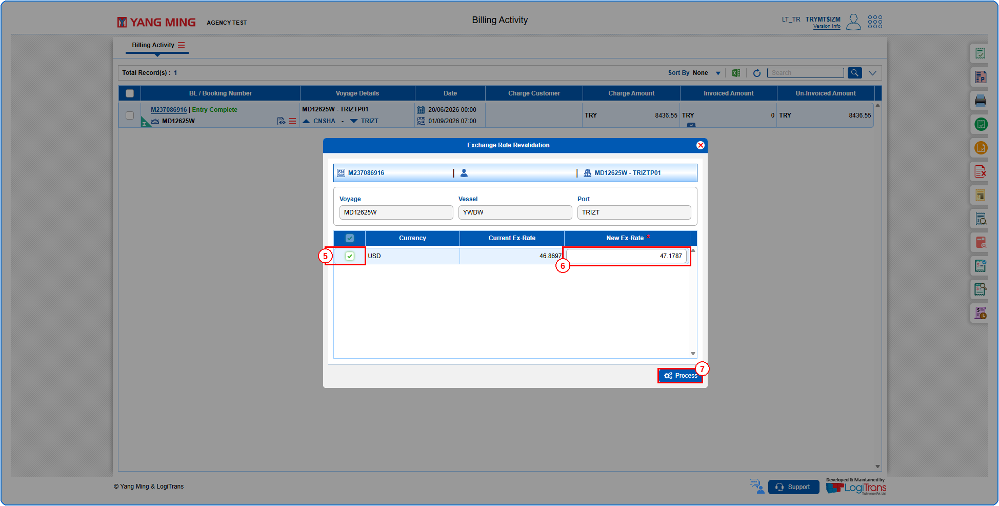
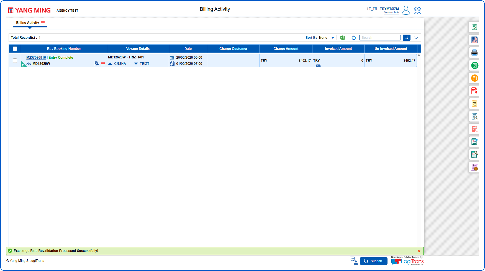

## Steps
**Step 1** : Enter the BL Number and ETD From/To Date and click on {img:../img/btn_search_q.png}.

**Step 2** : Upon clicking {img:../img/btn_search_q.png}, BL records with matching information are returned.
**Step 3** : Click on the menu icon {img:../img/icon_row_menu.png} of the required BL record and select "**Exchange Rate Revalidation**" from the menu.

**Step 4** : Upon clicking "**Exchange Rate Revalidation**", User will be shown the Exchange Rate Revalidation pop up screen.
**Step 5** : Select the required currency by clicking on {img:../img/chk_single.png}(single select checkbox).
**Step 6** : Enter the New Ex-Rate.
**Step 7** : Click on {img:../img/btn_process_err.png}.

If successfully processed, a success message is shown as given below.

