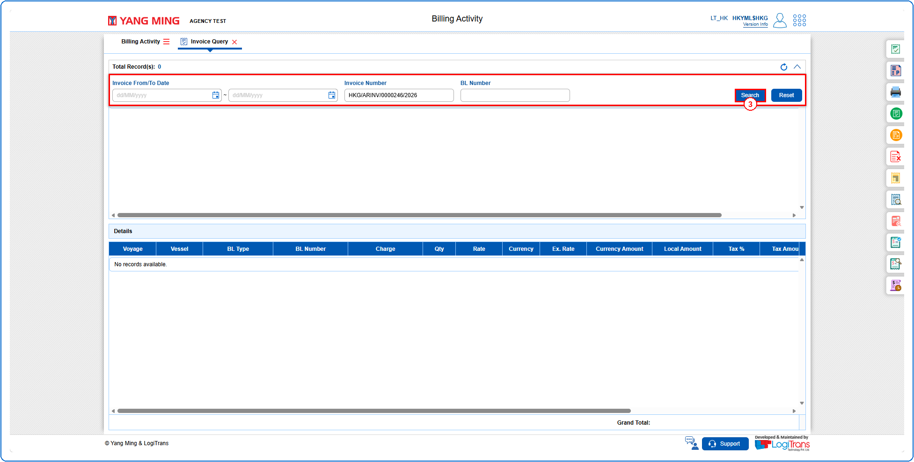
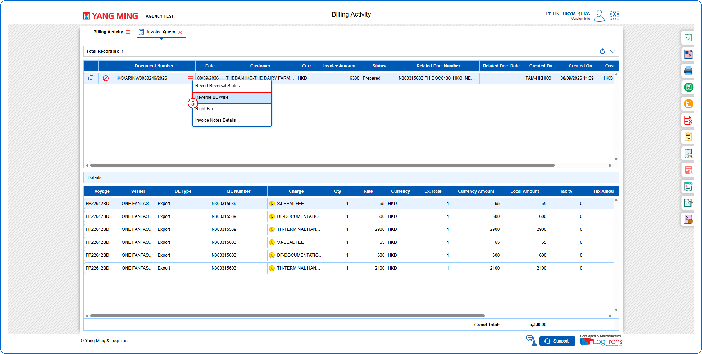
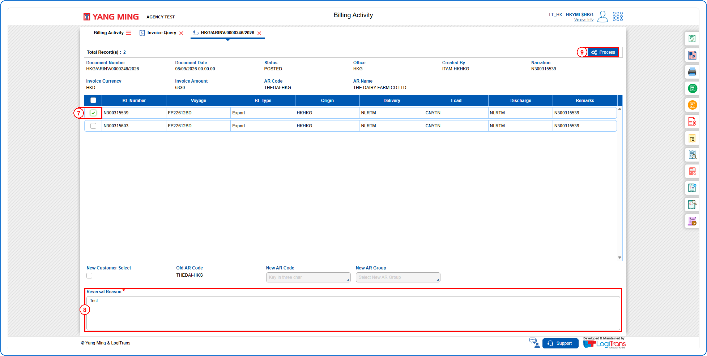
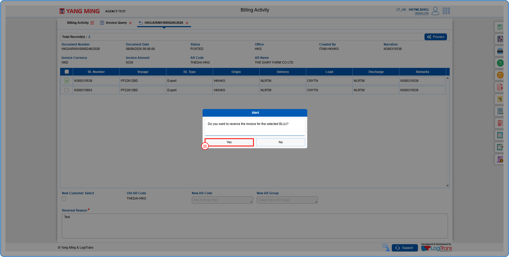
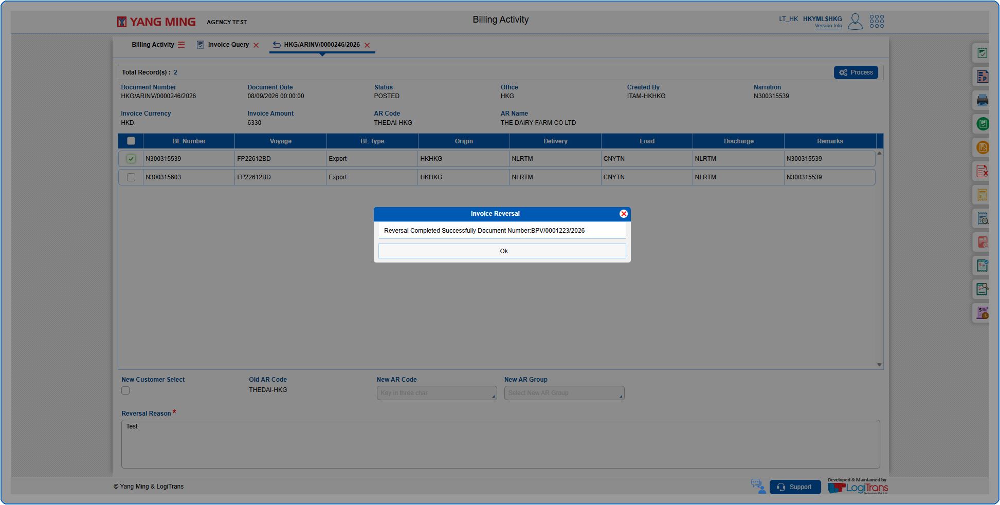

## Steps
**Step 1** : Click on the {img:../img/iq_icon_side.png} (Invoice Query side icon) given on the right side of the Billing Activity screen.

**Step 2** : Upon clicking {img:../img/iq_icon_side.png}, User will be shown the Invoice Query screen.
**Step 3** : Enter the query fields with desirable input for querying data and click on {img:../img/iq_btn_search.png}.

**Step 4** : Upon clicking {img:../img/iq_btn_search.png}, invoices with matching information are returned.
**Step 5** : The user should drag the cursor to the record menu icon {icon:record_menu} in the respective record, click on it, and then select "**Reverse BL Wise**" from the menu.

**Step 6** : Upon clicking "**Reverse BL Wise**" User will be shown the Reverse BL Wise screen.
**Step 7** : Either select all BLs available by clicking on {img:../img/iq_cb_all.png}(select all checkbox) or select individual BLs by clicking on {img:../img/iq_cb_single.png}(single select checkbox).
**Step 8** : Enter the data in "**Reversal Reason**" field. This field is mandatory.
**Step 9** : Click on {img:../img/iq_btn_process.png}.

**Step 10** : Upon clicking {img:../img/iq_btn_process.png}, the user is shown Alert pop up screen to confirm reversal of the invoice for the selected BL(s).
**Step 11** : Click on {img:../img/iq_btn_yes.png}.

If successfully processed, an alert with the System Generated Reversal Document Number is shown as given below.

