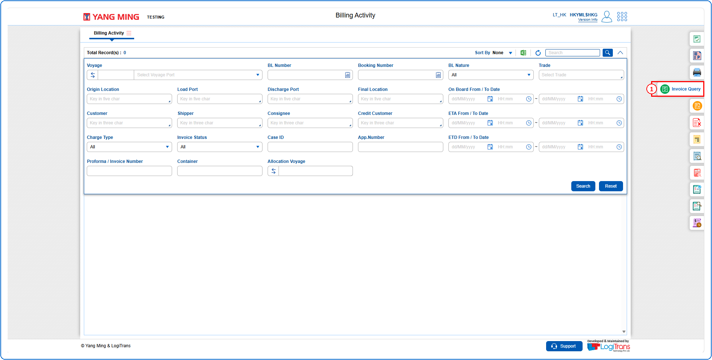
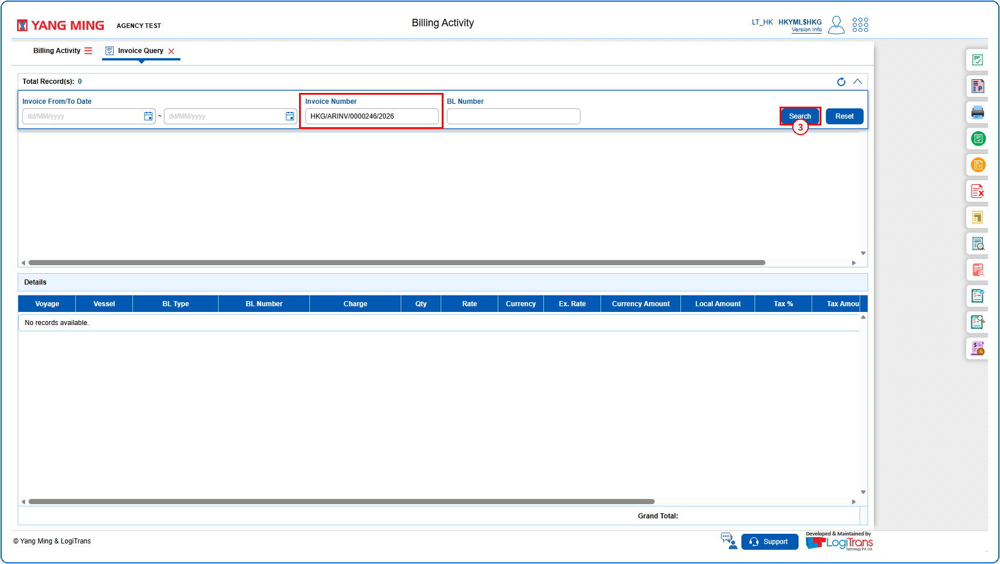
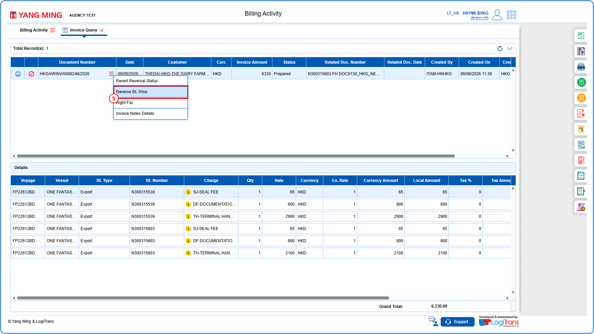
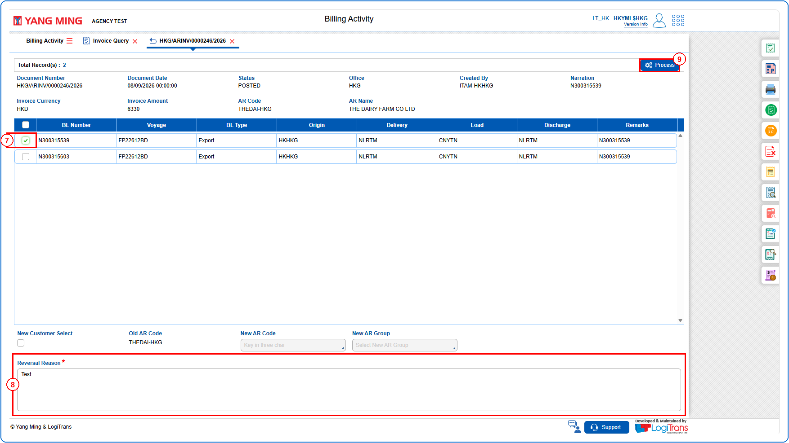
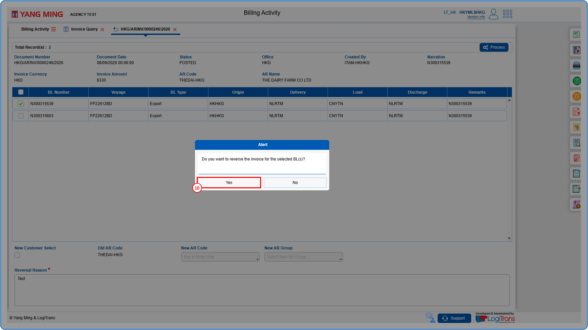
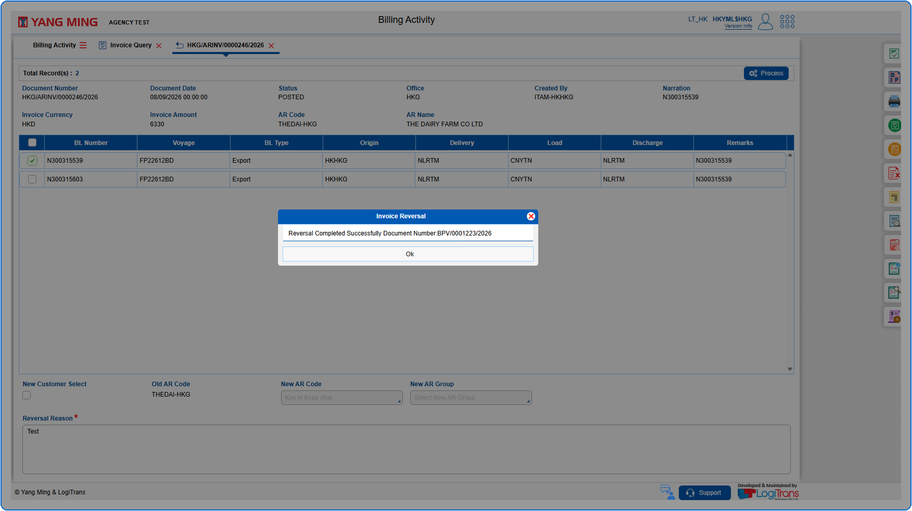

## Steps
**Step 1** : Click on the {img:../img/icon_invoice_query.png} (Invoice Query side icon) given on the right side of the Billing Activity screen.

**Step 2** : Upon clicking {img:../img/icon_invoice_query.png}, User will be shown the Invoice Query screen.
**Step 3** : Enter the Invoice Number and click on {img:../img/btn_search.png}.

**Step 4** : Upon clicking {img:../img/btn_search.png}, invoices with matching information are returned along with their details.
**Step 5** : Click on {img:../img/icon_row_menu.png}(menu icon) of the required invoice and select "**Reverse BL Wise**".

**Step 6** : Upon clicking "**Reverse BL Wise**", User will be shown the invoice BL details screen.
**Step 7** : Select the required BL Number by clicking on {img:../img/chk_single.png}(single select checkbox).
**Step 8** : Enter the Reversal Reason.
**Step 9** : Click on {img:../img/btn_process.png}.

**Step 10** : Upon clicking {img:../img/btn_process.png}, an alert is shown. Click on {img:../img/btn_yes.png}.

If successfully reversed, an alert with the Reversal Document Number is shown as given below.

