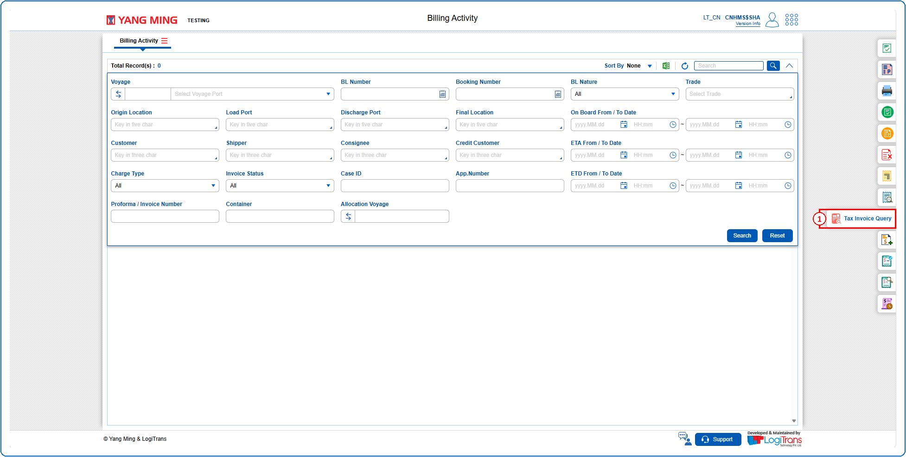
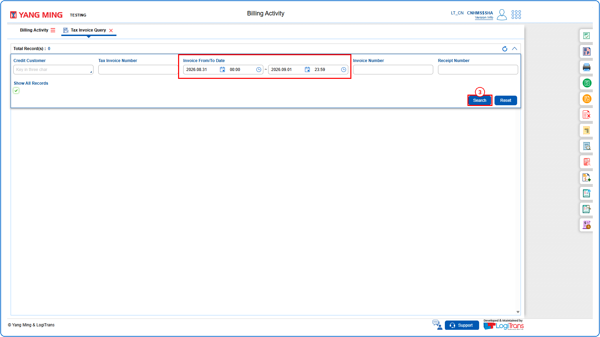
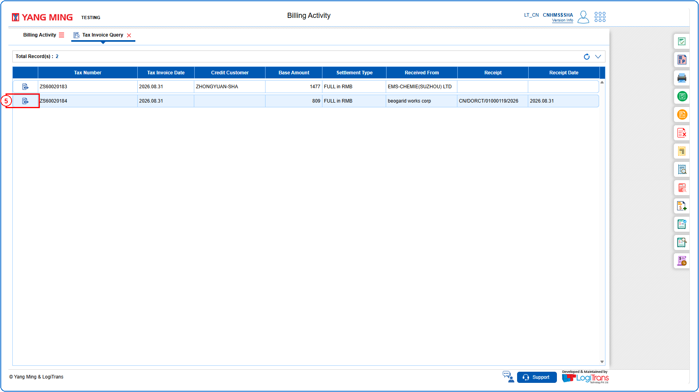
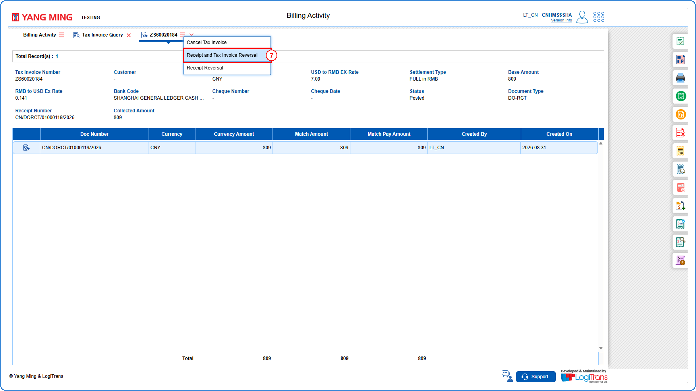
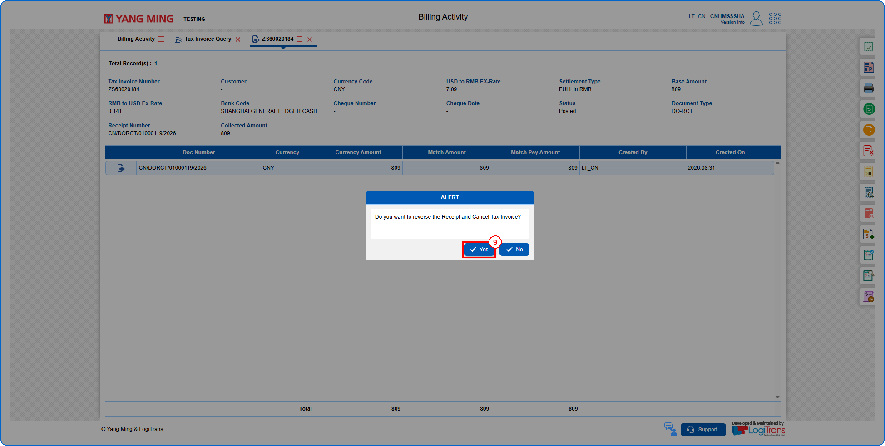
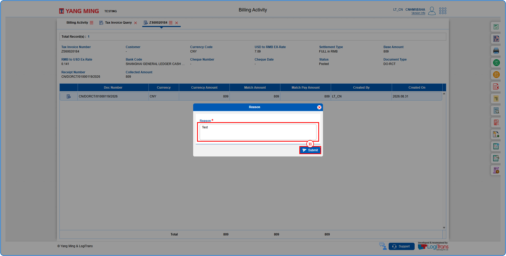
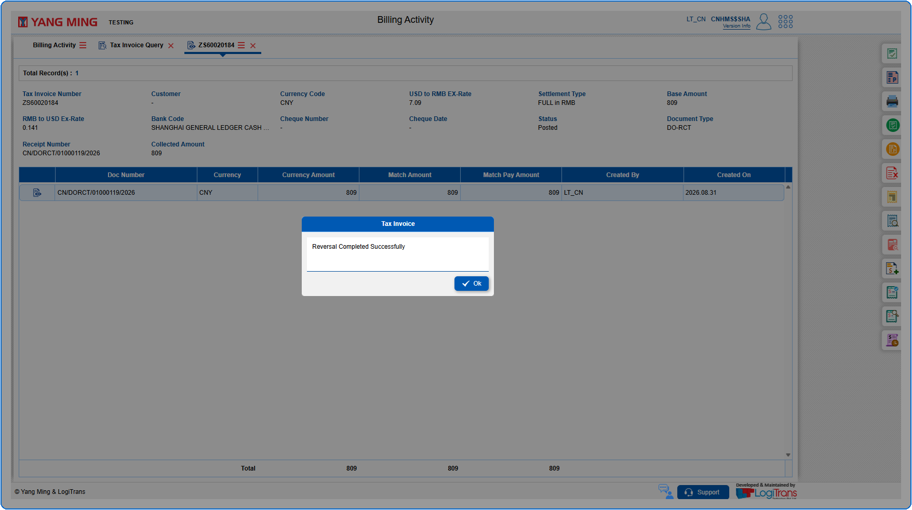

## Steps
**Step 1** : Click on the {img:../img/icon_tax_invoice_query.png} (Tax Invoice Query side icon) given on the right side of the Billing Activity screen.

**Step 2** : Upon clicking {img:../img/icon_tax_invoice_query.png}, User will be shown the Tax Invoice Query screen.
**Step 3** : Enter the Invoice From/To Date and click on {img:../img/btn_search.png}.

**Step 4** : Upon clicking {img:../img/btn_search.png}, tax invoices with matching information are returned.
**Step 5** : Click on {img:../img/icon_view_doc.png}(view icon) of the required tax invoice.

**Step 6** : Upon clicking {img:../img/icon_view_doc.png}, User will be shown the tax invoice details.
**Step 7** : The user should click on the menu icon {icon:batch_menu} of the tax invoice tab and select "**Receipt and Tax Invoice Reversal**" from the menu.

**Step 8** : Upon clicking "**Receipt and Tax Invoice Reversal**", User will be shown an alert to confirm.
**Step 9** : Click on {img:../img/btn_yes_alert.png}.

**Step 10** : Upon clicking {img:../img/btn_yes_alert.png}, User will be shown the Reason pop up screen.
**Step 11** : Enter the Reason and click on {img:../img/btn_submit_reason.png}.

If successfully reversed, an alert is shown as given below.

