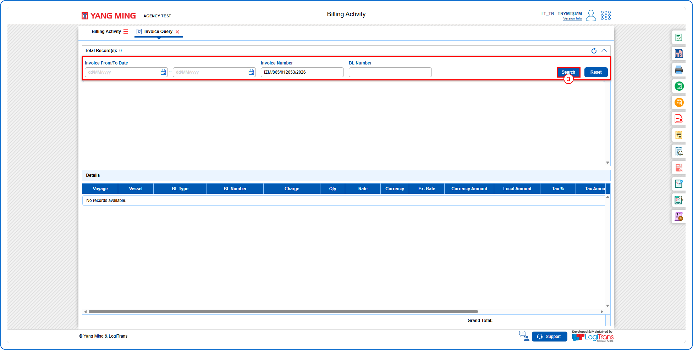
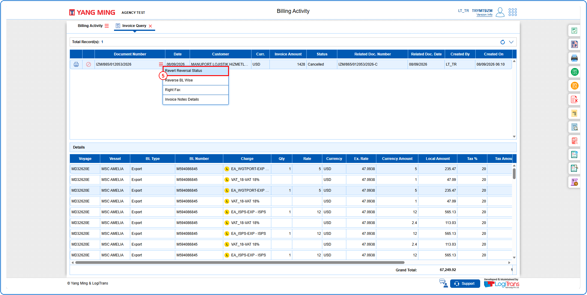
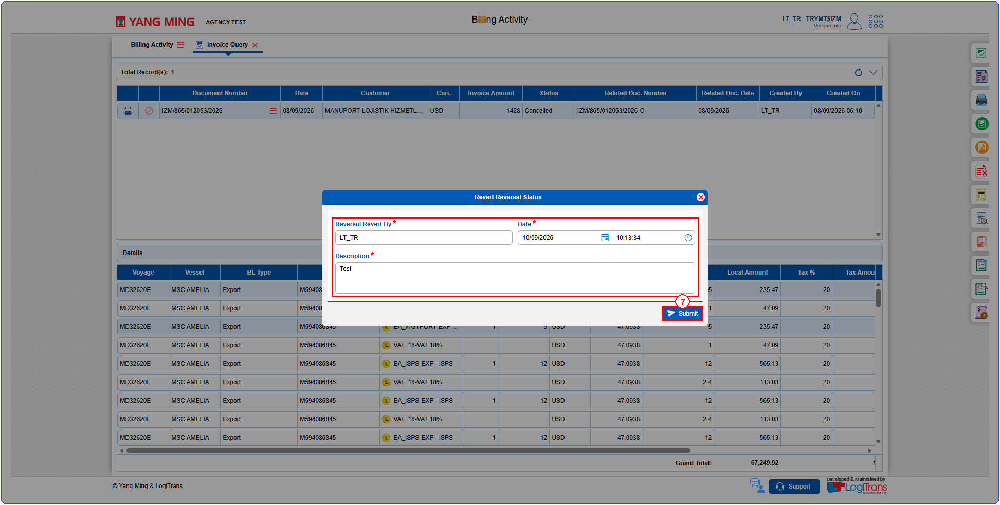
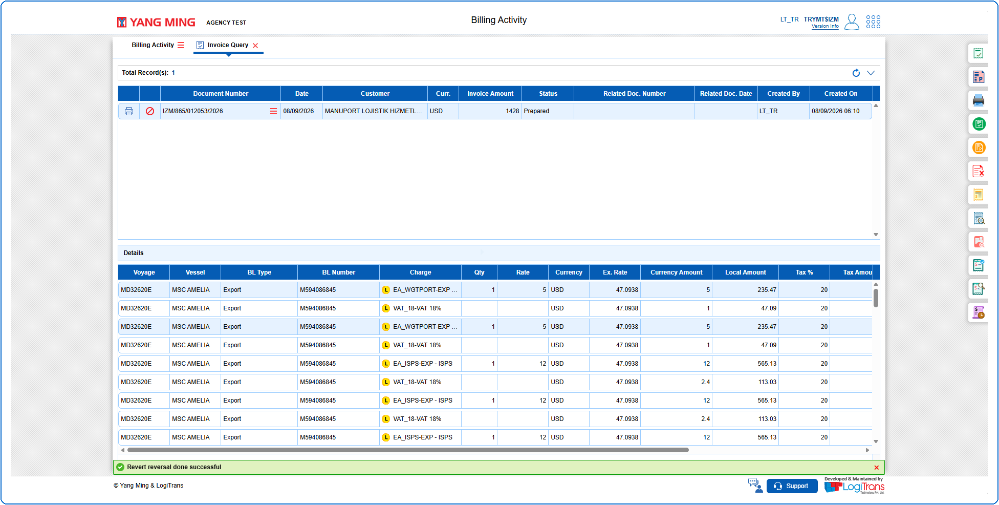

## Steps
**Step 1** : Click on the {img:../img/iq_icon_side.png} (Invoice Query side icon) given on the right side of the Billing Activity screen.

**Step 2** : Upon clicking {img:../img/iq_icon_side.png}, User will be shown the Invoice Query screen.
**Step 3** : Enter the query fields with desirable input for querying data and click on {img:../img/iq_btn_search.png}.

**Step 4** : Upon clicking {img:../img/iq_btn_search.png}, invoices with matching information are returned.
**Step 5** : The user should drag the cursor to the record menu icon {icon:record_menu} in the respective record, click on it, and then select "**Revert Reversal Status**" from the menu.

**Step 6** : Upon clicking "**Revert Reversal Status**" the user is shown Revert Reversal Status pop up screen.
**Step 7** : Enter the details as given below and click on {img:../img/iq_btn_submit_popup.png}.

If successfully submitted, a success message is shown as given below and the "**Status**" is changed to "**Prepared**".

