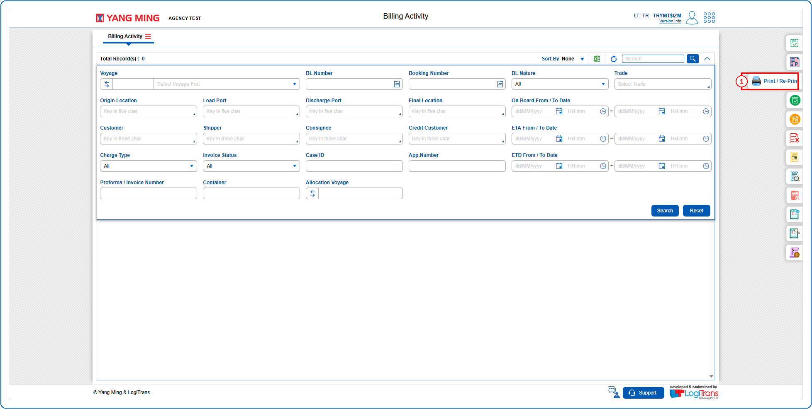
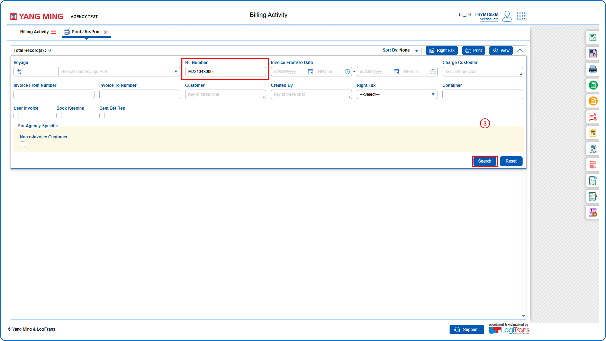
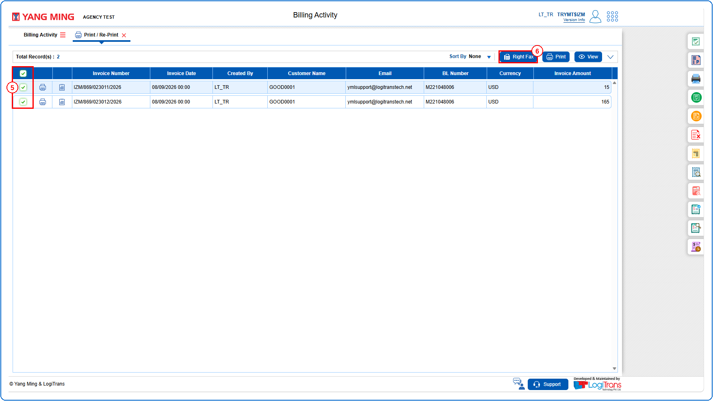
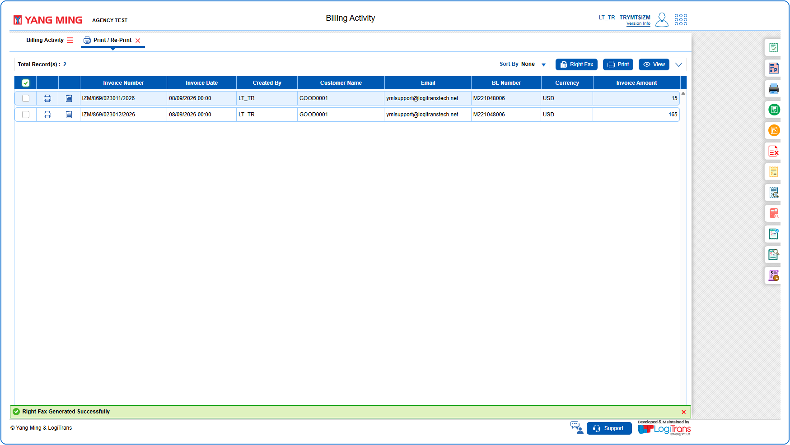

## Steps
**Step 1** : Click on the {img:../img/icon_print_reprint.png} (Print/Re-Print side icon) given on the right side of the Billing Activity screen.

**Step 2** : Upon clicking {img:../img/icon_print_reprint.png}, User will be shown the Print/Re-Print screen.
**Step 3** : Enter the BL Number and click on {img:../img/btn_search.png}.

**Step 4** : Upon clicking {img:../img/btn_search.png}, invoices with matching information are returned.
**Step 5** : Either select all invoices available by clicking on {img:../img/chk_select_all.png}(select all checkbox) or select individual invoices by clicking on {img:../img/chk_single.png}(single select checkbox).
**Step 6** : Click on {img:../img/btn_right_fax.png}.

If successfully generated, a success message is shown as given below.

