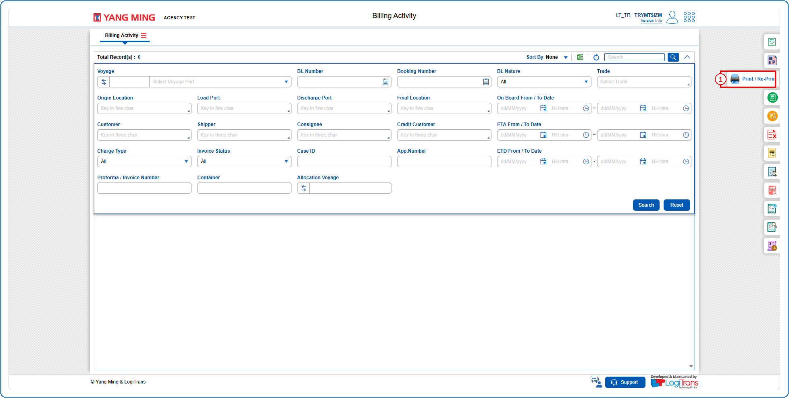
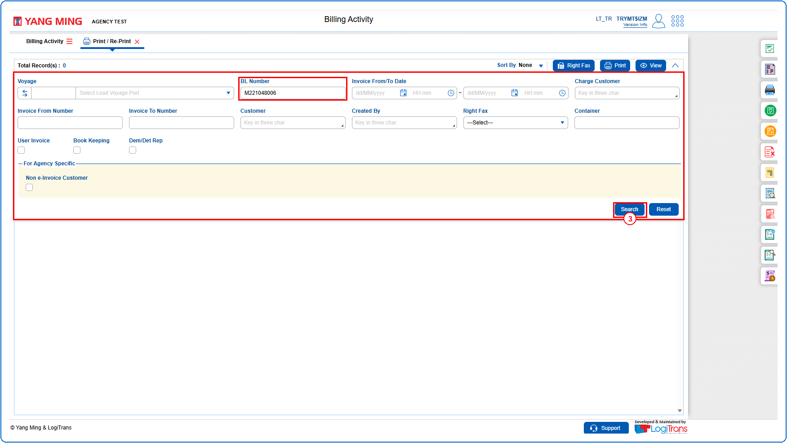
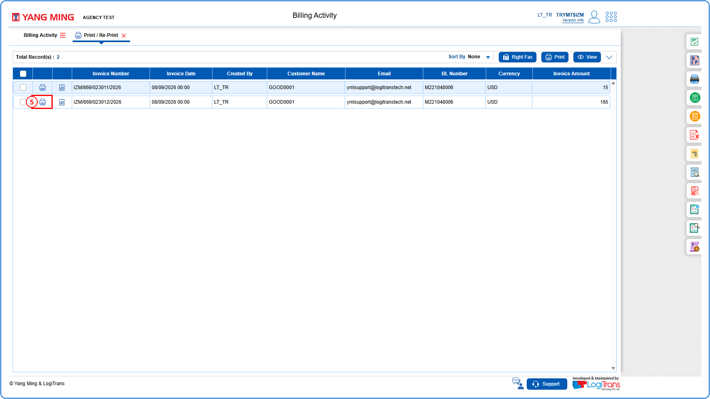
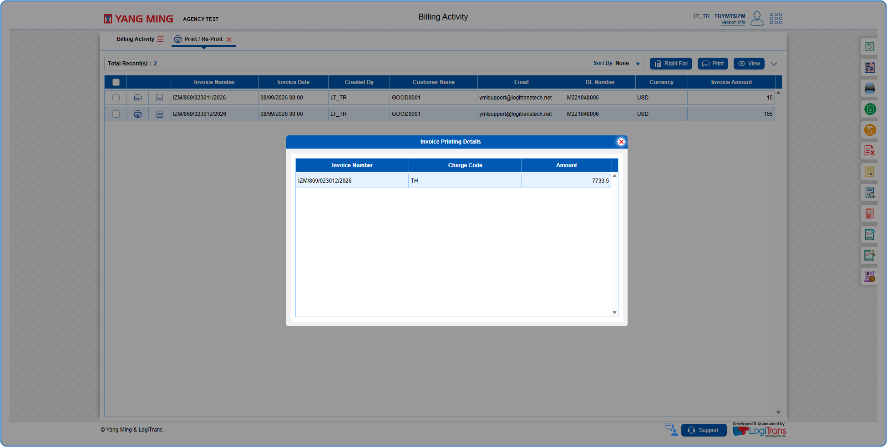

## Steps
**Step 1** : Click on the {img:../img/icon_print_reprint.png} (Print/Re-Print side icon) given on the right side of the Billing Activity screen.

**Step 2** : Upon clicking {img:../img/icon_print_reprint.png}, User will be shown the Print/Re-Print screen.
**Step 3** : Enter the BL Number and click on {img:../img/btn_search.png}.

**Step 4** : Upon clicking {img:../img/btn_search.png}, invoices with matching information are returned.
**Step 5** : Click on {img:../img/icon_printing_details.png}(invoice printing details icon) of the required invoice.

Upon clicking {img:../img/icon_printing_details.png}, the Invoice Printing Details pop up screen is shown as given below.

