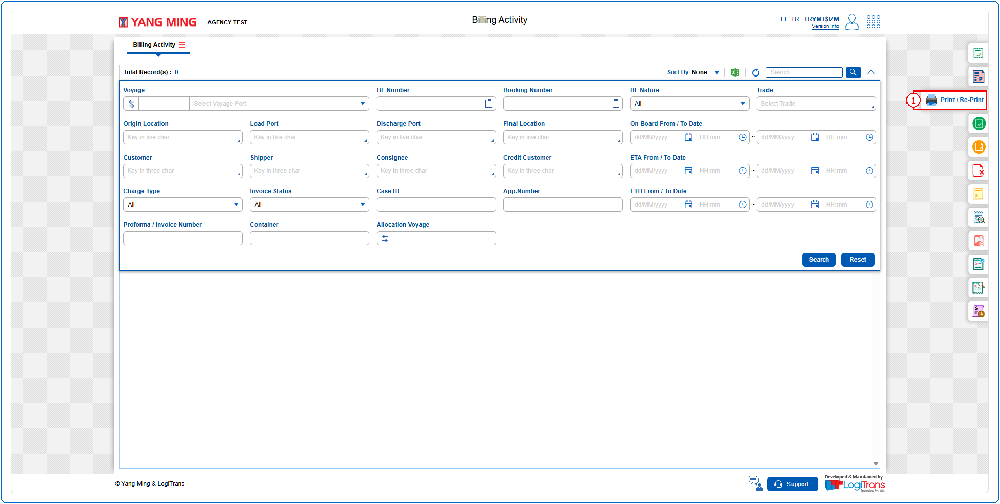
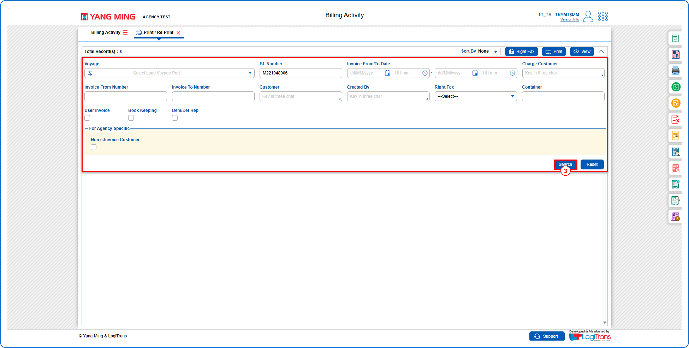
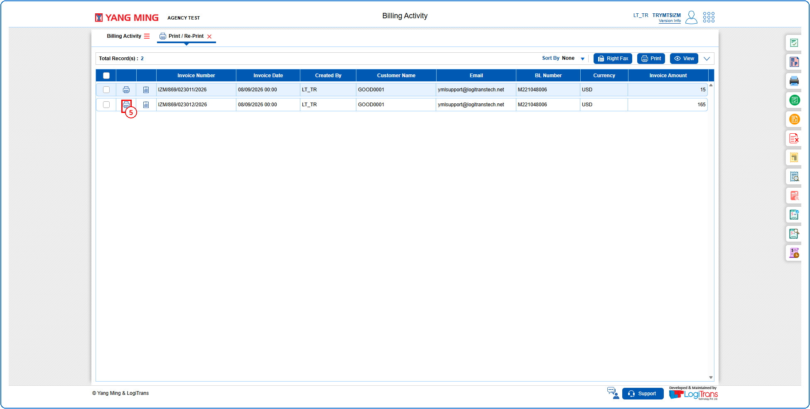
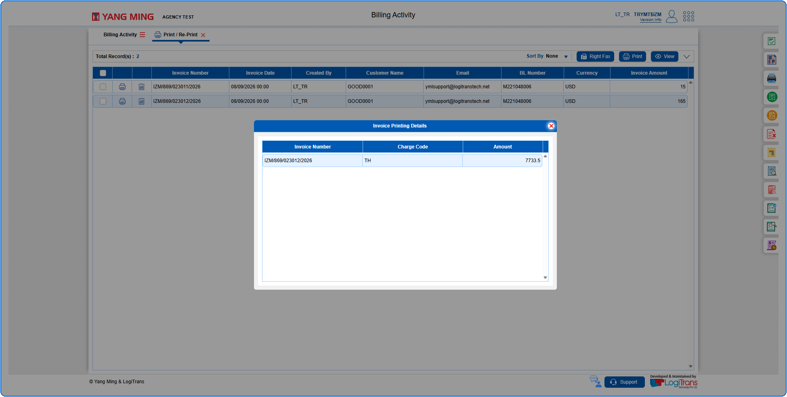

## Steps
**Step 1** : Click on the {img:../img/pr_icon_side.png} (Print / Re-Print side icon) given on the right side of the Billing Activity screen.

**Step 2** : Upon clicking {img:../img/pr_icon_side.png}, User will be shown the Print / Re-Print screen.
**Step 3** : Enter the query fields with desirable input for querying data and click on {img:../img/pr_btn_search.png}.

**Step 4** : Upon clicking {img:../img/pr_btn_search.png}, invoices with matching information are returned.
**Step 5** : Click on {img:../img/pr_icon_print.png} in the respective record.

**Step 6** : Upon clicking {img:../img/pr_icon_print.png}, the user is shown Invoice Printing Details pop up screen as given below.

