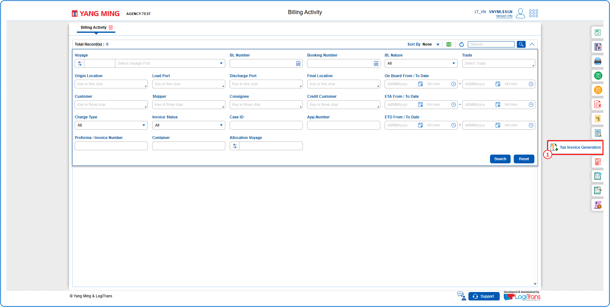
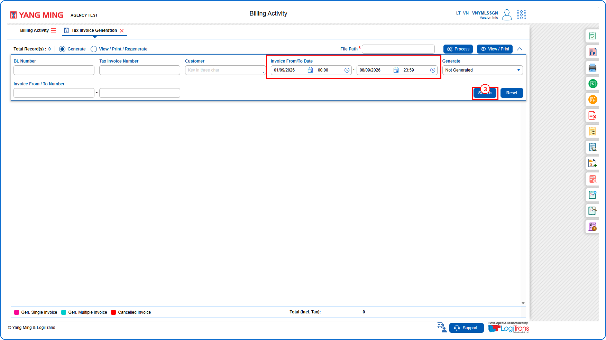
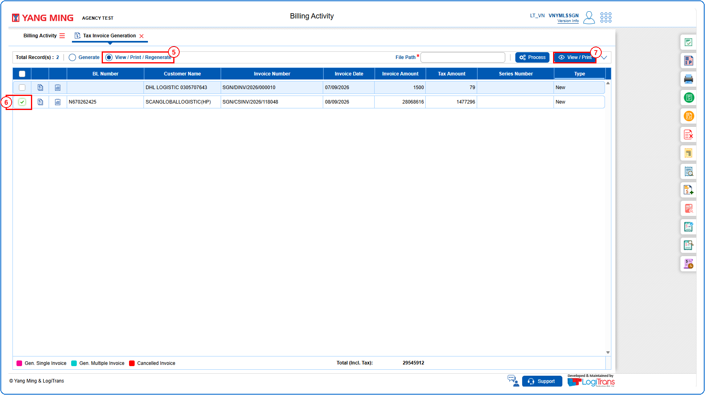
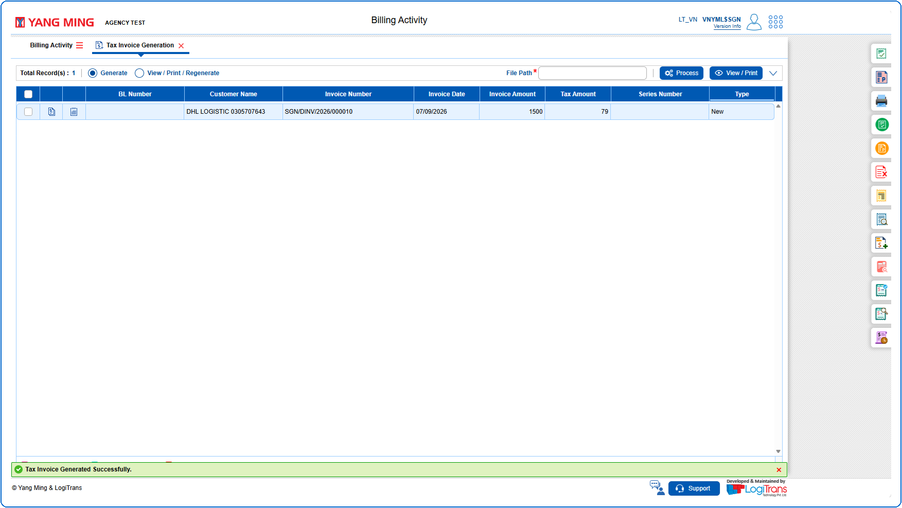

## Steps
**Step 1** : Click on the {img:../img/icon_tax_invoice_generation.png} (Tax Invoice Generation side icon) given on the right side of the Billing Activity screen.

**Step 2** : Upon clicking {img:../img/icon_tax_invoice_generation.png}, User will be shown the Tax Invoice Generation screen.
**Step 3** : Enter the Invoice From/To Date and click on {img:../img/btn_search.png}.

**Step 4** : Upon clicking {img:../img/btn_search.png}, invoices with matching information are returned.
**Step 5** : Select the View / Print / Regenerate option.
**Step 6** : Either select all records by clicking on {img:../img/chk_select_all.png}(select all checkbox) or select individual records by clicking on {img:../img/chk_single.png}(single select checkbox).
**Step 7** : Click on {img:../img/btn_view_print.png}.

If successfully processed, a success message is shown as given below.

