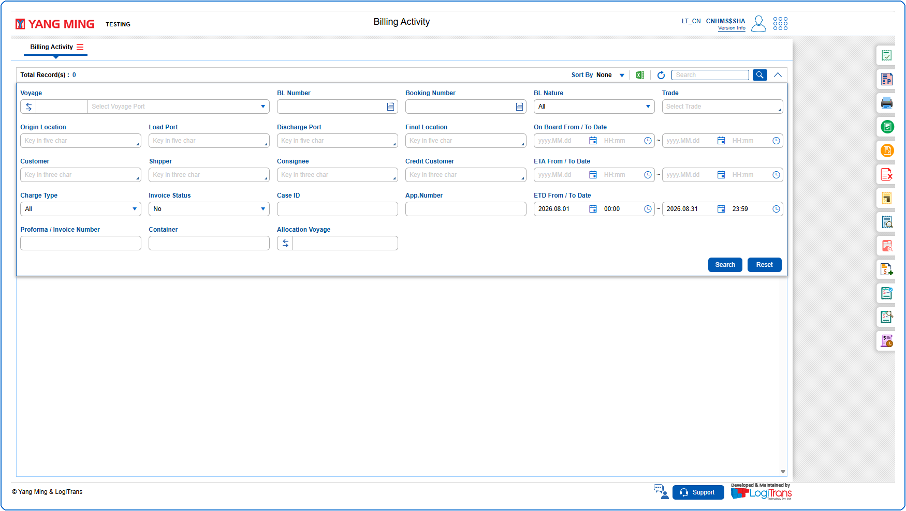

1. The query section can be expanded or collapsed by clicking on {img:../img/icon_collapse.png}
2. The User can search BLs using the Query Parameters like Voyage, BL Number, Booking Number, BL Nature, Trade, Origin Location, Load Port, Discharge Port, Final Location, On Board From / To Date, Customer, Shipper, Consignee, Credit Customer, ETA From / To Date, Charge Type, Invoice Status, Case ID, App.Number, ETD From / To Date, Proforma / Invoice Number, Container and Allocation Voyage.

{img:../img/btn_search.png} Used to search the data based on the information entered in the query fields.
{img:../img/btn_reset.png} Used to clear the information entered in the query fields.
