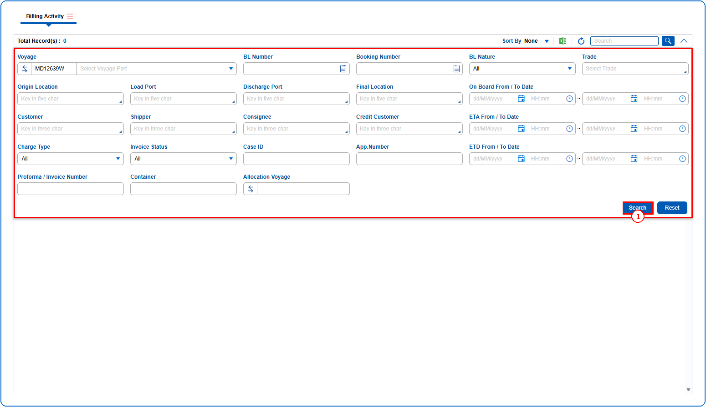
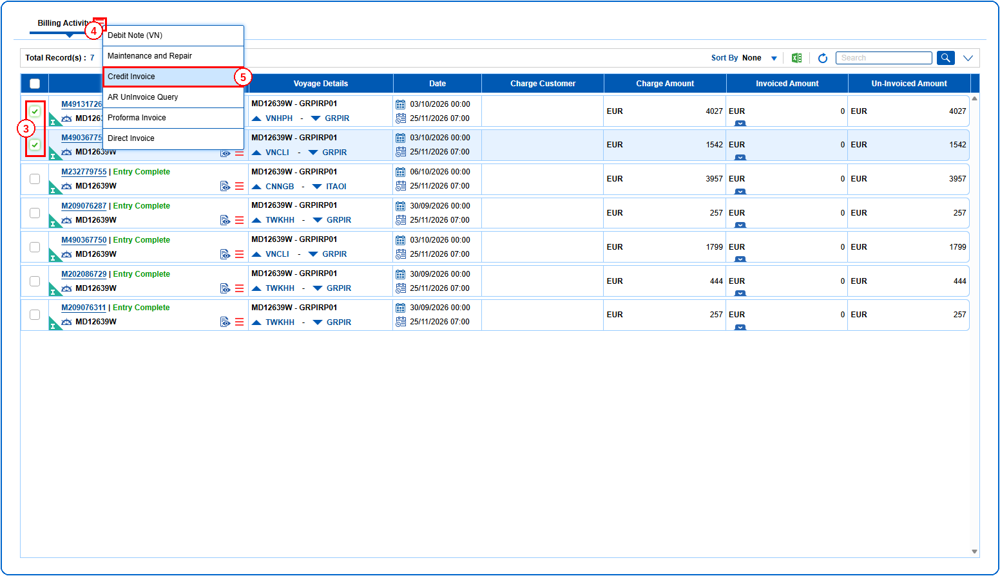
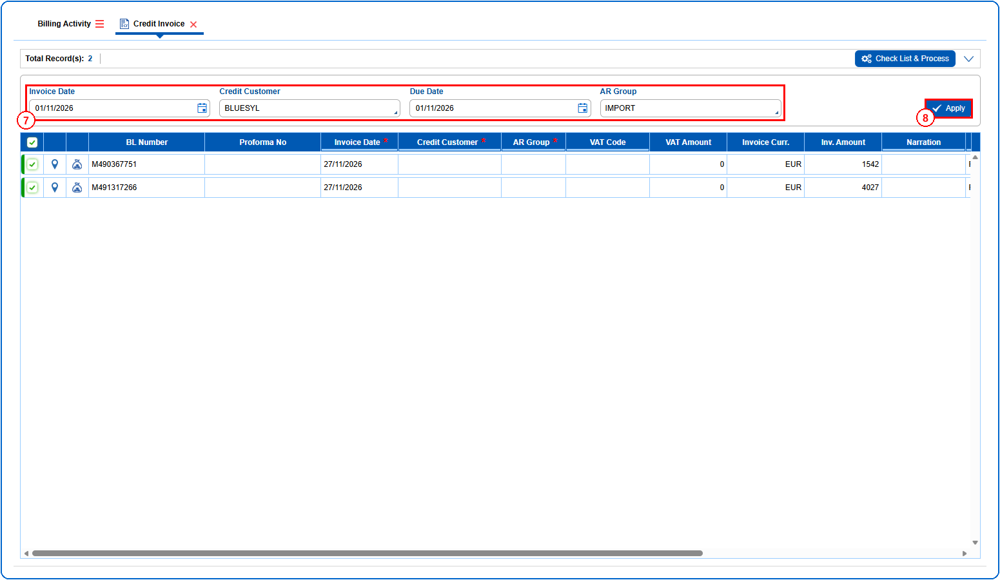
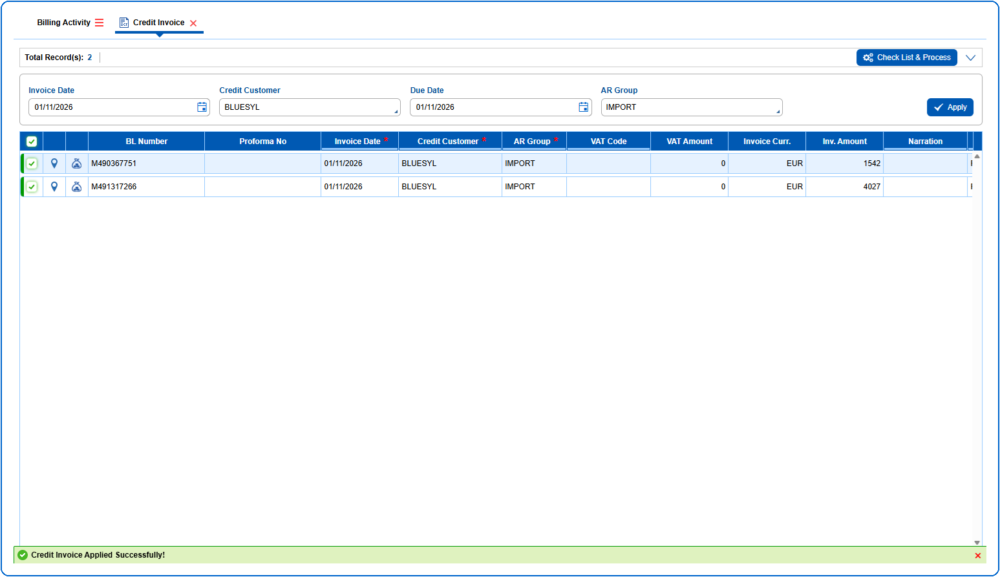

## Steps
**Step 1** : Enter the query fields with desirable input for querying data and click on {img:../img/btn_search.png}.

**Step 2** : Upon clicking {img:../img/btn_search.png}, BLs with matching information are returned.
**Step 3** : Select the required BLs by clicking on {img:../img/chk_single.png}(single select checkbox).
**Step 4** : Click on {img:../img/icon_billing_menu.png} (Billing Activity menu).
**Step 5** : Select "**Credit Invoice**" from the menu.

**Step 6** : Upon clicking "**Credit Invoice**", User will be shown the Credit Invoice screen.
**Step 7** : Enter the "**Invoice Date**", "**Credit Customer**", "**Due Date**" and "**AR Group**".
**Step 8** : Click on {img:../img/btn_apply.png}.

If successfully applied, a success message is shown as given below and the entered details are applied to the selected BLs.

