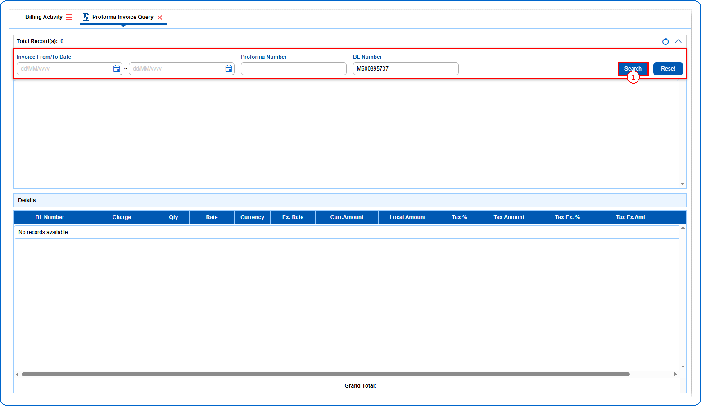
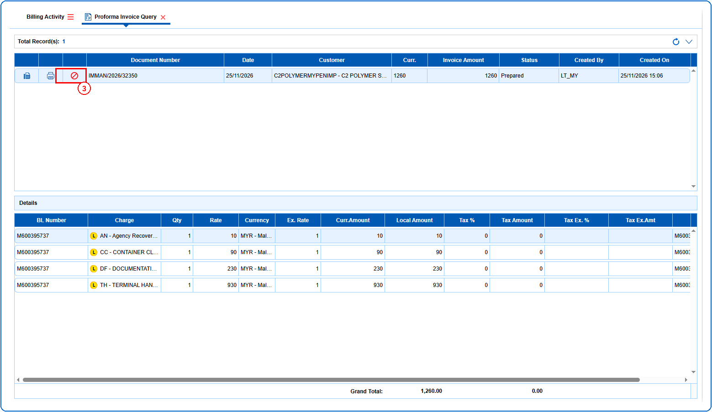
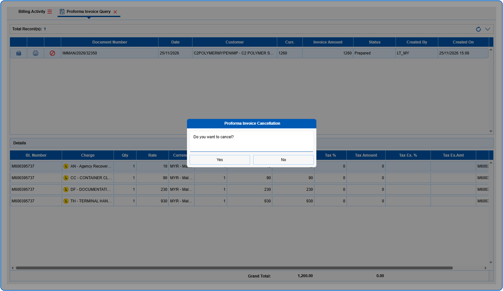
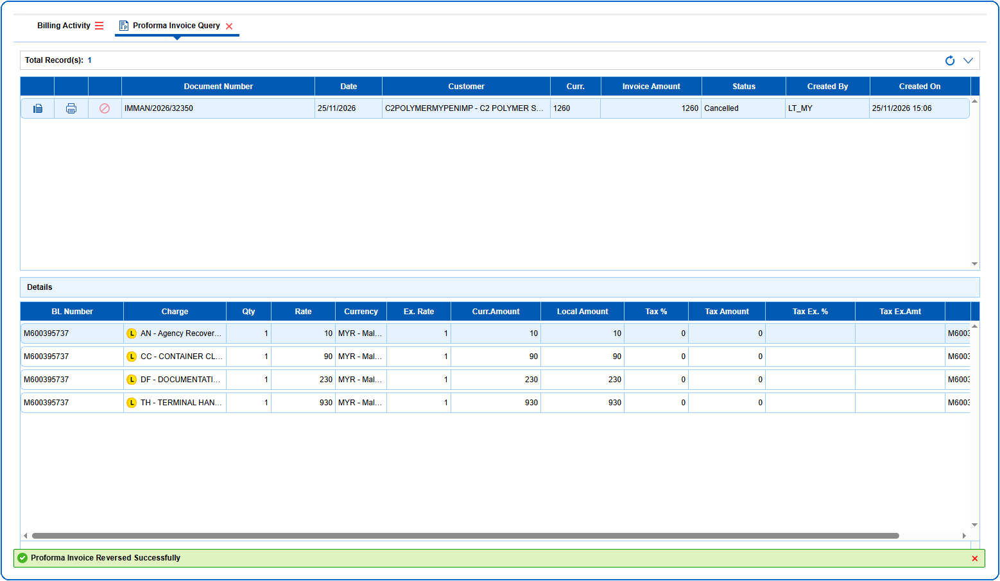

## Steps
**Step 1** : Enter the query fields with desirable input for querying data and click on {img:../img/btn_search.png}.

**Step 2** : Upon clicking {img:../img/btn_search.png}, proforma invoices with matching information are returned along with their details.
**Step 3** : Click on {img:../img/icon_cancel_pf.png} (Cancel icon) of the required proforma invoice.

**Step 4** : A confirmation alert is shown as given below. Click on [Yes] to cancel the proforma invoice.

If successfully reversed, a success message is shown as given below and the status of the proforma invoice is changed to Cancelled.

