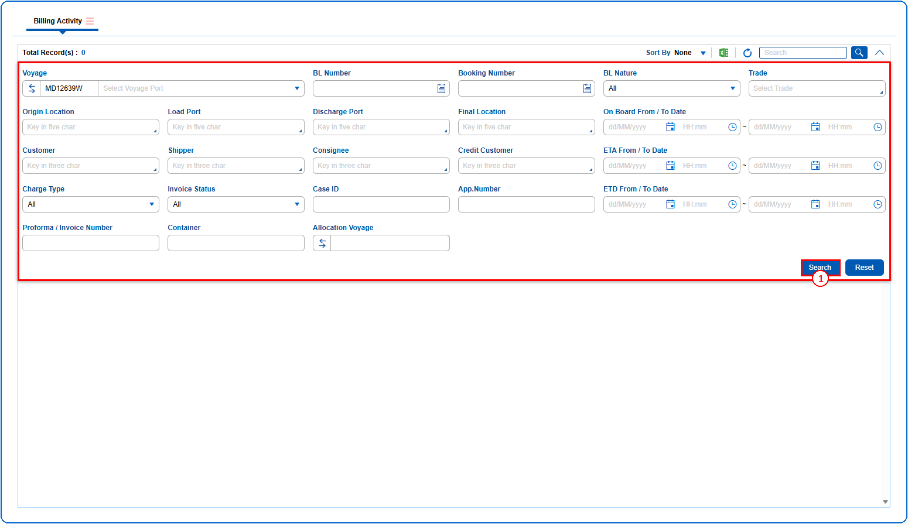
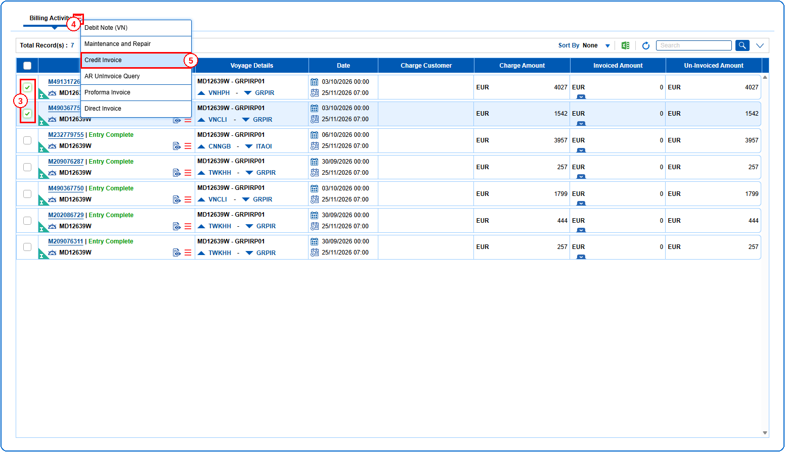
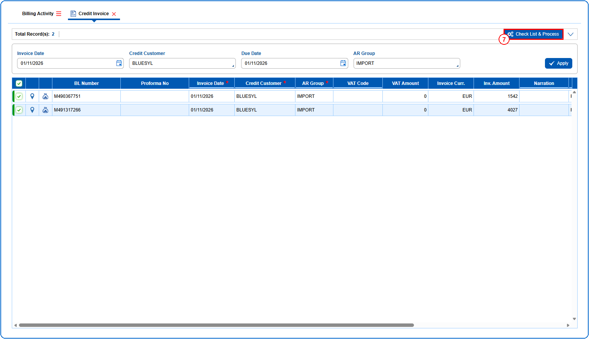
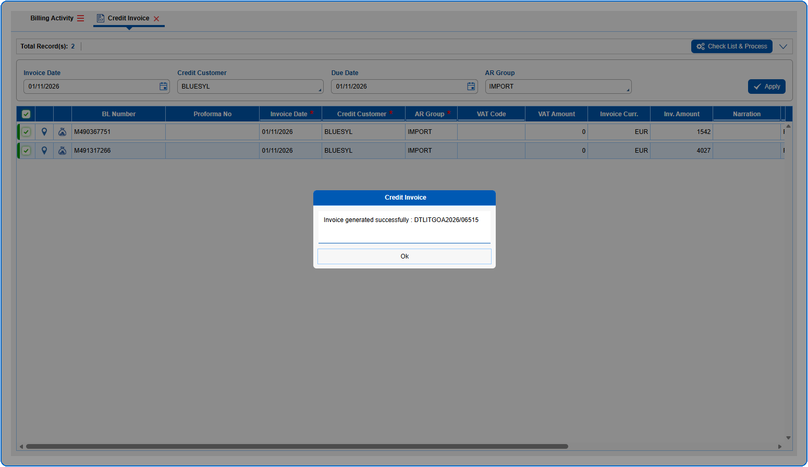

## Steps
**Step 1** : Enter the query fields with desirable input for querying data and click on {img:../img/btn_search.png}.

**Step 2** : Upon clicking {img:../img/btn_search.png}, BLs with matching information are returned.
**Step 3** : Select the required BLs by clicking on {img:../img/chk_single.png}(single select checkbox).
**Step 4** : Click on {img:../img/icon_billing_menu.png} (Billing Activity menu).
**Step 5** : Select "**Credit Invoice**" from the menu.

**Step 6** : Upon clicking "**Credit Invoice**", User will be shown the Credit Invoice screen. Apply the "**Invoice Date**", "**Credit Customer**", "**Due Date**" and "**AR Group**" as given in How to apply Credit Invoice.
**Step 7** : Click on {img:../img/btn_check_list_process.png}.

If successfully processed, the Credit Invoice pop up is shown with the generated Invoice number as given below.

