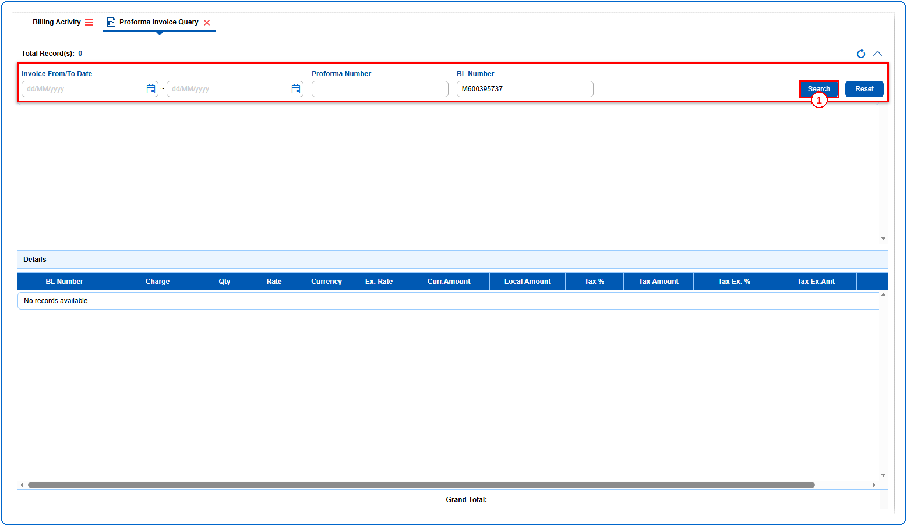
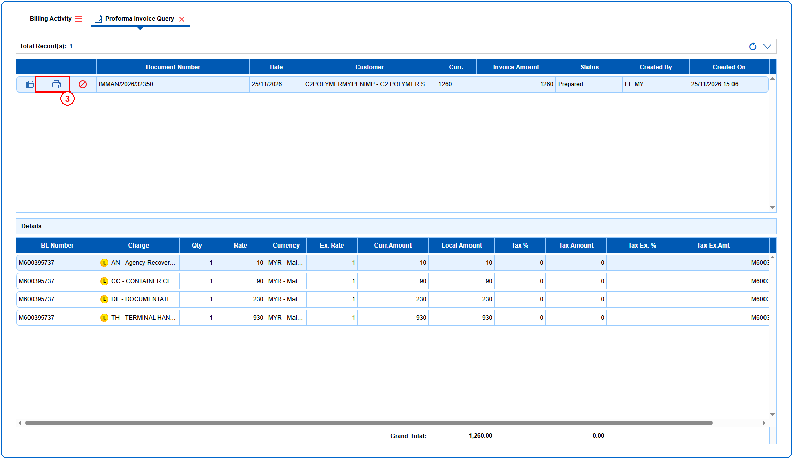
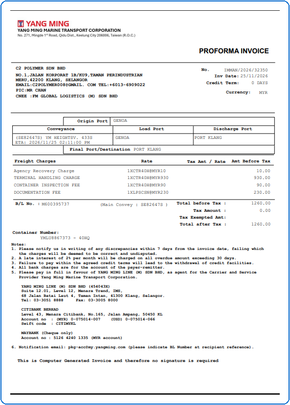

## Steps
**Step 1** : Enter the query fields with desirable input for querying data and click on {img:../img/btn_search.png}.

**Step 2** : Upon clicking {img:../img/btn_search.png}, proforma invoices with matching information are returned along with their details.
**Step 3** : Click on {img:../img/icon_reprint.png} (Print icon) of the required proforma invoice.

The proforma invoice is generated in PDF format as given below.

