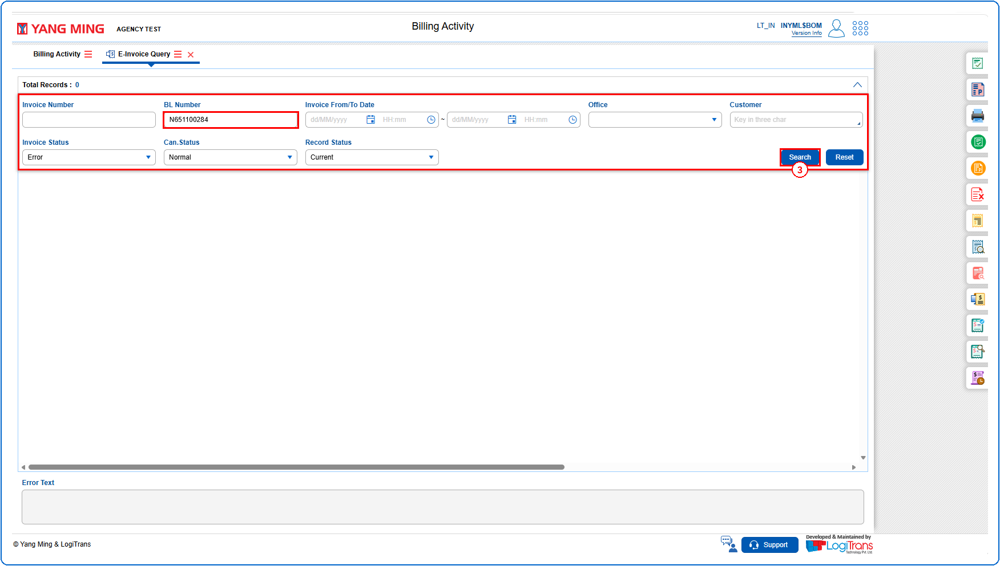
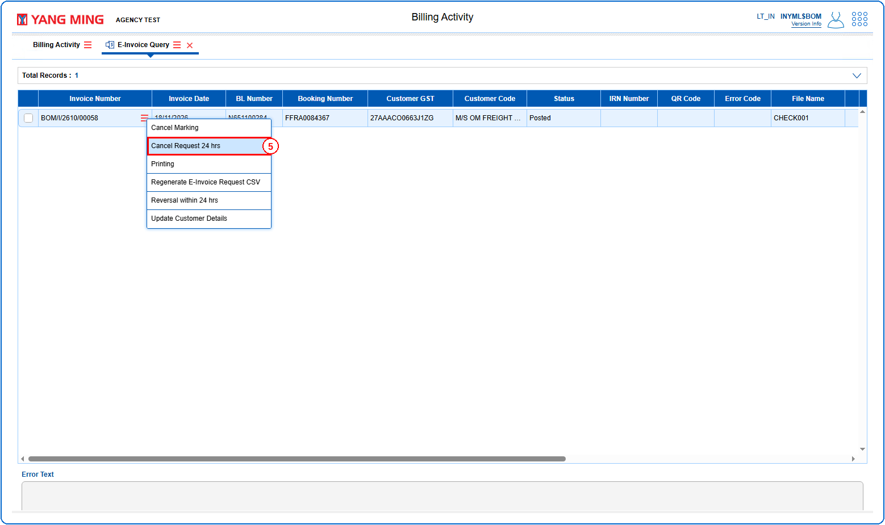
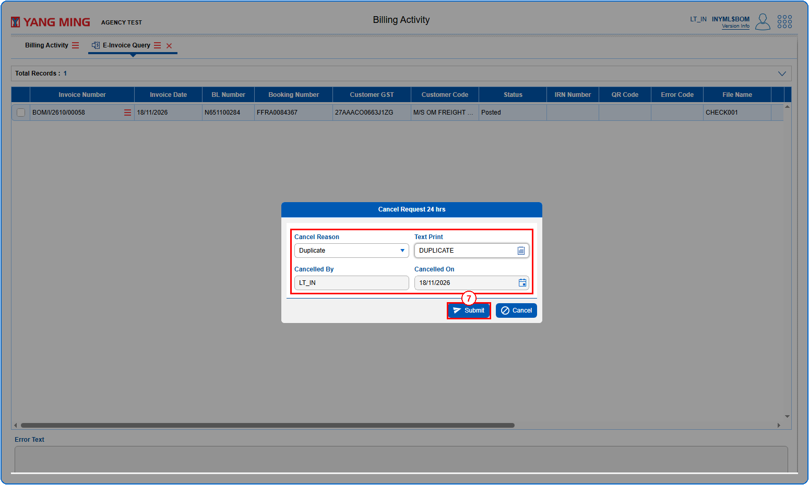
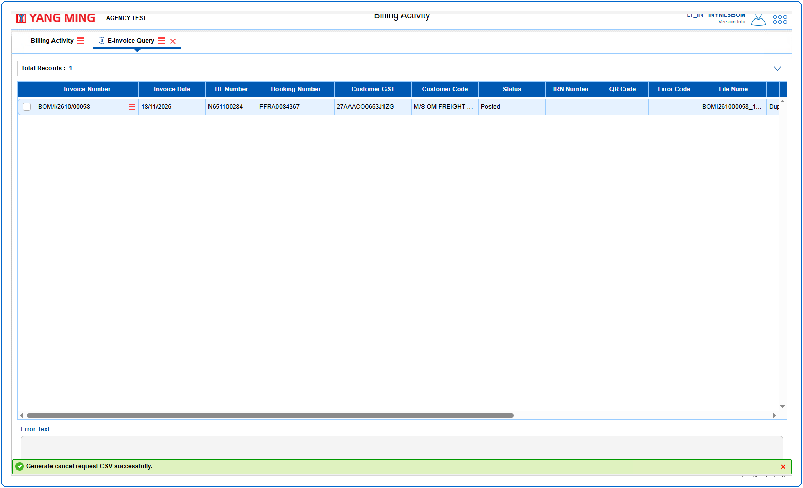

## Steps
**Step 1** : Click on the {img:../img/icon_e_invoice_query.png} (E-Invoice Query side icon) given on the right side of the Billing Activity screen.

**Step 2** : Upon clicking {img:../img/icon_e_invoice_query.png}, User will be shown the E-Invoice Query screen.
**Step 3** : Enter the BL Number and click on {img:../img/btn_search.png}.

**Step 4** : Upon clicking {img:../img/btn_search.png}, e-invoices with matching information are returned.
**Step 5** : Click on the menu icon {img:../img/icon_row_menu.png} of the required e-invoice and select "**Cancel Request 24 hrs**" from the menu.

**Step 6** : Upon clicking "**Cancel Request 24 hrs**", User will be shown the Cancel Request 24 hrs pop up screen.
**Step 7** : Select the Cancel Reason, enter the Text Print, Cancelled On and click on {img:../img/btn_submit_ein.png}.

If successfully submitted, a success message is shown as given below and the cancel request CSV is generated.

