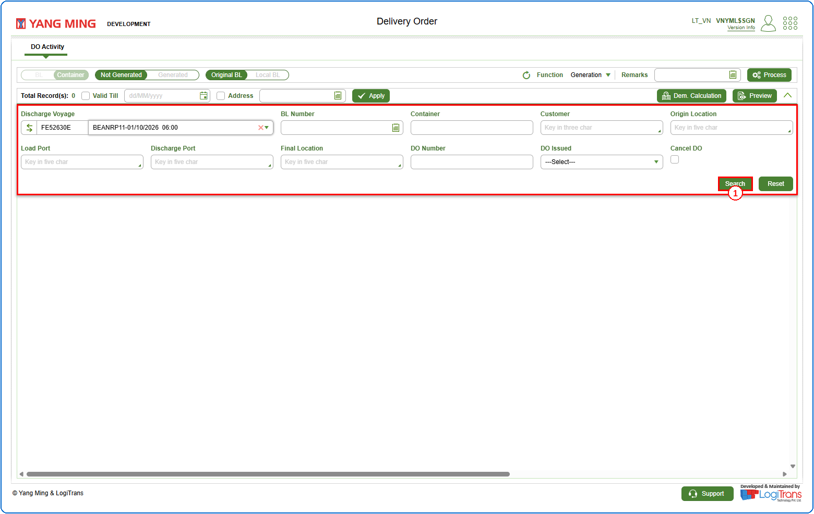
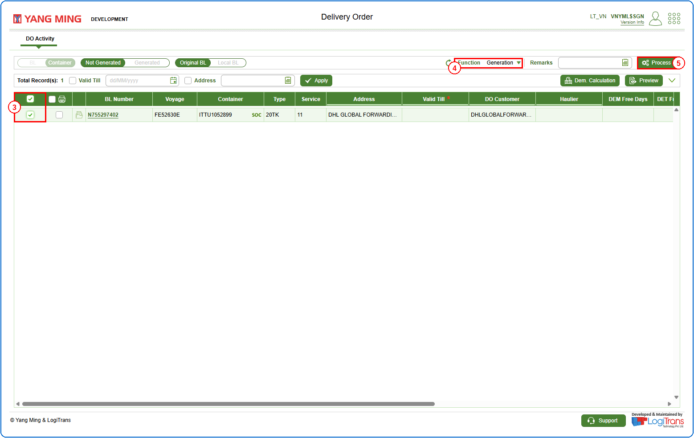
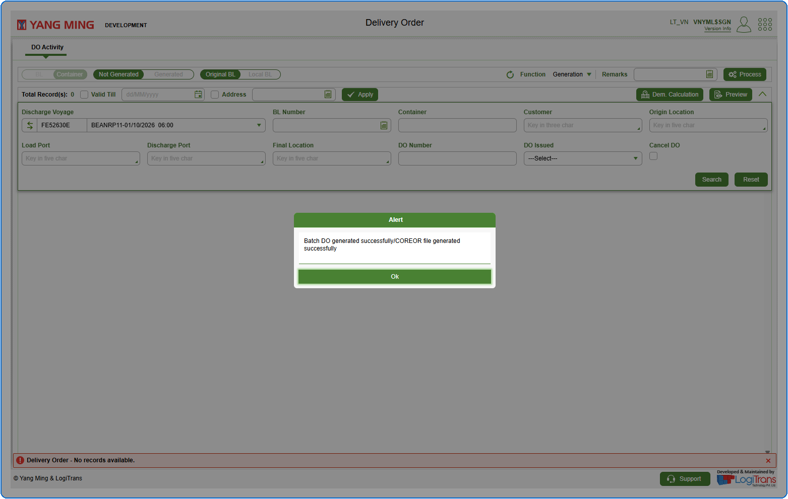

## Pre defined conditions

## Steps
**Step 1** : Enter the query fields with desirable input for querying data and click on {img:../img/btn_search.png}.

**Step 2** : Upon clicking {img:../img/btn_search.png}, BLs with matching information are returned.
**Step 3** : Either select all BLs available by clicking on {img:../img/cb_select_all.png} or select individual BLs by clicking on {img:../img/cb_single_select.png}.
**Step 4** : Select "**Generation**" from the "**Function**" drop-down.
**Step 5** : Click on {img:../img/btn_process.png}.

If successfully processed, an alert is shown as given below.

