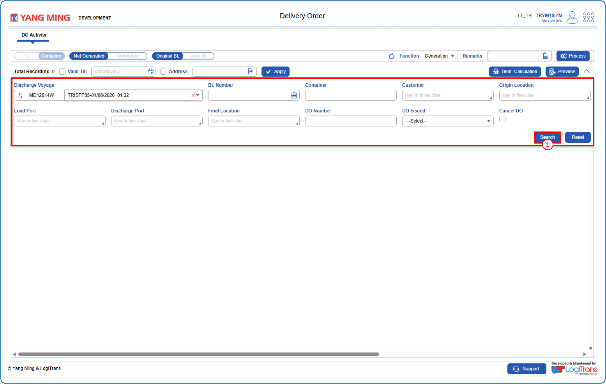
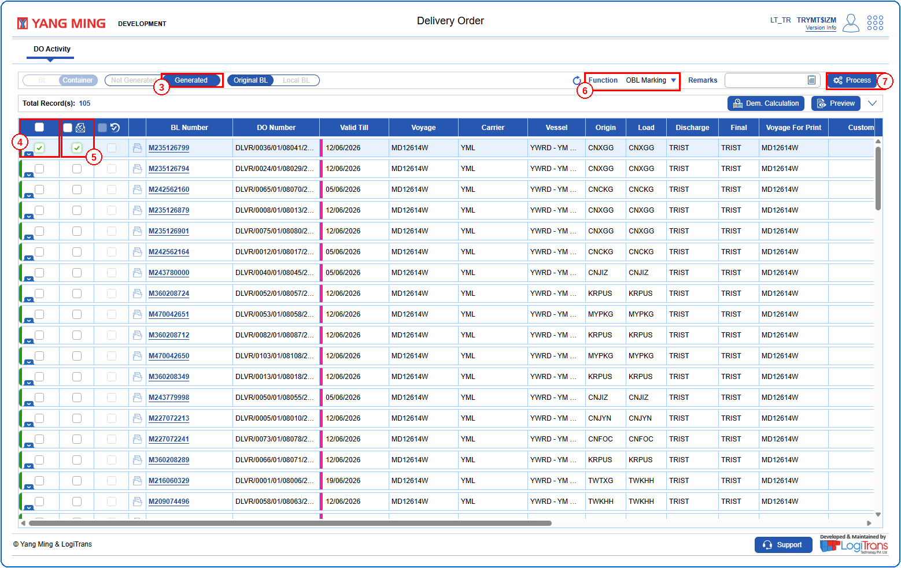
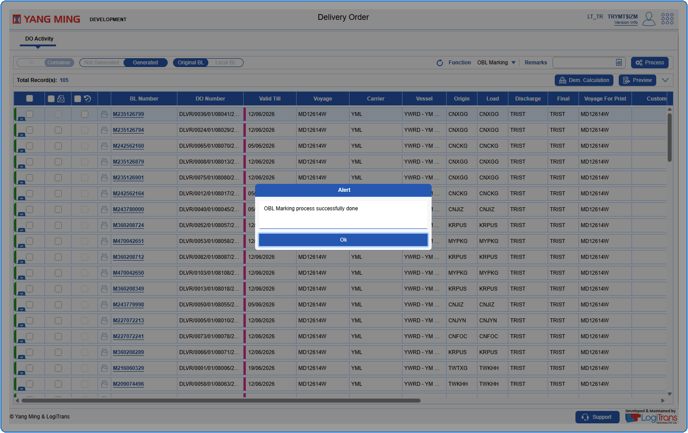

## Pre defined conditions
The BL should have an already generated DO.

## Steps
**Step 1** : Enter the query fields with desirable input for querying data and click on {img:../img/obl_btn_search.png}.

**Step 2** : Upon clicking {img:../img/obl_btn_search.png}, BLs with matching information are returned.
**Step 3** : Click on "**Generated**".
**Step 4** : Either select all BLs available by clicking on {img:../img/obl_cb_select_all.png} or select individual BLs by clicking on {img:../img/obl_cb_single_select.png}.
**Step 5** : Tick the "**OBL Selected**" checkbox {img:../img/obl_cb_obl_selected.png} in the respective BL.
**Step 6** : Select "**OBL Marking**" from the "**Function**" drop-down.
**Step 7** : Click on {img:../img/obl_btn_process.png}.

If successfully processed, an alert is shown as given below.

