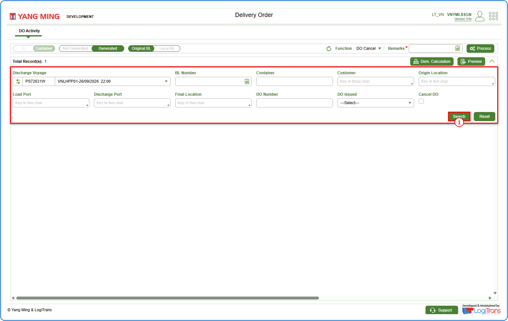
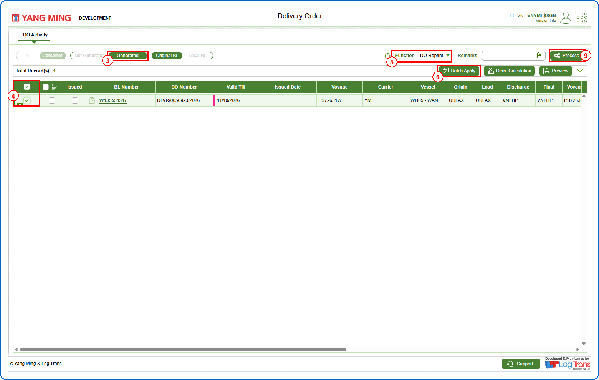
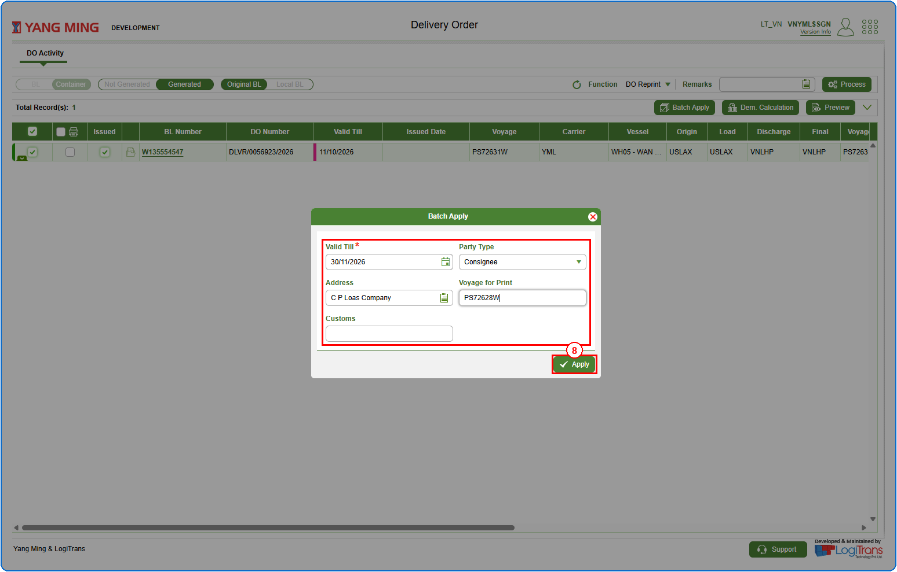
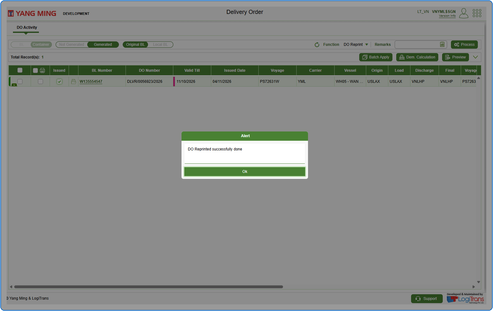

## Pre defined conditions
The BL should have an already existing DO.

## Steps
**Step 1** : Enter the query fields with desirable input for querying data and click on {img:../img/btn_search.png}.

**Step 2** : Upon clicking {img:../img/btn_search.png}, BLs with matching information are returned.
**Step 3** : Click on "**Generated**".
**Step 4** : Either select all BLs available by clicking on {img:../img/cb_select_all.png} or select individual BLs by clicking on {img:../img/cb_single_select.png}.
**Step 5** : Select "**DO Reprint**" from the "**Function**" drop-down.
**Step 6** : Click on {img:../img/btn_batch_apply.png}.

**Step 7** : Upon clicking {img:../img/btn_batch_apply.png}, the user is shown Batch Apply pop up screen.
**Step 8** : Enter the details as given below and click on {img:../img/btn_apply.png}. **Valid Till** field is mandatory.

**Step 9** : Click on {img:../img/btn_process.png}.
If successfully processed, an alert is shown as given below.

