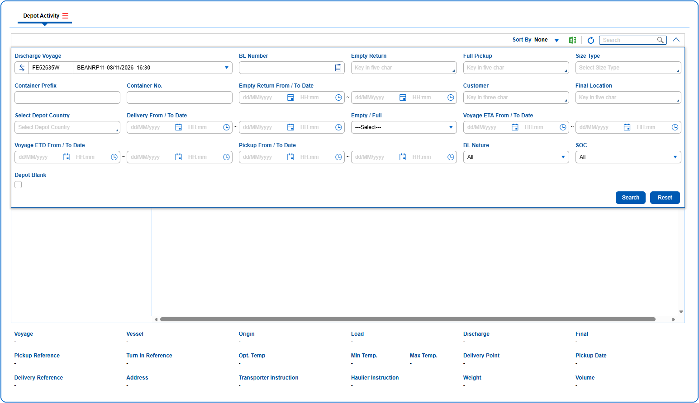

1. The query section can be expanded or collapsed by clicking on {img:../img/icon_collapse.png}
2. The User can search containers using the Query Parameters like Discharge Voyage, BL Number, Empty Return, Full Pickup, Size Type, Container Prefix, Container No., Customer, Final Location and Voyage ETA From / To Date.

{img:../img/btn_search.png} Used to search the data based on the information entered in the query fields.
{img:../img/btn_reset.png} Used to clear the information entered in the query fields.
