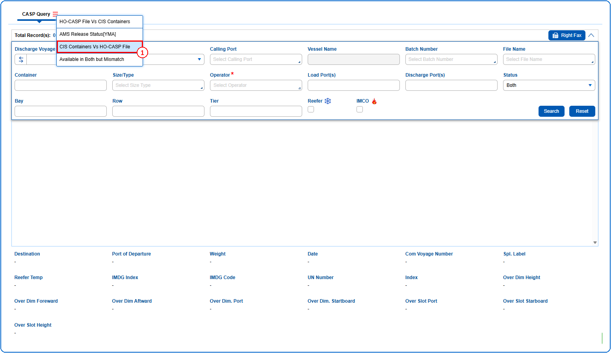
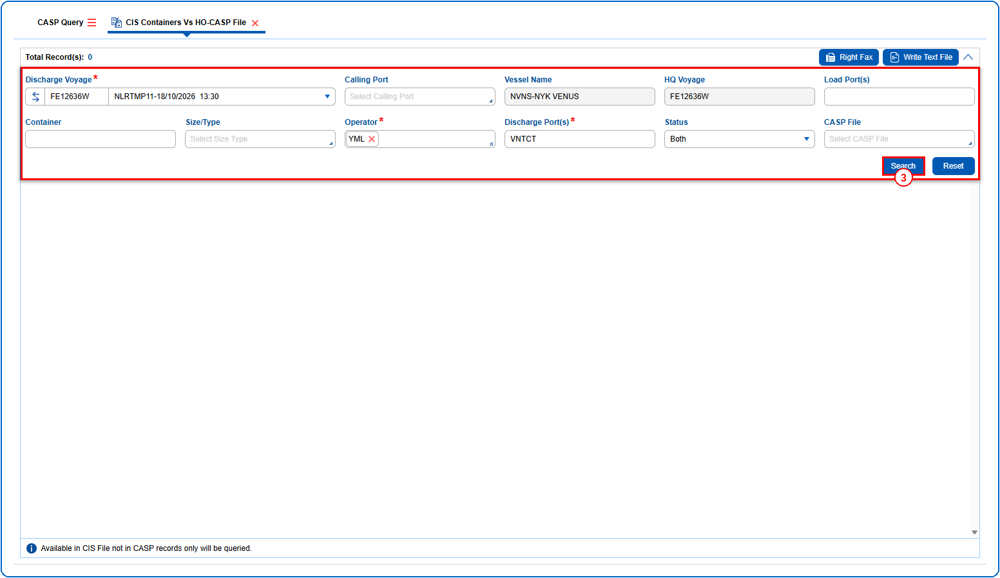
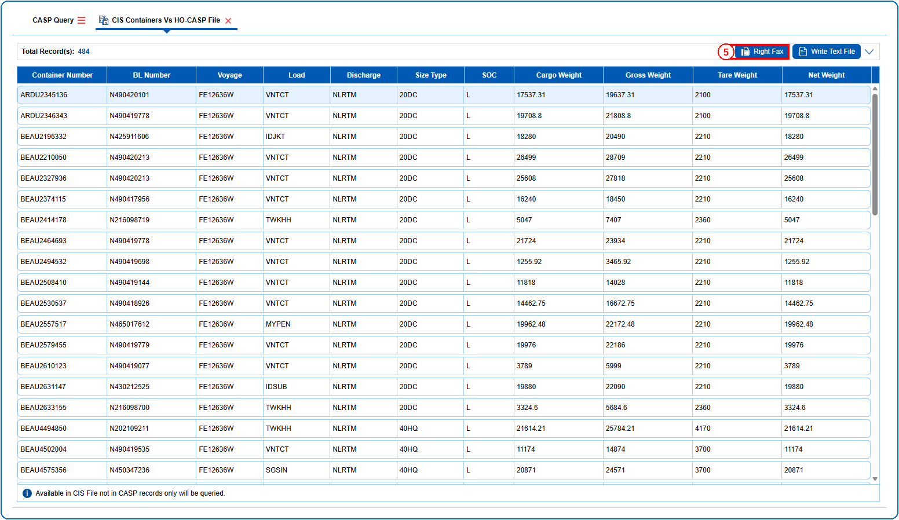
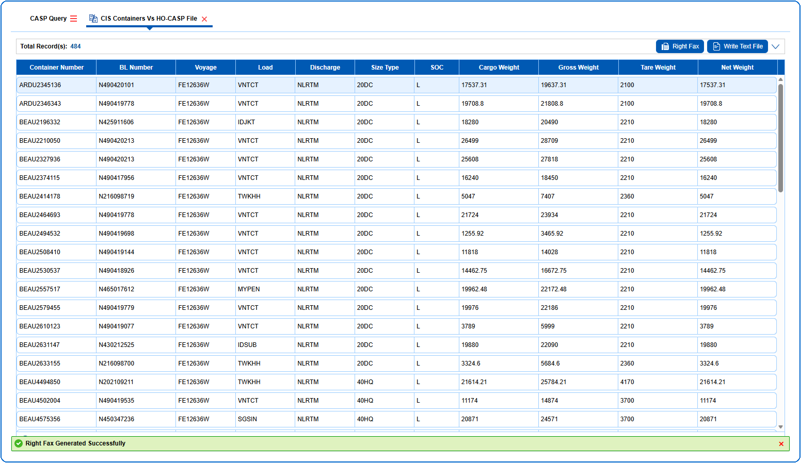

## Steps
**Step 1** : The user should drag the cursor to the batch function menu icon {icon:batch_menu}, click on it, and then select "**CIS Containers Vs HO-CASP File**" from the menu.

**Step 2** : Upon clicking "**CIS Containers Vs HO-CASP File**" User will be shown the CIS Containers Vs HO-CASP File screen.
**Step 3** : Enter the query fields with desirable input for querying data and click on {img:../img/btn_search_ho.png}.

**Step 4** : Upon clicking {img:../img/btn_search_ho.png}, containers with matching information are returned.
**Step 5** : Click on {img:../img/btn_right_fax.png}.

If successfully generated, a success message is shown as given below.

