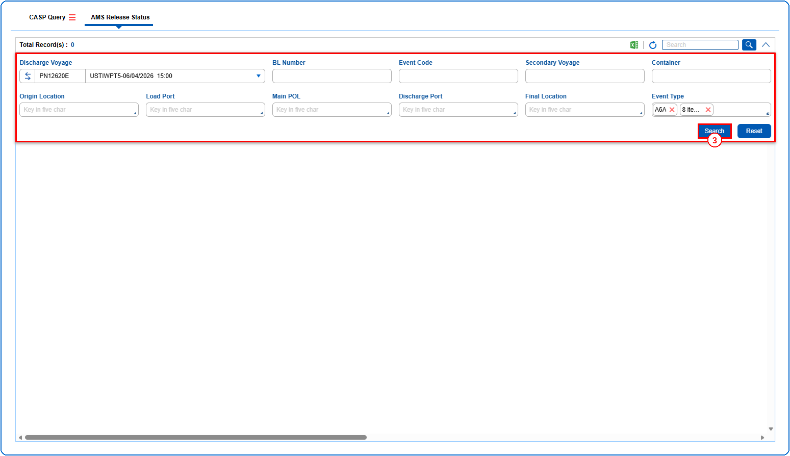
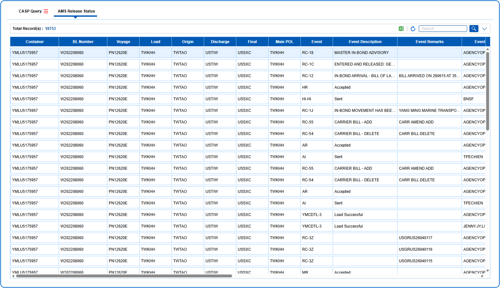

## Pre defined conditions

## Steps
**Step 1** : The user should drag the cursor to the batch function menu icon {icon:batch_menu}, click on it, and then select "**AMS Release Status**" from the menu.
**Step 2** : Upon clicking "**AMS Release Status**" User will be shown the AMS Release Status screen.
**Step 3** : Enter the query fields with desirable input for querying data and click on {img:../img/btn_search.png}.

**Step 4** : Upon clicking {img:../img/btn_search.png}, AMS release status records with matching information are returned.
If data is available, the queried data is displayed as given below.

