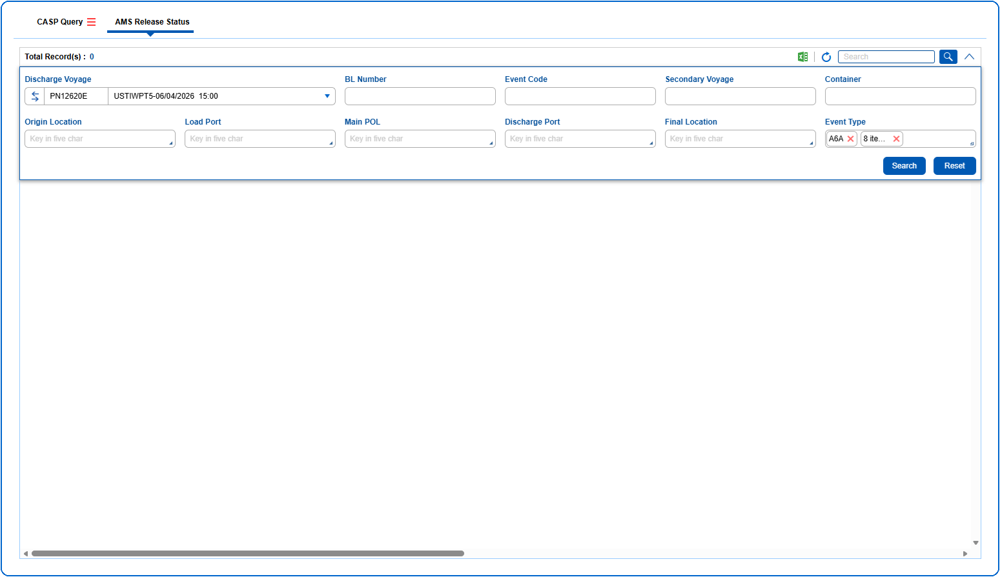

1. The query section can be expanded or collapsed by clicking on {img:../img/icon_collapse.png}
2. The User can search AMS release status records using the Query Parameters like Discharge Voyage, BL Number, Event Code, Secondary Voyage, Container, Origin Location, Load Port, Main POL, Discharge Port, Final Location and Event Type.

{img:../img/btn_search.png} Used to search the data based on the information entered in the query fields.
{img:../img/btn_reset.png} Used to clear the information entered in the query fields.
