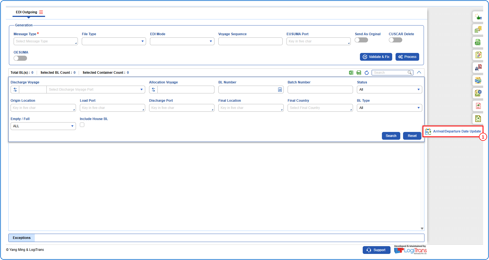
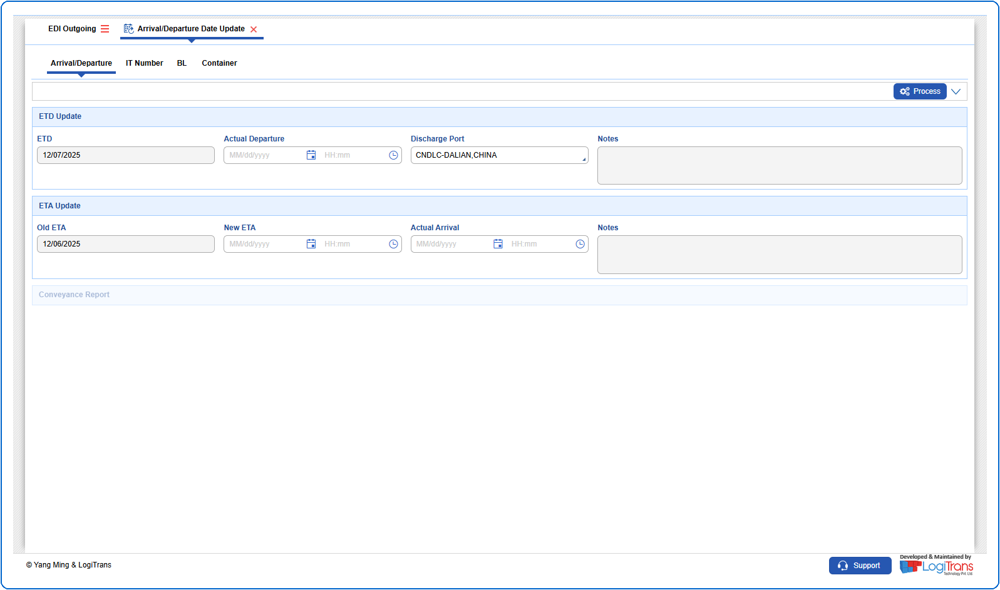
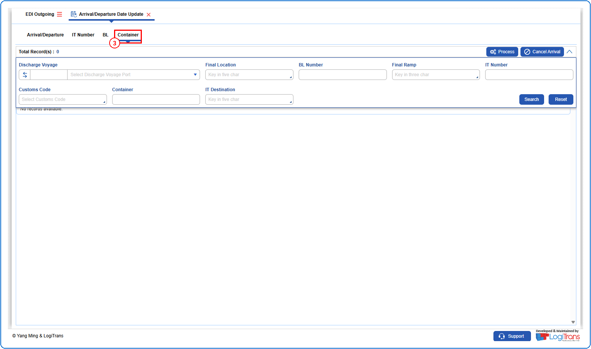
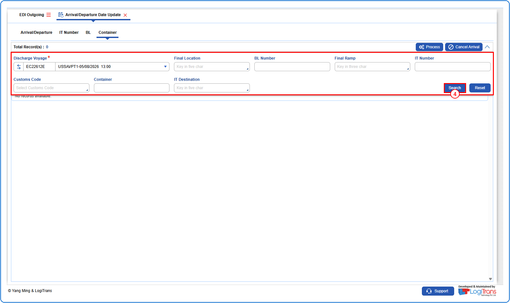
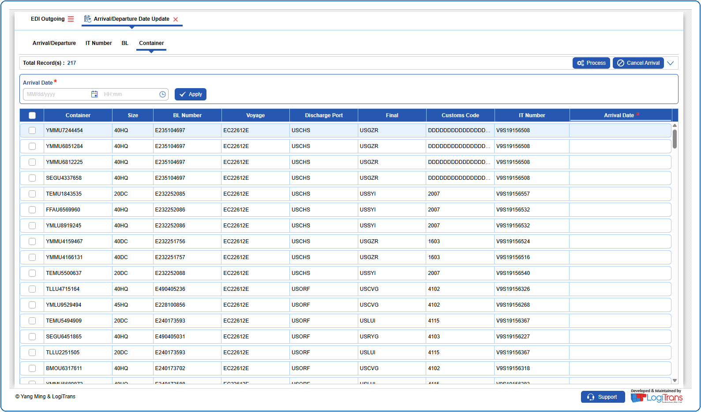
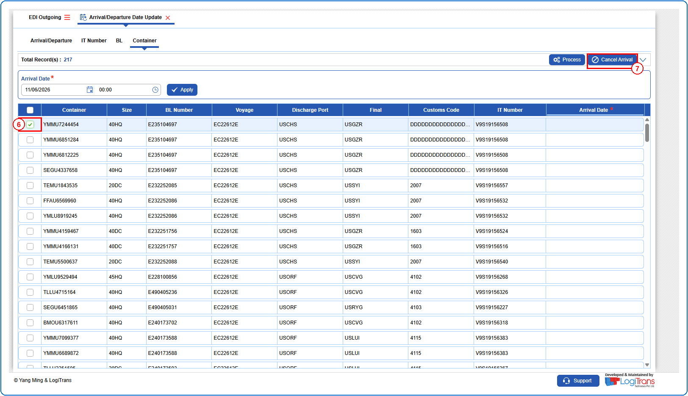
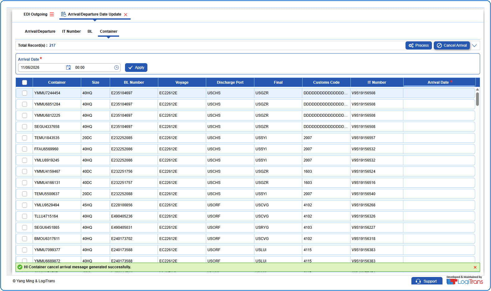

## Steps
**Step 1** : Click on the {img:../img/side_adu.png} (Arrival/Departure Date Update side icon) given on the right side of the EDI Outgoing screen.

**Step 2** : Upon clicking {img:../img/side_adu.png}, User will be shown the Arrival/Departure Date Update screen.

**Step 3** : Click on the "**Container**" tab.

**Step 4** : Enter the query fields with desirable input for querying data and click on {img:../img/btn_search.png}.

**Step 5** : Upon clicking {img:../img/btn_search.png}, containers with matching information are returned.

**Step 6** : Either select all containers available by clicking on {img:../img/chk_select_all.png}(select all checkbox) or select individual containers by clicking on {img:../img/chk_single.png}(single select checkbox).
**Step 7** : Click on {img:../img/btn_adu_cancel_arrival.png}.

If successfully cancelled, a success message is shown as given below.

