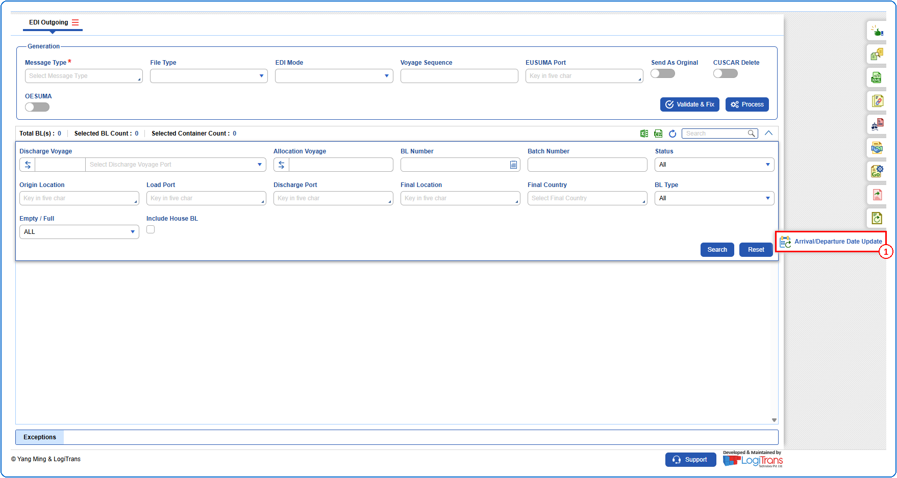
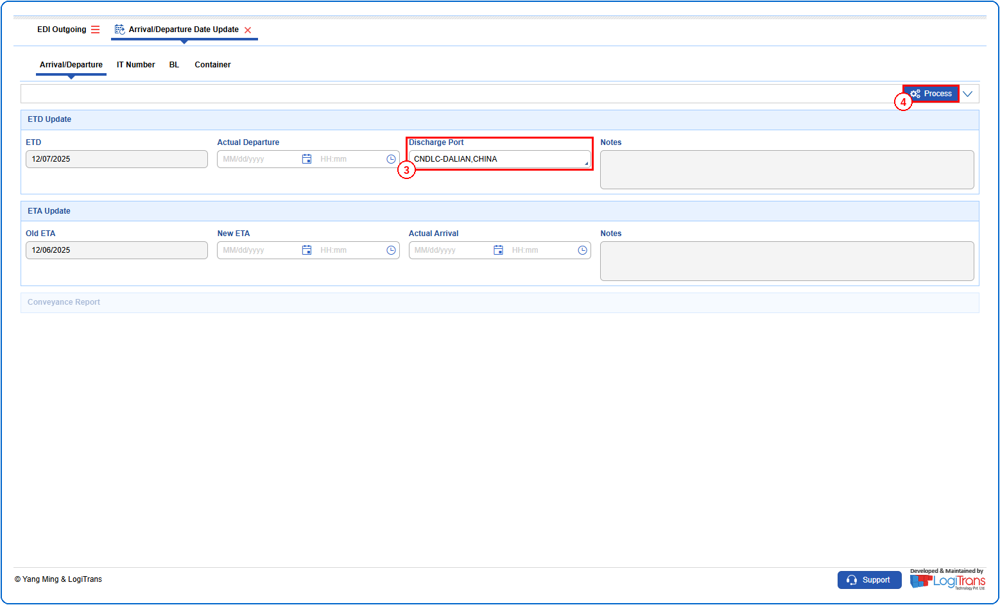
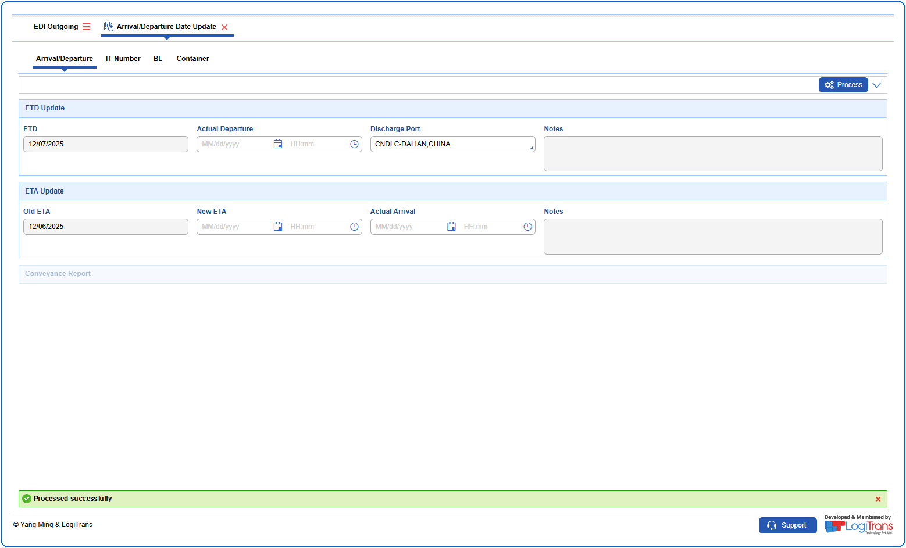

## Steps
**Step 1** : Click on the {img:../img/side_adu.png} (Arrival/Departure Date Update side icon) given on the right side of the EDI Outgoing screen.

**Step 2** : Upon clicking {img:../img/side_adu.png}, User will be shown the Arrival/Departure Date Update screen.
**Step 3** : Select the required "**Discharge Port**".
**Step 4** : Click on {img:../img/btn_adu_process.png}.

If successfully processed, a success message is shown as given below.

