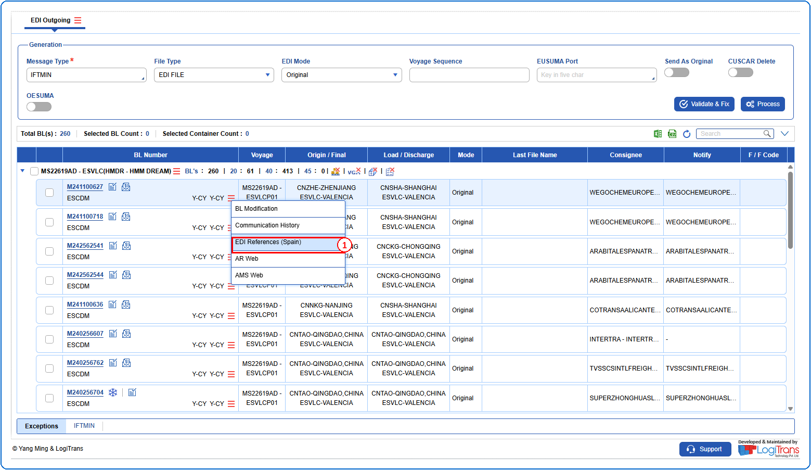
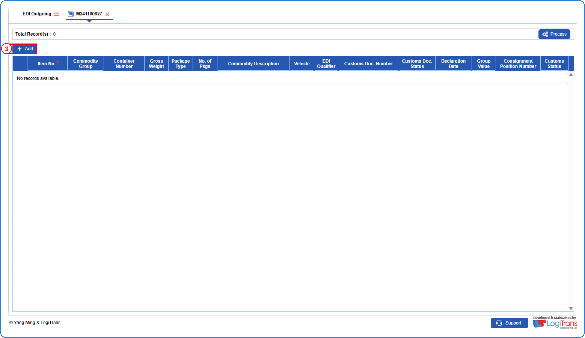
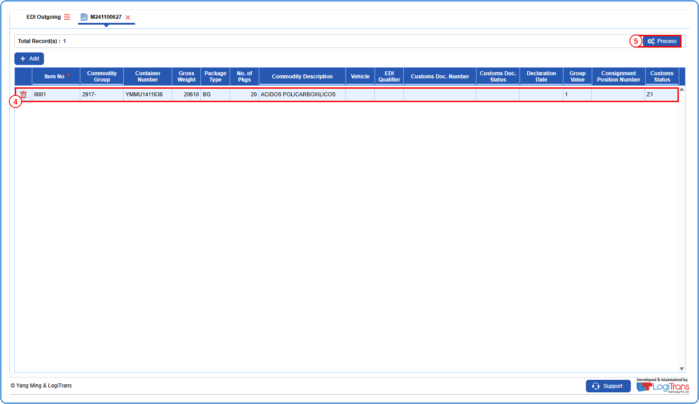
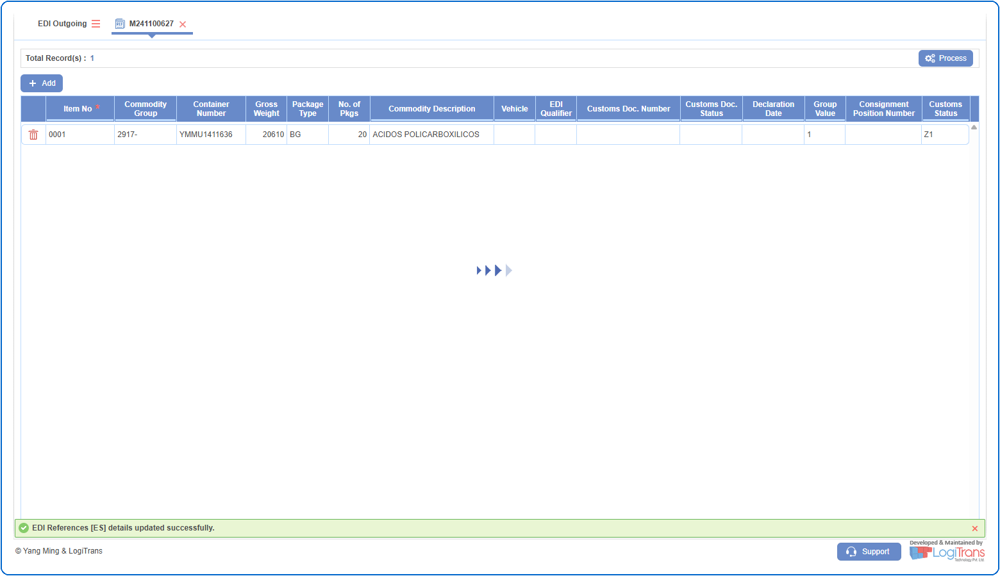

## Steps
**Step 1** : The user should drag the cursor to the record menu icon {icon:record_menu} in the respective record, click on it, and then select "**EDI References (Spain)**" from the menu.

**Step 2** : Upon clicking "**EDI References (Spain)**" User will be shown the EDI References (Spain) screen.
**Step 3** : Click on {img:../img/btn_add.png}.

**Step 4** : Enter all the required details in the newly added row as shown below.
**Step 5** : Click on {img:../img/btn_process_edir.png}.

If successfully processed, a success message is shown as given below.

